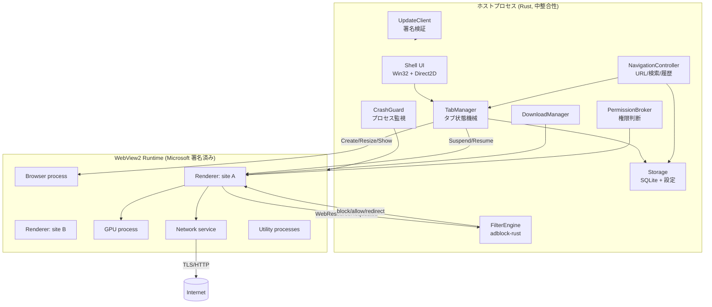
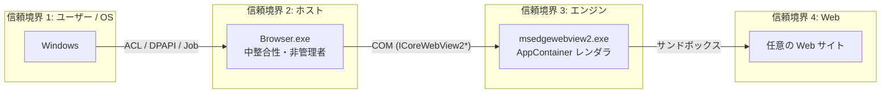
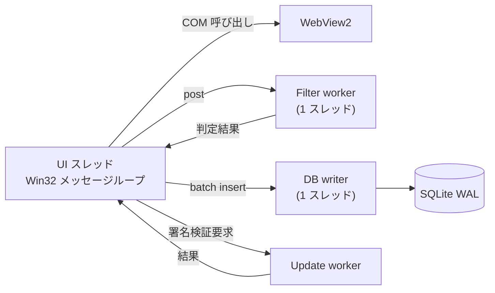
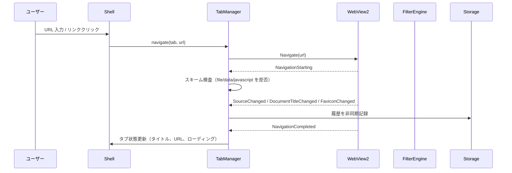
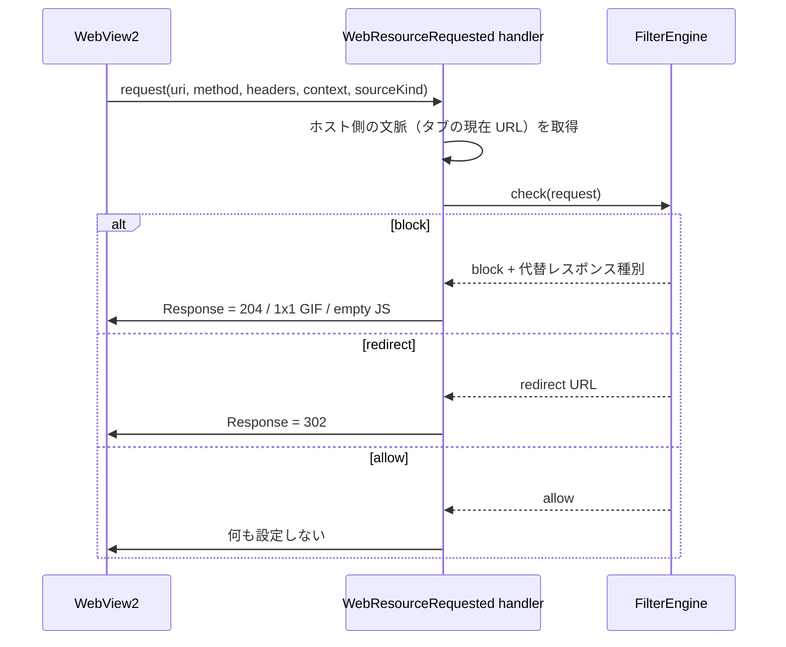
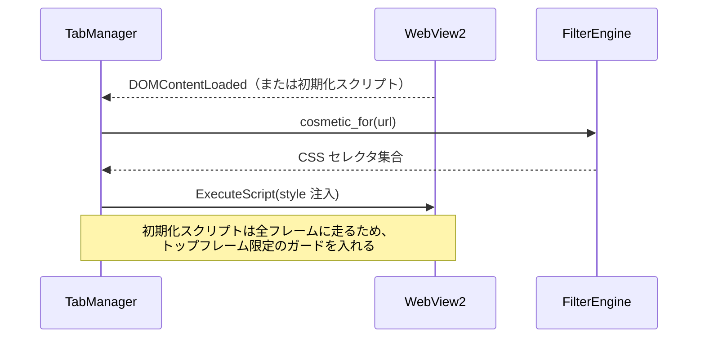
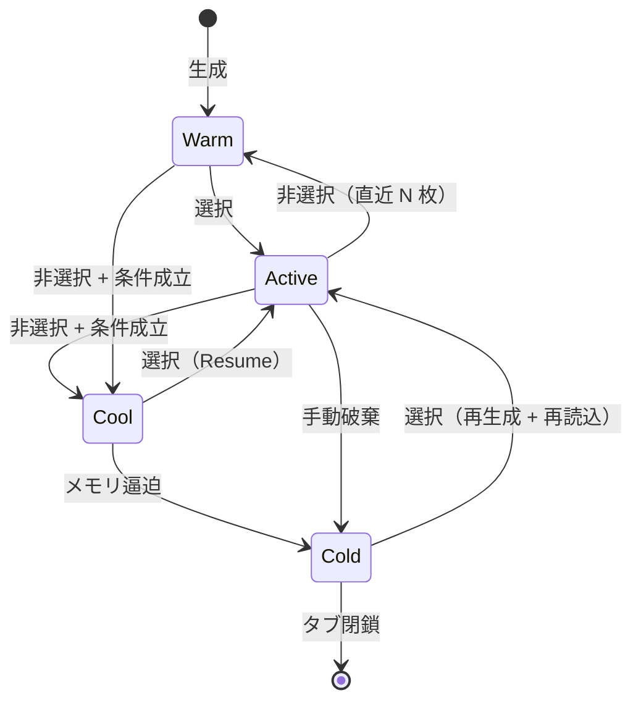
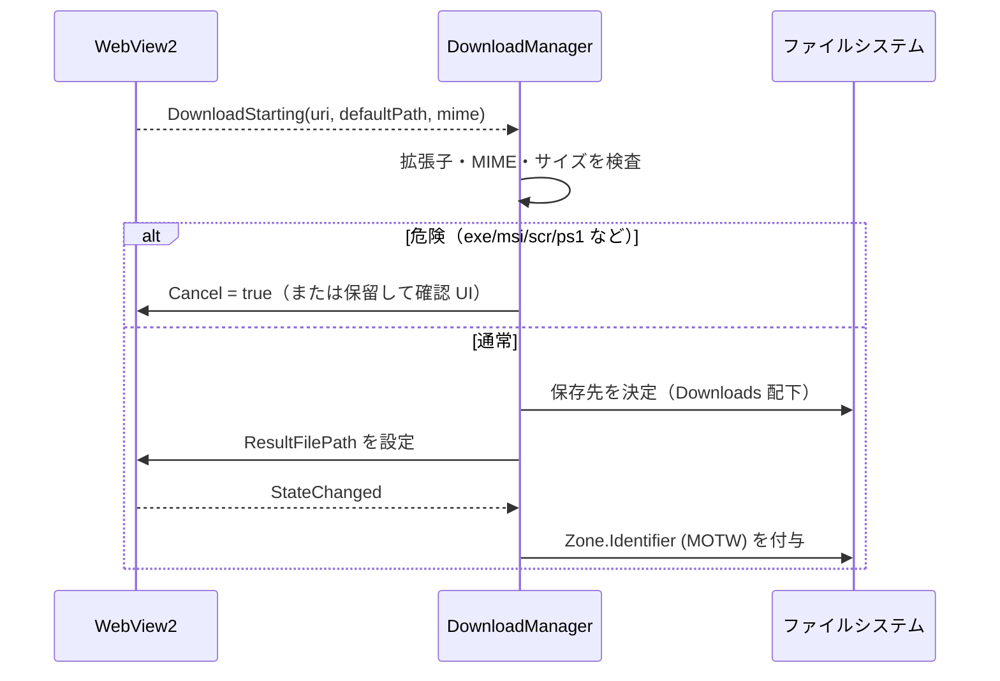
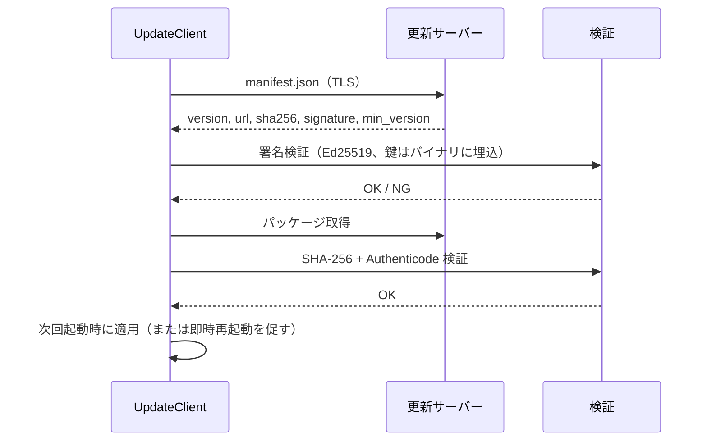

# 03. システムアーキテクチャ

状態: 確定案
確信度: 高（WebView2 の API とプロセスモデルに基づく）

## 1. 設計原則

1. **コンテンツページに特権を渡さない。** ホストオブジェクトを公開しない。Web メッセージを有効にしない。IPC ブリッジを注入しない。これは WebView2 の公式な推奨と一致する [S16]。
2. **UI スレッドをブロックしない。** WebResourceRequested はホストの UI スレッドで発火する [S09][S10]。ここでファイル I/O や DB 書き込みをしない。
3. **エンジンのセキュリティ機能を無効化しない。** サンドボックス、サイト分離、TLS 検証、SmartScreen の基盤は維持する [S05][S08]。
4. **状態の正本を 1 つにする。** タブの状態はホストの `TabRegistry` が正本。WebView2 は従属。
5. **プロセスを増やさない。** 通常タブは 1 つの `CoreWebView2Environment` を共有する [S05]。プライベートは同一 UDF 内の InPrivate プロファイルを使う [S07]。
6. **失敗を局所化する。** レンダラ崩壊、ブラウザプロセス崩壊、GPU 崩壊を区別し、タブ単位で復旧する。
7. **交換可能性を残す。** エンジン境界を trait で切り、将来 CEF に替える余地を残す。ただし二重実装はしない。

## 2. 全体構成



図の要点:

- ホストは UI と意思決定を持ち、レンダリングとネットワークはエンジンに任せる。
- フィルタ判定はホスト内で完結する。外部サーバに問い合わせない。
- エンジンは Microsoft が更新する。ホストはエンジンの内部にパッチを当てない。

## 3. プロセスと信頼境界



| 境界 | 越えるもの | 越えないもの |
|---|---|---|
| OS → ホスト | ファイル、レジストリ、トークン | 管理者権限（要求しない） |
| ホスト → エンジン | COM 呼び出し、URL、設定 | 生のポインタ、エンジン内部構造 |
| エンジン → Web | HTTP、レンダリング | ホストのファイル、レジストリ |
| Web → ホスト | **なし**（設計上） | — |

【重要】Web → ホストの経路を作らない。`AddHostObjectToScript` を使わない。`IsWebMessageEnabled` を false にする。`AddScriptToExecuteOnDocumentCreated` は、広告遮断の cosmetic 注入だけに限定し、ページからホストへメッセージを送らせない。この制約により、ページ側からホストの API を叩く経路は存在しない。

## 4. コンポーネント

| コンポーネント | 責務 | 禁止事項 |
|---|---|---|
| `Shell` | ウィンドウ、タブストリップ、アドレスバー、メニュー、DPI、IME | ページ内容の解釈 |
| `TabManager` | タブ生成・破棄・選択・サスペンド・復元、状態機械 | ネットワーク処理 |
| `NavigationController` | URL 正規化、検索クエリ生成、履歴、戻る/進む | 証明書検証の代替 |
| `WebViewHost` | `ICoreWebView2Controller` の生成と破棄、COM イベントの受信 | ページへの特権公開 |
| `FilterEngine` | フィルタ読込・コンパイル・照合・cosmetic 生成 | UI スレッドでの重い処理 |
| `PermissionBroker` | オリジン別の権限判断、既定拒否 | 永続的な全許可 |
| `DownloadManager` | 保存先決定、MOTW、実行ファイル警告、中断 | 自動実行 |
| `Storage` | 履歴、設定、フィルタメタデータ、タブセッション | Cookie の直接読取（原則） |
| `UpdateClient` | マニフェスト取得、署名検証、適用、ロールバック | 署名なしの適用 |
| `CrashGuard` | プロセス監視、タブ復旧、診断ログ（ローカルのみ） | 自動送信 |

## 5. スレッドモデル



規則:

1. UI スレッドで行ってよいのは、COM 呼び出し、描画、小さな状態更新だけ。
2. WebResourceRequested のハンドラは、**同期的に判定できる場合だけ同期的に返す**。判定に時間がかかる場合は `GetDeferral` を取得し、別スレッドで判定して完了させる [S09]。ただし deferral 中もページ読み込みは待つため、待ち時間は最小化する。
3. DB 書き込みはバッチ化し、UI スレッドから呼ばない。SQLite は WAL モードを使う。
4. フィルタのコンパイルと更新は起動後に行い、初回描画を待たせない。

## 6. データフロー

### 6.1 ナビゲーション



- `NavigationStarting` で `http`/`https` 以外を拒否する。`file://` は既定で無効。
- 証明書エラーは回避しない。証明書エラーを無視する API は確認していないため、設計上も例外を作らない。
- リダイレクトは `SourceChanged` で追跡し、履歴は最終 URL で 1 件にする。

### 6.2 ネットワーク遮断



- フィルタは `AddWebResourceRequestedFilter` で事前登録する [S09]。全リクエストに `*` を付けると往復が増えるため、後述のハイブリッドを使う。
- 判定は URL とリソース種別だけで行う。発信元フレームは取得できない [S18] ため、タブの現在 URL で近似する。
- 遮断時のレスポンスは種別ごとに変える。画像は 1x1 GIF、スクリプトは空 JS、XHR は 204、文書は 204。誤った MIME を返すとページ側のエラーハンドリングを壊す。

### 6.3 Cosmetic 注入



- 初期化スクリプトは `AddScriptToExecuteOnDocumentCreated` で登録する。Windows では全フレームに適用される [S36]。
- ページ側からホストへメッセージを送らない。CSS はホストが一方的に注入する。
- 注入時期は `DOMContentLoaded` 後。FOUC は残る。完全な防止は、ドメイン別ルールを初期化スクリプトに埋め込む場合だけ可能で、サイズとのトレードオフになる（06 で扱う）。

### 6.4 タブのサスペンドと復元



- `Cool` は `IsVisible=false` にしてから `TrySuspendAsync` を呼ぶ [S11]。
- `TrySuspendAsync` は best-effort で、音声再生中などは失敗する [S11]。失敗したら Warm に戻す。
- `Cold` はコントローラを `Close` し、URL・タイトル・スクロール位置・フォームの有無だけ保持する。復元は再読込であり、フォーム内容は失われる。だから自動では Cold にしない（05 で詳述）。

### 6.5 ダウンロード



- 自動実行しない。保存後に「開く」を自動で押さない。
- 実行ファイルは既定で警告し、ユーザーが明示した場合だけ保存する。
- 保存先はユーザーの Downloads 配下に限定し、パス・トラバーサルを検査する。

### 6.6 更新



- 署名鍵はコードに埋め込み、複数鍵のローテーションを許す。
- ダウングレードを拒否する（`min_version` と単調増加）。
- 失敗時は現行版を維持し、再試行する。自動ロールバックは「前版を保持している場合のみ」。

## 7. エンジン境界

将来 CEF に替える可能性を残すため、次の trait を置く。ただし実装は 1 つだけにする。

```rust
pub trait WebEngine {
    fn create_tab(&mut self, id: TabId, profile: Profile) -> Result<()>;
    fn close_tab(&mut self, id: TabId) -> Result<()>;
    fn navigate(&mut self, id: TabId, url: &Url) -> Result<()>;
    fn set_visible(&mut self, id: TabId, visible: bool) -> Result<()>;
    fn suspend(&mut self, id: TabId) -> Result<bool>;
    fn resume(&mut self, id: TabId) -> Result<()>;
    fn set_filter(&mut self, rules: &CompiledRules) -> Result<()>;
}
```

この trait は「交換可能」を約束するものではない。CEF に替えると UI とイベントモデルが変わるため、実際の移植コストは大きい。trait の目的は、ホストの上位ロジックが WebView2 の型に依存しすぎるのを防ぐことにある。

## 8. 失敗時の挙動

| 事象 | 検知 | 挙動 |
|---|---|---|
| レンダラ崩壊 | `ProcessFailed` | 該当タブだけ再読込。他タブは維持 |
| ブラウザプロセス崩壊 | `ProcessFailed` / プロセス終了 | 全タブを Cold 扱いにして再生成。履歴と URL は復元 |
| GPU プロセス崩壊 | `ProcessFailed` | エンジンが自動回復。回復しなければ GPU 無効化を提案（既定では無効化しない） |
| ホストのパニック | Rust の panic hook | タブ状態を退避し、プロセスを再起動。ページ内容は失う |
| メモリ不足 | `CreateMemoryResourceNotification` | Cool を増やし、それでも不足なら Cold 化 |
| ネットワーク断 | `NavigationCompleted` のエラー | オフライン画面。キャッシュのみ表示 |
| 更新失敗 | 署名/SHA 不一致 | 現行版で継続。次回再試行。ユーザーに通知 |

## 9. ディレクトリ構成（実装時の想定）

```text
browser/
├─ crates/
│  ├─ host/          # エントリポイント、COM 初期化、単一インスタンス
│  ├─ shell/         # Win32 ウィンドウ、タブストリップ、アドレスバー
│  ├─ engine/        # WebView2 ラッパー、イベント変換
│  ├─ tabs/          # TabManager、状態機械、ポリシー
│  ├─ adblock/       # adblock-rust 統合、フィルタ管理
│  ├─ storage/       # SQLite、設定、履歴
│  ├─ security/      # 権限、ダウンロード検査、署名検証
│  └─ common/        # 型、エラー、ログ
├─ assets/           # アイコン、既定フィルタ（無改変）
├─ installer/        # WiX / MSIX
└─ docs/             # 本設計資料
```

## 10. 設計上の不変条件（テスト対象）

1. コンテンツページから `chrome.webview.postMessage` でホストに到達できない。
2. `AddHostObjectToScript` が呼ばれない。
3. `file://` と `javascript:` のナビゲーションが拒否される。
4. 証明書エラー時に例外処理が存在しない。
5. UI スレッドで DB ファイル I/O が発生しない。
6. 通常タブのブラウザプロセスが 1 つである（プロファイル分離を含む）。
7. フィルタ更新は署名検証を通過しない限り適用されない。
8. ダウンロードは自動実行されない。
9. プライベートタブのデータが通常プロファイルに混ざらない。
10. クラッシュログが自動送信されない。

これらは CI の統合テストと、手動のセキュリティチェックリストで検証する。
