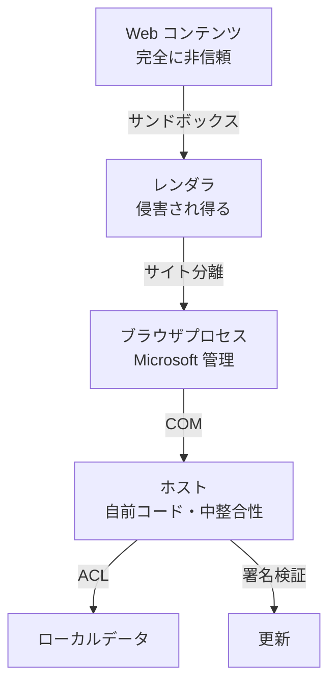
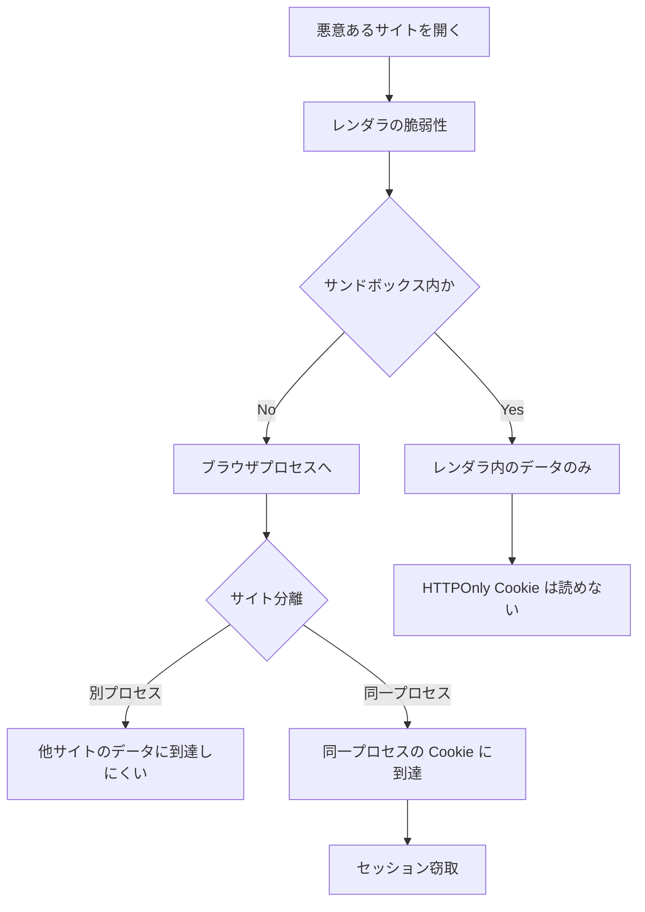
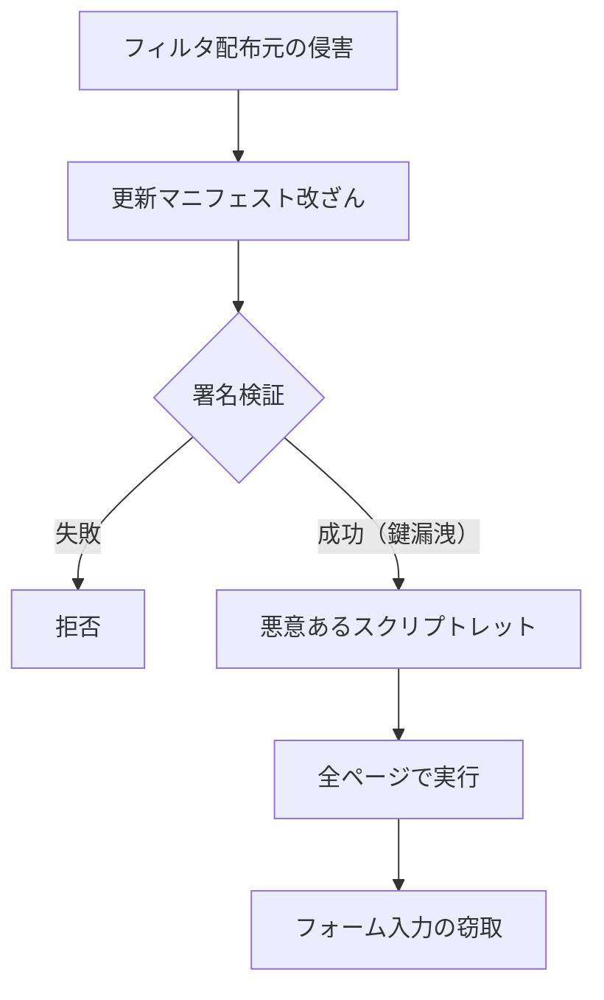

# 04. セキュリティ脅威モデル

状態: 確定案（残留リスクを含む）
確信度: 高（エンジンの境界は一次資料で確認）、中（ホスト側の実装は未着手のため、設計上の想定）

## 1. 資産

| 資産 | 所在 | 侵害された場合の影響 |
|---|---|---|
| 認証 Cookie / セッション | WebView2 の UDF | なりすまし、アカウント乗っ取り |
| 閲覧履歴 | ホストの SQLite | 行動・関心の漏洩 |
| 入力中のフォーム内容 | レンダラのメモリ | 資格情報・個人情報の漏洩 |
| ダウンロードファイル | ユーザーのファイルシステム | マルウェア実行 |
| フィルタ定義とスクリプトレット | ホストのメモリ | 全ページへのコード注入 |
| 更新マニフェストとパッケージ | ネットワーク / ディスク | 任意コード実行 |
| ホストのプロセス | ユーザー権限 | 同一ユーザーの全ファイルへのアクセス |
| ユーザーの信頼（UI 表示） | 画面 | フィッシング、誤認 |

## 2. 攻撃者

| 攻撃者 | 能力 | 主な狙い |
|---|---|---|
| 悪意ある Web サイト | 任意の HTML/JS、リダイレクト、ポップアップ | レンダラ侵害、フィッシング、情報窃取 |
| 悪意ある広告配信者 | 第三者スクリプト、iframe | トラッキング、マルウェア配信 |
| 同一ユーザーのマルウェア | ユーザー権限のファイル読取、プロセス注入 | Cookie 窃取、セッション乗っ取り |
| ネットワーク攻撃者 | DNS 偽装、MITM、Captive Portal | 資格情報窃取、コード注入 |
| フィルタ配布元の侵害 | フィルタ更新の改ざん | 全ページへのスクリプト注入 |
| 依存ライブラリの侵害 | ビルド時のコード混入 | 任意コード実行 |
| 更新サーバーの侵害 | 偽パッケージ配布 | 任意コード実行 |
| 物理アクセス者 | ディスク読取、メモリダンプ | データ窃取 |

## 3. 信頼境界と前提

前提:

1. レンダラは侵害され得る。サンドボックスとサイト分離は、侵害後の横移動を制限するためにある [S26]。
2. ブラウザプロセスも侵害され得る。その場合、ホストは同じユーザー権限で動いているため、ホスト側の防御だけでは守れない。
3. ホストは侵害され得る。Rust のメモリ安全は、論理バグと COM 境界の誤用を消さない。
4. 同一ユーザーのマルウェアは、原則として UDF を読める。Cookie の暗号化は OS のユーザー境界に依存する。

## 4. 脅威と緩和

### 4.1 Web コンテンツ由来

| ID | 脅威 | 経路 | 緩和 | 残留リスク |
|---|---|---|---|---|
| T01 | レンダラの任意コード実行 | 悪意ある HTML/JS、メディアパーサ | Chromium サンドボックス、サイト分離 [S05][S26] | エンジンの 0-day。Microsoft の更新まで待つ |
| T02 | サンドボックス脱出 | レンダラ + OS カーネル | サンドボックス、AppContainer、低整合性 | カーネル/ドライバの脆弱性は範囲外 |
| T03 | XSS | サイトの実装バグ | エンジンに委譲。ホストは DOM を触らない | サイト側の責任。本製品では検知しない |
| T04 | クロスサイト情報漏洩 | Spectre、UXSS | サイト分離 [S26] | サイドチャネルは完全には消えない |
| T05 | ポップアップ悪用 | `window.open`、`NewWindowRequested` | 新規タブはユーザー操作を要求。自動オープンを拒否 | ユーザーが許可した場合は開く |
| T06 | 権限悪用（カメラ/マイク/位置情報） | `getUserMedia` など | 既定拒否。オリジン別に明示許可 [S08] | ユーザーが許可した後の悪用 |
| T07 | 通知スパム | Notification API | WebView2 は Web Push 非対応 [S08]。通知権限は既定拒否 | — |
| T08 | クリップボード読取 | Clipboard API | 権限要求を既定拒否 | ユーザー操作後の読取は許容され得る |
| T09 | フィンガープリンティング | Canvas、WebGL、フォント、UA | 追跡防止を Strict、UA は正直に提示 | 完全な防止は不可能。Brave の farbling 相当は無い |
| T10 | WebRTC による IP 漏洩 | STUN/ICE | 権限でカメラ/マイクを拒否。IP 処理はエンジン設定に依存 | `--force-webrtc-ip-handling-policy` は未検証。既定では漏れ得る |
| T11 | 悪意あるダウンロード | `Content-Disposition`、偽装 MIME | 実行ファイル警告、MOTW、自動実行禁止 [S08] | ユーザーが実行した場合は防げない |
| T12 | フィッシング | 偽ログインページ | アドレスバーのオリジン表示、HTTPS 表示、外部ブラウザ連携 | サイト内容の真偽は判定しない |
| T13 | 証明書エラーの誘導 | 期限切れ、名前不一致 | 例外処理を実装しない。エラーを表示して終了 | ユーザーが無視する手段を提供しない |

### 4.2 ホスト由来

| ID | 脅威 | 経路 | 緩和 | 残留リスク |
|---|---|---|---|---|
| T14 | ホスト API の悪用 | ページ → ホスト | ホストオブジェクト無し、Web メッセージ無効、IPC 無し [S16] | ホストの COM バグ |
| T15 | Tauri IPC の悪用 | ページ → `__TAURI_INTERNALS__` | **Tauri を製品基盤にしない** [S02]（MVP では capability を絞る） | 試作段階では残る |
| T16 | スクリプトレットによる資格情報窃取 | フィルタ更新 → 全ページ | スクリプトレット既定無効、署名済みバンドルのみ、レビュー | 有効化した場合のリスク |
| T17 | フィルタ配布の改ざん | 更新経路 | 署名、SHA-256、ピン留め、ロールバック | 配布元の鍵が漏れた場合 |
| T18 | 更新機構への攻撃 | DNS/MITM/サーバー | TLS、Ed25519 署名、Authenticode、ダウングレード拒否 | 署名鍵の管理 |
| T19 | 依存ライブラリの侵害 | crates.io、ビルド | ロックファイル、`cargo-audit`、`cargo-vet`、SBOM | 新規依存のレビュー漏れ |
| T20 | ローカルデータ窃取 | 同一ユーザーのマルウェア | UDF の ACL、DPAPI（エンジン依存）、プライベートモード | 同一ユーザー権限では完全防御できない |
| T21 | クラッシュダンプからの漏洩 | クラッシュ時 | 自動送信しない。ローカル保存も既定で無効 | ユーザーが手動添付した場合 |
| T22 | ログからの漏洩 | 診断ログ | URL を既定で記録しない。記録時はマスク | デバッグビルドのログ |
| T23 | 権限昇格 | ホストの脆弱性 | 中整合性、非管理者、UIAccess 無効、Job Object | OS の権限昇格脆弱性 |
| T24 | DLL ハイジャック | 探索パス | `SetDefaultDllDirectories`、自ディレクトリのみ | サードパーティ DLL の混入 |
| T25 | ホストの MITM（設計上） | 通信フックと注入 | ホストを最小化、メモリ安全、署名、監査 | ホスト侵害時は全通信が露出 |

### 4.3 プライバシー・保存

| ID | 脅威 | 経路 | 緩和 | 残留リスク |
|---|---|---|---|---|
| T26 | 履歴の漏洩 | SQLite | ACL、保存期間、削除 UI | ディスク復元 |
| T27 | プライベートモードの混線 | プロファイル分離 | InPrivate プロファイル [S07] | サイトデータ行は残らないが、空の History/Cookies DB、Local Storage、Code Cache、Crashpad が残る（PX5）[S53]。DNS / OS キャッシュ |
| T28 | 削除の不完全性 | SSD、ジャーナル | 削除 API、SQLite の `secure_delete` | 物理的な消去は保証できない |
| T29 | テレメトリによる漏洩 | 通信 | テレメトリを実装しない | 更新チェックの通信は残る |

## 5. 攻撃木（代表例）

### 5.1 悪意あるサイトから Cookie 窃取まで

緩和の中心は、レンダラから Cookie ストアへの直接アクセスをさせないことと、サイト分離を維持することにある [S26]。ホスト側で追加できるのは、Cookie をホストのメモリに読み込まないこと、UDF の ACL を絞ること、プライベートモードを分離することである。

### 5.2 フィルタ更新から全ページへのコード注入

緩和:

- スクリプトレットを既定で無効にする。
- 有効化する場合も、出荷時にレビューした固定セットだけを許可し、リモートから JS を追加しない。
- フィルタの更新は署名 + SHA-256 + バージョン単調増加。
- 配布元を 1 つに依存しない（ミラーとハッシュのピン留め）。

【設計判断】汎用のスクリプトレット実行は、利便性よりリスクが大きい。初期リリースでは無効とし、必要なサイト別対応だけをコードに埋め込む。

## 6. 既存ブラウザとの差分

| 防御 | Chrome | Edge | Brave | 本製品 | 差分の意味 |
|---|---|---|---|---|---|
| サンドボックス | あり | あり | あり | あり（エンジン） | 同等 |
| サイト分離 | あり | あり | あり | あり（エンジン） | 同等 |
| 拡張機能の隔離 | あり | あり | あり | 無し | 拡張自体が無いため攻撃面は小さい |
| Safe Browsing | あり | あり（SmartScreen） | あり | 基盤のみ [S08] | 警告 UI と評判 DB の統合が弱い |
| パスワード漏洩チェック | あり | あり | あり | 無し | パスワードを保存しないため対象外 |
| Cookie の追加暗号化 | あり（App-Bound） | あり（推定） | あり（推定） | エンジン依存・未確認 | 同一ユーザーのマルウェアへの耐性が劣る可能性 |
| 自動更新 | あり | あり | あり | あり（エンジン + ホスト） | ホストの再起動設計が課題 |
| VRP / バグバウンティ | あり | あり | あり | 無し | 脆弱性報告の窓口は自作 |
| テレメトリ | あり | あり | あり | 無し | プライバシーは上、診断能力は下 |
| 拡張機能経由の攻撃 | あり | あり | あり | 無し | 攻撃面は小さい |

この表は「本製品が安全」という意味ではない。**エンジン由来の防御は同等だが、ブラウザ製品としての周辺防御は劣る**。とくに Safe Browsing の UI 統合、Cookie 保護の追加層、脆弱性対応の組織力は、個人〜小規模チームでは埋めにくい。

## 7. 保証できないこと

以下は、設計上「保証しない」と明記する。

1. **エンジンの 0-day に対する即時防御。** Microsoft の更新に依存する。実行中のプロセスは、再起動するまで旧ランタイムを使い続ける [S15]。このため、更新検知時に再起動を促す設計が必須である。
2. **同一ユーザー権限のマルウェアからの Cookie 保護。** UDF はユーザーのファイルであり、同一ユーザーは読める。DPAPI はユーザー境界を越えない。
3. **削除の物理的な完全性。** SSD のウェアレベリング、ファイルシステムのジャーナル、Windows のキャッシュにより、削除後の復元を完全には防げない。
4. **フィッシングサイトの判定。** ドメインの見た目と HTTPS の有無は示すが、内容の真偽は判定しない。
5. **DNS レベルの攻撃の完全防御。** システムリゾルバとネットワークに依存する。DoH の強制は未検証。
6. **WebRTC の IP 漏洩の完全防止。** エンジンの設定に依存し、ホストから確実に制御できる API は限られる。
7. **ホスト侵害時の通信秘匿。** ホストは設計上、リクエストとレスポンスのメタデータを見る。侵害されれば全通信が露出する。
8. **フィルタリストの正確性。** 誤遮断はサイト破壊につながる。配布元の品質に依存する。

## 8. セキュリティ不変条件（実装時にテストする）

1. `AddHostObjectToScript` を呼ばない。
2. `IsWebMessageEnabled = false`、`AreHostObjectsAllowed = false` [S16]。
3. `AddScriptToExecuteOnDocumentCreated` に渡すのは、レビュー済みの固定スクリプトだけ。
4. リモートデバッグを有効にしない（リリースビルド）。
5. `file://`、`javascript:`、`data:` のナビゲーションを拒否する（内部 UI を除く）。
6. 証明書エラーの例外処理を持たない。
7. 更新は署名検証なしで適用しない。
8. ダウンロードを自動実行しない。
9. プライベートデータを通常プロファイルに書かない。
10. クラッシュログを自動送信しない。

## 9. 脆弱性対応

- 窓口: セキュリティ連絡先を公開し、PGP 鍵を置く。
- 目標: 受領から 7 日以内に一次回答、30 日以内に修正または緩和。エンジン由来は Microsoft に報告し、ホスト側で緩和できる範囲を実施。
- 公表: 修正後 90 日で開示。ユーザーへの影響が大きい場合は早める。
- 報奨: 初期は謝辞のみ。予算が付いたら報奨金。

## 10. 監査

- 設計段階: この文書の赤チームレビュー（`evidence/red-team-review.md`）と [13-refutation-review.md](13-refutation-review.md)。
- 実装段階: 依存の監査（`cargo-audit`、`cargo-vet`）、ファジング（フィルタパーサ、更新マニフェスト、URL パーサ）。
- 公開前: 外部のペネトレーションテスト。少なくとも、ホストの COM 境界、更新、ダウンロード、プロファイル分離を対象にする。
- 公開後: 年 1 回の再監査。

## 11. 反証レビューによる再評価

13 の反証レビューを受けて、次の 3 点を修正する。

1. **「攻撃面が小さい」と言い切らない。** ホストは通信を横取りし、スクリプトを注入する。TCB は「小さい」とは限らない。コードサイズ、`unsafe` の数、外部依存の数を公開し、監査で評価する。
2. **AppContainer を P1 の実験にする。** WebView2 は AppContainer のプロセスから動かせる [S43]。成功すれば、同一ユーザーのマルウェアからの Cookie 窃取を緩和できる。ただし、COM、ファイル、印刷、ドラッグドロップの挙動を再検証する。
3. **「Google ログインを避けることはセキュリティ上の利点」と書かない。** 利用者が別のブラウザに資格情報を置くだけであり、全体のリスクは下がらない。本製品のセキュリティ上の利点は、テレメトリの不在、拡張機能の不在、ホストの最小化、署名更新である。これらを過大に一般化しない。
