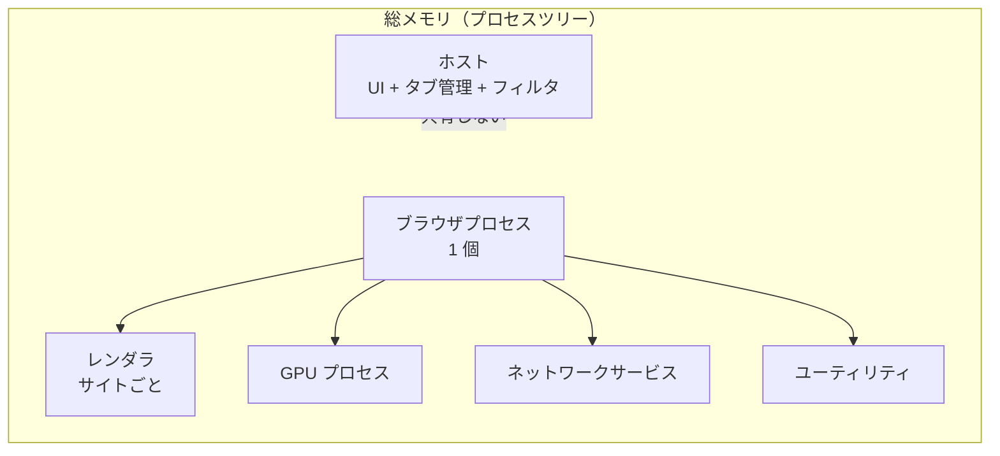
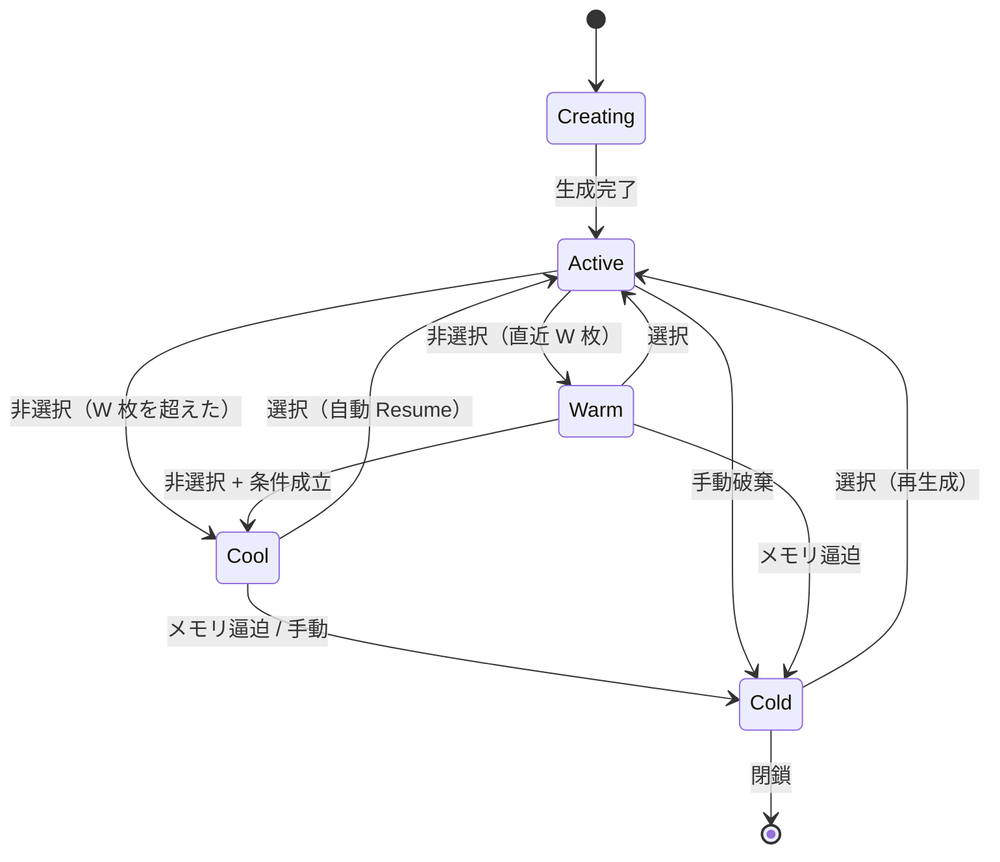
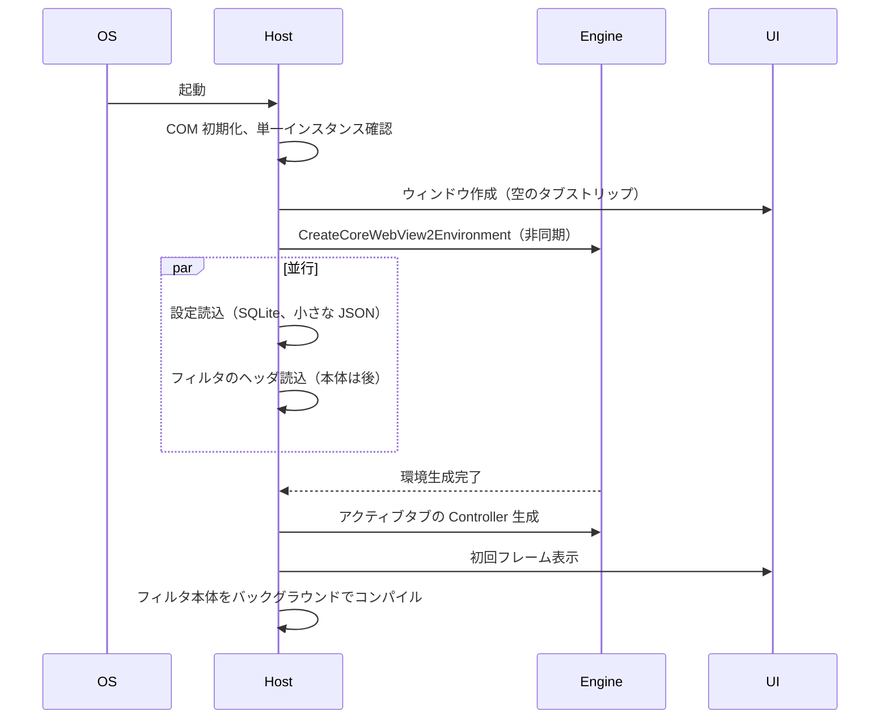
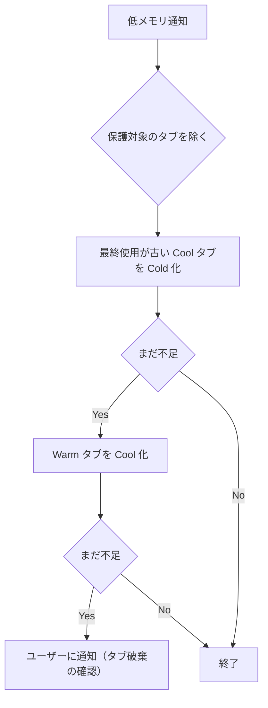

# 05. 性能アーキテクチャ

状態: 設計案（数値は目標であり実測ではない）
確信度: 中（API の挙動は一次資料で確認、実測値は未取得）

## 1. 性能の考え方

「メモリを最小化する」は目的ではない。**応答性を落とさずに、固定費とアイドルコストを下げる**のが目的である。したがって、次の 3 方式を比較し、適応型を採用する。

| 方式 | 内容 | 長所 | 短所 |
|---|---|---|---|
| 常時低メモリ | 非アクティブタブを即座に破棄 | 総メモリは小さい | タブ切替が遅い。フォームが消える |
| 応答速度優先 | 全タブを生かす | 切替が速い | 多タブでメモリが膨らむ |
| 適応型 | 直近タブは Warm、古いタブは Cool、逼迫時だけ Cold | バランス | ポリシーの調整が必要 |

採用: **適応型**。既定は「自動破棄しない」。Cool（サスペンド）を主に使い、Cold はメモリ逼迫時と手動操作時だけにする。

理由: `TrySuspendAsync` はタブを眠らせるが、ページの状態（DOM、フォーム、JS のヒープ）は保持する [S11]。Cold はコントローラを閉じるため、フォームとスクロール位置が失われる。日常利用では、フォーム入力中のタブを落とすコストの方が、メモリ削減の便益より大きい。

## 2. メモリの構造



| 領域 | 支配要因 | ホストが制御できるか |
|---|---|---|
| ホスト | 自前コード、フィルタのメモリ、履歴キャッシュ | できる |
| ブラウザプロセス | エンジン。UDF、プロファイル数 | 間接的にできる（プロファイル数を増やさない） |
| レンダラ | サイトの複雑さ、タブ数、サイト分離 | タブの破棄・サスペンドで間接的にできる |
| GPU | タブ数、動画、合成レイヤ | 露出を減らす程度 |
| ネットワーク | 接続数、キャッシュ | 間接的にできる |

【事実】同一 UDF の WebView2 は 1 つのブラウザプロセスを共有し、レンダラはサイト分離に応じて共有される [S05]。複数プロファイルも同一 UDF 内で分離でき、ブラウザプロセスを増やさない [S07]。

【推測】したがって、タブごとに WebView2 を作っても、プロセス数は「タブ数」ではなく「異なるサイト数」に近づく。メモリの削減余地は、ホストの固定費と、レンダラのサスペンド/破棄にある。

### 2.1 参考値（他ブラウザの公表値）

- Chrome のサイト分離は、デスクトップで約 10〜13% のメモリ増加をもたらした（Chrome 67 時点）[S26]。
- Edge の sleeping tabs は、平均でメモリ 32% 削減、CPU 37% 削減と Microsoft が報告している（約 40,000 端末、Canary/Dev）[S27]。
- Chrome の Memory Saver は、一定時間使われていないタブを破棄し、再訪時に再読み込みする [S28]。

これらはベンダー公表値であり、独立検証ではない。本製品の目標値をこれらから直接導かない。09 の実測で比較する。

### 2.2 反証レビューで見つかった矛盾

- Microsoft の性能ガイドは「各コントロールがプロセス群を起動する」と説明する [S40]。一方、プロセスモデルの文書は「1 UDF に 1 ブラウザプロセス」と説明する [S05]。タブごとのプロセス生成が実際にどうなるかは、PX3 で測る。ここが想定と違えば、メモリの主張は崩れる。
- Microsoft の性能ガイドは、コールドスタートを既知のボトルネックとしている [S40]。Edge は OS 同梱で起動経路が最適化されている可能性があり、新規アプリが冷起動で勝てる保証は無い。
- したがって「5 タブメモリ」と「暖機後起動」の両方を、PX3 の合格条件にする。片方だけでは足りない。

### 2.3 PX3 の初期実測

2026-10-23、Windows 11、WebView2 155 の環境で、同じローカルページを使って 1/5/20 タブの Private メモリを測った [S50]。

| タブ | 本プロトタイプ | Edge | 差 |
|---:|---:|---:|---:|
| 1 | 204.3MB | 372.7MB | -45.2% |
| 5 | 289.9MB | 493.9MB | -41.3% |
| 20 | 768.5MB | 851.7MB | -9.8% |

- 1/5 タブでは大きく下回った。20 タブでは -10% に縮む。
- 起動は、本が全タブ読込完了、Edge がウィンドウ表示で定義が異なり、比較できない。
- 各条件 1 回、軽量・同一オリジン。実サイトと複数回の測定は PX3b で行う。

この結果は「5 タブメモリ」の合格方向を示すが、「起動が Edge より速い」ことは示さない。20 タブの優位も 10% であり、主張には使わない。

PX3b では、ページの `load` ビーコンで起動を同じ定義にした。1 タブ 5.13 vs 5.90 秒、5 タブ 4.24 vs 7.56 秒、20 タブ 7.47 vs 6.73 秒（本 vs Edge、各 3 回の中央値）[S51]。5 タブは遅延復元で有利、1 タブは僅差、20 タブは逆転した。分散が大きく、起動の優位は未判定である。

PX3c では、同じ UDF / プロファイルを再利用した暖機後起動を測った。1 タブ 481 vs 293ms、5 タブ 456 vs 310ms で Edge が速い。20 タブは 534 vs 589ms だが、本は最初のタブのみである [S52]。**「起動が速い」は支持されない。Gate 1 は起動で不合格。**

## 3. タブの状態機械



| 状態 | WebView2 | メモリ | 切替時間 | フォーム |
|---|---|---|---|---|
| Active | 表示 | 最大 | 即時 | 保持 |
| Warm | 非表示・非サスペンド | 大 | 速い | 保持 |
| Cool | 非表示・サスペンド | 中（OS が回収可能） | 中 | 保持 |
| Cold | 破棄 | 最小 | 遅い（再読込） | 失う |

### 3.1 パラメータ（初期案）

| パラメータ | 既定 | 根拠 |
|---|---|---|
| Warm 枚数 W | 3 | 直近の切替を速くする |
| Cool 化までの非選択時間 | 30 秒 | 短すぎると切替が遅くなる |
| Cold 化 | 通常は自動で行わない（逼迫時を除く） | フォーム喪失を避ける |
| メモリ逼迫時の Cold 化 | 空きコミットが閾値未満 | OS の通知を使う |
| タブ上限 | 50（警告）、100（上限） | 無制限はリソース管理を破綻させる |

### 3.2 保護ルール（Cool/Cold にしない）

| 条件 | 検知方法 | 理由 |
|---|---|---|
| 音声・動画の再生中 | `IsDocumentPlayingAudio` [S08] | 再生を止めない |
| 画面共有・カメラ・マイクの使用中 | 権限状態と `PermissionRequested` | 会議を切らない |
| ダウンロード中 | `DownloadStarting` の状態 | 中断しない |
| アップロード中 | 検知が難しい。フォームの変更を JS で観測しない方針のため、**時間ベースの保護**にする | 送信中の切断を避ける |
| 直近 60 秒に入力があったタブ | ウィンドウの入力イベント（WM_KEYDOWN 等） | 入力中の喪失を避ける |
| 固定タブ | ユーザー操作 | 意図の尊重 |

アップロードとフォームの「正確な」検知は、ページに JS を注入してホストへ通知する経路が必要になる。これは「コンテンツに特権を渡さない」方針と衝突する。したがって、**正確な検知はしない**。代わりに、入力・音声・権限・ダウンロードの観測可能なシグナルで保護し、Cold を自動化しない。

## 4. サスペンドと破棄

### 4.1 サスペンド

```
if !visible && !protected && idle > 30s {
    controller.IsVisible = false;
    match core.TrySuspendAsync().await {
        true  => state = Cool,
        false => state = Warm,   // 音声再生などで失敗
    }
}
```

- `TrySuspendAsync` は `IsVisible=false` でないと例外になる [S11]。
- 成功しても、実行中のスクリプトが終わるまで完全には止まらない [S11]。
- 復帰は `IsVisible=true` で自動的に行われる [S11]。明示 `Resume` は不要だが、状態を同期するために呼んでもよい。

### 4.2 メモリ目標

サスペンドを使わないタブ（音声再生中など）には `MemoryUsageTargetLevel = Low` を使う [S12]。

- `Low` はスクリプトを止めずにメモリを下げる。ページの状態を保ちたいが、メモリを下げたい場合に適する。
- `TrySuspendAsync` と `MemoryUsageTargetLevel` を混在させない [S12]。
- 復帰時に `Normal` に戻す。戻さないと性能が落ちる [S12]。

### 4.3 生成・破棄コスト

WebView2 のコントローラ生成は、環境の生成ほどではないが、無視できない。環境は起動時に 1 度だけ作り、タブごとのコントローラは必要になったときに作る。

| 操作 | 想定コスト | 備考 |
|---|---|---|
| 環境生成 | 100〜300ms | 起動時に 1 回。体感に直結する |
| コントローラ生成 | 50〜150ms | タブ生成。非同期化する |
| 初回ナビゲーション | ネットワーク依存 | 生成とは別 |
| コントローラ破棄 | 数十 ms | Cold 化。UI を止めない |
| サスペンド | 数 ms（要求） | 完了は非同期 |

【推測】の値であり、Phase 0 で測る。生成が遅い場合、タブの追加を「先に空のタブを出し、後から WebView を差し込む」方式にする。破棄が遅い場合、Cold 化をバックグラウンドで行い、UI の応答を優先する。

### 4.4 破棄の安全性

- 破棄前に `NavigationCompleted` と `DownloadStarting` の状態を確認する。
- 破棄中にユーザーがタブを選んだ場合、生成を優先し、破棄をキャンセルする。
- 破棄後に `ProcessFailed` が来ても、二重に処理しない（世代番号で識別）。

### 4.5 Cold 化の条件

Cold 化は次だけ:

1. ユーザーが明示的に「タブを破棄」した。
2. メモリ逼迫の通知があり、保護対象外のタブが複数ある。
3. クラッシュ復旧で、状態を再構築する必要がある。

Cold 化の前に、URL、タイトル、スクロール位置、履歴、タブの並び順を保存する。フォーム内容は保存しない（保存すると機密情報の永続化になる）。復元時は「復元しました」と表示し、再読込する。

## 5. 起動



目標:

| 段階 | 目標 | 備考 |
|---|---|---|
| ウィンドウ表示 | 150ms 以内 | 空の UI を先に出す |
| 初回タブの生成 | 400ms 以内 | 環境生成を含む |
| 初回ページの描画開始 | 800ms 以内 | ネットワーク依存 |
| フィルタ適用開始 | 1,000ms 以内 | 間に合わなければ最初の数リクエストは素通し |

【目標】であり、保証ではない。環境生成の実測は Phase 0 で行う。

### 5.1 遅延初期化

- 履歴 DB は起動時に開くが、書き込みは最初のナビゲーションまで遅延。
- フィルタは「ヘッダ + ドメイン高速判定用の小さい索引」を先に読み、本体はバックグラウンドでデシリアライズする。adblock-rust は `serialize` / `deserialize` を持つ [S23]。
- 更新チェックは起動 30 秒後。
- クラッシュ監視は起動時から（軽量）。

### 5.2 起動時にやらないこと

- 全タブの復元（前回のタブは Cold として URL だけ復元し、必要になったら生成）。
- フィルタのフルコンパイル。
- 履歴の全件読み込み。
- アイコンのプリロード。
- ネットワーク接続の先読み。

## 6. 応答性

### 6.1 UI スレッドの規律

| 操作 | 許容時間 | 実装 |
|---|---|---|
| キー入力 → アドレスバー表示 | 16ms | ネイティブ EDIT。IME は OS に任せる |
| タブクリック → 表示 | 100ms（Warm）、300ms（Cool） | 事前に `IsVisible` を切り替える |
| スクロール | フレーム落ちなし | エンジンに任せる。ホストはオーバーレイを描かない |
| タブ生成 | 200ms | Controller 生成を非同期化 |
| メニュー表示 | 50ms | 事前生成 |

### 6.2 やってはいけないこと

- タブ切替時に同期 I/O をしない。
- タブストリップの再描画で全タブのアイコンを再デコードしない。
- WebResourceRequested のハンドラでログファイルを書かない。
- アニメーションを多用しない。タブの開閉は即時、フェードは 100ms 以下。

### 6.3 入力遅延

- アドレスバーは Win32 の EDIT を使う。IME の確定処理を自前で実装しない。
- ページ内の入力はエンジンに任せる。ホストはキーフックを入れない。
- グローバルホットキーを登録しない（`RegisterHotKey` を使わない）。

## 7. GPU と描画

- GPU アクセラレーションは既定で有効。無効化を既定にしない。
- ソフトウェアレンダリングへのフォールバックは、GPU プロセスの繰り返し崩壊時だけ提案する。
- 動画再生時は、省電力のため `MemoryUsageTargetLevel` を上げない（再生を優先）。
- タブが非表示のときは `IsVisible=false` にして、合成を止める。
- GPU メモリは、タブ数と動画の数に比例する。ホストから直接解放する API は限られるため、タブの破棄と `IsVisible=false` で間接的に抑える。
- 4K 動画や複数の動画タブは、GPU メモリの上限に達することがある。上限に達した場合は、新しい動画の再生を妨げず、古いタブを Cool にする。

## 8. メモリ逼迫時のポリシー



- 通知は `CreateMemoryResourceNotification` / `QueryMemoryResourceNotification` を使う。
- プロセスのワーキングセットを直接削らない（エンジンの内部状態を壊す）。
- ページキャッシュのクリアは最後の手段。再読み込みコストが大きい。

## 9. アイドル CPU

- ホストのタイマーは 1 秒間隔の監視だけ。ポーリングを増やさない。
- 非表示タブは Cool にし、タイマーとアニメーションを止める [S11]。
- 更新チェックは 6 時間に 1 回。
- テレメトリ送信なし。
- Service Worker のバックグラウンド処理はエンジンに任せる（Push は無い [S08]）。

## 10. 測定

- 起動: `CreateProcess` から最初の `WM_PAINT` までを ETW で計測。
- タブ切替: 入力メッセージのタイムスタンプから、`PresentMon` の present まで [S32]。
- メモリ: Job Object 配下の全プロセスの private working set と commit [S30][S31]。
- ページ読み込み: ナビゲーション開始から `NavigationCompleted`、および CDP の Performance メトリクス。
- 遮断コスト: フィルタ有無の A/B、リクエストあたりのホスト滞在時間。

詳細は 09。

## 11. 目標値（仮）

| 指標 | 仮目標 | 位置づけ |
|---|---|---|
| コールドスタート | Edge より短い（PX3c 未達） | 実測で判定 |
| 5 タブ総メモリ | Edge 以下 | 実測で判定 |
| 20 タブ総メモリ | Edge の +10% 以内 | 勝ちとは主張しない |
| Warm 切替 p95 | 100ms 未満 | 実測で判定 |
| Cool 復帰 p95 | 300ms 未満 | 実測で判定 |
| アイドル CPU | Edge 以下 | 実測で判定 |
| 遮断による読み込み悪化 | 中央値 +3% 以内 | 実測で判定 |

これらは【目標】であり、達成を約束しない。Phase 0 の結果で修正する。

## 12. 追加最適化の評価

要求に縛られずに検討した案を、効果・実現性・性能・セキュリティ・互換性・保守コスト・優先度で評価する。優先度は P0（採用）、P1（条件付き採用）、P2（将来）、R（不採用）。

| 案 | 理論効果 | 実現性 | 性能 | セキュリティ | 互換性 | 保守 | 優先 |
|---|---|---|---|---|---|---|---|
| ネイティブ UI（Web UI を使わない） | 固定費と起動を削減 | 高 | 中〜大 | 向上（レンダラを増やさない） | 影響小 | 高 | P0 |
| タブのサスペンド | 非アクティブのメモリと CPU を削減 [S11] | 高 | 中 | 影響小 | 一部サイトで復帰が遅い | 低 | P0 |
| `MemoryUsageTargetLevel=Low` | 音声再生中でもメモリを削減 [S12] | 高 | 小〜中 | 影響小 | 影響小 | 低 | P0 |
| 事前コンパイル済みフィルタ | 起動時のコンパイルを削減 [S23] | 高 | 中 | 影響小 | なし | 低 | P0 |
| ハイブリッドなフィルタ登録 | 往復を削減 [S09] | 高 | 大 | 影響小 | 遮断漏れの可能性 | 中 | P0 |
| サイト分離の維持 | 横移動を制限 [S26] | 高 | メモリ増 | 大 | なし | 低 | P0 |
| GPU アクセラレーションの維持 | 描画と動画を高速化 | 高 | 大 | 影響小 | なし | 低 | P0 |
| アニメーションの最小化 | UI の応答を改善 | 高 | 小 | なし | なし | 低 | P0 |
| DB 書き込みのバッチ化 | 起動と入力の詰まりを削減 | 高 | 中 | 影響小 | なし | 低 | P0 |
| Enhanced Security Mode（任意） | JIT 無効化で攻撃面を削減 [S14] | 高 | JS が遅くなる | 向上 | 一部サイトが重い | 低 | P1 |
| 追跡防止の Strict（既定） | 第三者トラッカーを削減 [S13] | 高 | 影響小 | 向上 | 一部サイトが壊れる | 低 | P1 |
| DNS-over-HTTPS の強制 | DNS 傍受を減らす | 中（フラグ依存） | 影響小 | 向上 | 企業網で壊れる | 中 | P1 |
| プロセスの EcoQoS / 優先度調整 | アイドル CPU を削減 | 中 | 小 | 影響小 | なし | 中 | P1 |
| Service Worker の無効化 | バックグラウンド処理を削減 | 高 | 小 | 向上 | 多くのサイトが壊れる | 低 | R |
| 全タブのプリロード | 切替を高速化 | 高 | メモリ増 | 影響小 | なし | 低 | R |
| 独自ネットワークスタック | TLS の最適化 | 低 | 不明 | 危険（自前 TLS） | 大 | 極大 | R |
| タブごとの別 UDF | 分離の強化 | 高 | ブラウザプロセス増 | 向上 | なし | 中 | R |
| ローカルプロキシによる遮断 | 全リクエストを検査 | 中 | 大（MITM） | 危険（TLS の信頼を壊す） | 大 | 大 | R |
| 履歴の全文検索 | 利便性 | 中 | 小 | 影響小 | なし | 中 | P2 |
| タブのサムネイル | 利便性 | 高 | メモリと描画 | 影響小 | なし | 中 | P2 |
| Composition controller による描画 | タブ切替の描画を滑らかにする | 中 | 中 | 影響小 | なし | 高 | P2 |

この表の R は、効果があっても、セキュリティ・互換性・保守のいずれかを大きく損なうため採用しない。とくに、独自 TLS とローカルプロキシは、ブラウザの信頼の基盤を壊す。
