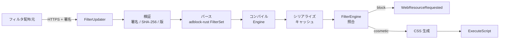
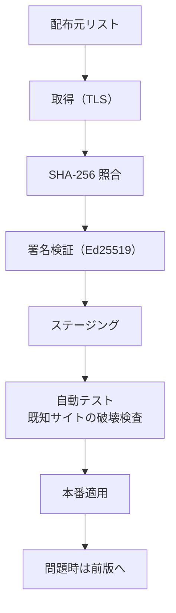

# 06. 広告遮断アーキテクチャ

状態: 設計案（WebView2 の制約を前提に再設計）
確信度: 高（API 制約は一次資料で確認）、中（遮断率と性能は実測前）

## 1. 目標と非目標

### 目標

1. ネットワーク要求の遮断（広告、トラッカー、悪性ドメイン）。
2. 既定で有効。ユーザーがサイト単位で無効化できる。
3. ページ読み込みを悪化させない（中央値 +3% 以内を目標）。
4. フィルタ更新の完全性を署名で検証する。
5. 誤遮断でサイトを壊したとき、原因を特定できる（ログと一時解除）。

### 非目標

1. uBlock Origin と同等の遮断率。
2. すべての uBO 構文の完全互換。
3. YouTube の広告を完全に除去すること。
4. スクリプトレットの汎用実行。
5. フィルタ配布元の信頼性を、こちらで保証すること。

## 1.1 反証レビューによる戦略変更（2026-10-23）

[13-refutation-review.md](13-refutation-review.md) の結果、主戦略を変更する。

- `WebResourceRequested` は WebSocket で発火しない [S39]。`$websocket` は実装できない。
- 発信元フレーム URL が無い、UI スレッド往復がある、`$csp` が実装できない。全件遮断は構造的に不利である。
- したがって、第一候補を「**エンジンの追跡防止（Strict）を主、ホストの遮断を高リスクドメインに限定**」に変える [S13]。
- EasyList 全件の適用は、性能と法務の両面で保留する。uBO 互換は名乗らない。
- CDP Fetch は、WebSocket を含む代替の実験としてのみ扱う。採用は性能とセキュリティの実測後。

この変更により、遮断率は下がるが、ホストが全通信を見る範囲が狭まり、ページ読み込みへの悪化も抑えられる。製品の売りは「広告遮断」から「プライバシー既定値と軽さ」に移る。

以下の 3〜10 節は、ホスト遮断を採用する場合の設計である。主戦略ではない。主戦略は、エンジンの追跡防止（Strict）と、高リスクドメインに限定したホスト遮断の併用である。

## 2. なぜ uBO 同等にならないのか

WebView2 の `WebResourceRequested` は、リクエストの URL・メソッド・ヘッダ・ボディ・リソース種別・要求元種別を渡す [S17][S19][S20]。しかし**発信元のフレーム URL（イニシエータ）を渡さない** [S18]。adblock-rust の判定は `source_url` を必要とする [S23]。

この 1 点が、次の構文を「近似」に落とす。

| 構文 | 必要な情報 | WebView2 での実現 |
|---|---|---|
| `$third-party` | リクエスト URL と発信元の比較 | タブの現在 URL で近似。iframe 内では誤判定 |
| `$domain=` | 発信元ドメイン | 同上。サブフレームで誤判定 |
| `$popup` | ポップアップ要求 | `NewWindowRequested` で別処理 |
| `$csp` | レスポンスヘッダの変更 | 直接変更する API は無い [S09]。文書を自前で取得して差し替える方式は、ストリーミングと認証を壊すため実用的でない |
| `$removeparam` | URL の書換 | Win32 の `put_Uri` で可能 [S17] |
| `$redirect` | 代替リソースの返却 | `CreateWebResourceResponse` で可能 [S09] |
| `$websocket` | WebSocket ハンドシェイク | 不可。`WebResourceRequested` が発火しない [S39] |
| `$ping` | Ping 要求 | リソース種別で判定できる可能性。未検証 |

したがって、**コンテキスト非依存のルール（ドメイン・パス・正規表現・リソース種別）を主軸にする**。`$third-party` と `$domain` は、トップレベル URL が確実な場合だけ適用し、サブフレームでは保守的に倒す（遮断しない）。

## 3. パイプライン

### 3.1 起動時のロード

1. 署名済みのコンパイル済みキャッシュがあれば `Engine::deserialize` で読み込む [S23]。
2. キャッシュが無い、または版が古い場合は、元リストをパースしてコンパイルする。
3. コンパイルはバックグラウンドスレッド。完了までは「素通し + 既知ドメインの高速ブロック」で動く。

### 3.2 フィルタの構成

| レイヤ | 内容 | 用途 |
|---|---|---|
| L0 | 自前の小さいドメインブロックリスト（数百件） | 起動直後の即時遮断 |
| L1 | EasyList / EasyPrivacy のネットワークルール | 一般の広告・追跡 |
| L2 | 悪性ドメインリスト（署名済み、別配布） | マルウェア・フィッシング |
| L3 | サイト別の例外（ユーザー設定） | 誤遮断の解除 |

L0 はコードに埋め込む。L1〜L3 は署名済みバンドル。ユーザーが追加したリストは、信頼済みとして扱わない（スクリプトレットを含めない）。

同一ルールは `FilterSet` の段階で重複排除し、コンパイル後のルール数を抑える。複数リストをメモリ上で合成する場合も、同一のネットワークルールと同一の cosmetic ルールを 1 つにまとめる。これにより、照合の候補数を減らし、キャッシュのサイズを抑える。

## 4. ネットワーク遮断の実装

### 4.1 フィルタの登録戦略

`AddWebResourceRequestedFilter` は、条件に合うリクエストだけをホストに通知する [S09]。全リクエストに `*` を付けると、すべてのリクエストがホスト UI スレッドとの往復になる [S10]。

3 つの戦略を比較する。

| 戦略 | 登録 | 往復 | 遮断率 | 性能 |
|---|---|---|---|---|
| A: 全件 | `*` + All | 全リクエスト | 高い | 悪い |
| B: ドメイン事前登録 | 既知の遮断ドメインごとに `*://*.example/*` | 該当のみ | ドメイン系は高い。パス系は漏れる | 良い |
| C: ハイブリッド | B + ドキュメント/スクリプト/XHR だけ全件 | 一部 | 中〜高 | 中 |

推奨: **C**。画像・フォント・メディアはドメイン事前登録で拾い、文書・スクリプト・XHR は全件を見てパス・正規表現ルールを適用する。これにより、往復を「ページあたり数十回」に抑えつつ、重要な遮断を逃さない。

【未検証】登録できるフィルタ数の上限と、数万件登録したときのメモリ・照合コスト。Phase 0 で測る。

### 4.2 遮断レスポンス

| リソース種別 | 返すもの | 理由 |
|---|---|---|
| Image | 1x1 GIF（透過） | レイアウト崩れを最小化 |
| Script | 空の JS（`application/javascript`） | 実行時エラーを避ける |
| Stylesheet | 空の CSS | 同上 |
| XHR / Fetch | 204 No Content | アプリのエラーハンドリングを壊しにくい |
| Subdocument | 204 | 空白フレーム |
| Document | 204 | 遮断ページを表示しない |
| Media | 204 | 再生エラーにする |

`CreateWebResourceResponse` でストリームを返す [S09]。ストリームはバックグラウンド STA で作るか、アジャイルにする [S17]。

### 4.3 URL 書換（`$removeparam`）

`ICoreWebView2WebResourceRequest::put_Uri` で URL を書き換えられる [S17]。ただし次の制約がある。

- 書換はリクエスト送信前に行う必要がある。
- 書換後の URL が同一オリジンでない場合、CORS の挙動が変わる可能性がある。
- 署名付き URL やトラッキングパラメータが認証に使われている場合、壊すことがある。

初期リリースでは、既知のトラッキングパラメータ（`utm_*`, `fbclid`, `gclid` など）だけを対象にし、サイト別の例外を持つ。

### 4.4 レスポンスヘッダ（`$csp`）

`WebResourceResponseReceived` はレスポンスを参照できるが、変更はできない [S09]。したがって `$csp` は実装しない。CSP による防御は、サイト自身のヘッダに依存する。

### 4.5 サービスワーカー

`RequestedSourceKind` で Document / SharedWorker / ServiceWorker を区別できる [S19]。サービスワーカー由来のリクエストは、発信元の文脈が無いため、コンテキスト非依存ルールだけを適用する。既定ではインターセプトしない（性能優先）。悪性ドメインの遮断は、サービスワーカー側でも必要になるため、L2 のドメイン判定だけは適用する。

## 5. カバレッジ表

| 機能 | 対応 | 備考 |
|---|---|---|
| ドメイン遮断 | 対応 | 主軸 |
| パス・正規表現 | 対応 | スクリプト/XHR/文書 |
| リソース種別 | 対応 | `ResourceContext` |
| 第三者判定 | 近似 | フレーム URL 無し [S18] |
| `$domain` | 近似 | トップレベル限定 |
| `$removeparam` | 部分対応 | `put_Uri` [S17] |
| `$redirect` | 対応 | 代替レスポンス |
| `$csp` | 非対応 | レスポンス変更不可 [S09] |
| `$popup` | 部分対応 | `NewWindowRequested` |
| `$websocket` | 不可 | 発火しない [S39] |
| cosmetic（要素隠し） | 部分対応 | 注入方法に制約（6 節） |
| scriptlet | 既定無効 | サプライチェーンリスク（7 節） |
| hosts 構文 | 対応 | adblock-rust |
| uBO 独自構文 | 一部 | adblock-rust の対応範囲 [S22] |

## 6. Cosmetic filtering

### 6.1 制約

- `AddScriptToExecuteOnDocumentCreated` は Windows では全フレームに適用される [S36]。
- ページからホストへメッセージを送らない方針のため、ページ側から「このドメインのルールをくれ」と要求できない。
- 初期化スクリプトに全ドメインのルールを埋め込むと、スクリプトサイズが数 MB になり、全ドキュメントでパースコストがかかる。

### 6.2 3 つの方式

| 方式 | 仕組み | 長所 | 短所 |
|---|---|---|---|
| C1: 汎用 CSS | 全ページに共通の小さな CSS を注入 | 軽い、FOUC なし | 効果が限定的 |
| C2: 事後注入 | ナビゲーション後にホストが `ExecuteScript` | ドメイン別に正確 | FOUC、レイアウトずれ |
| C3: 埋め込み表 | 初期化スクリプトにドメイン→セレクタの表を埋め込む | FOUC なし、正確 | サイズとパースコスト |

推奨: **C1 + C2 の併用**。C1 で一般的な広告枠を早めに隠し、C2 でドメイン固有のルールを追加する。C3 は、上位 1,000 ドメインだけに限定する場合の将来拡張とする（サイズ上限を 300KB とし、Phase 2 で評価）。

### 6.3 レイアウト補正

- 非表示にした要素の親が空白を残す場合、`display:none` だけでなく、高さ 0 の collapsed クラスを追加する。
- ただし、空要素の折りたたみは誤爆しやすい。サイト別のルールがある場合だけ行う。
- 広告ブロック後のレイアウトシフトは、`ResizeObserver` で補正しない（ページの JS と競合する）。

## 7. スクリプトレット

### 7.1 リスク

スクリプトレットはページの main world で実行される。ページと同じ権限を持つため、DOM、フォーム、Cookie（HTTPOnly を除く）、`fetch` にアクセスできる。フィルタ更新経由で任意の JS を配布できる設計は、**全ページの資格情報を窃取できる経路**になる。

### 7.2 方針

1. 初期リリースでは**無効**。
2. 有効化する場合も、出荷時にレビューした固定スクリプトだけを許可する。リモートから JS を追加しない。
3. スクリプトはバンドルに含め、SHA-256 で固定する。
4. サイト別に必要な処理は、汎用スクリプトレットではなく、アプリ側のコードとして実装し、レビューする。
5. `eval`、`new Function`、動的な `import()` を使わない。
6. 注入するスクリプトは、`window.top === window` のガードを入れ、iframe での重複実行を避ける。

### 7.3 YouTube

YouTube の広告は、DOM の構造と再生制御に強く依存する。uBO は専用のスクリプトレットで対応しているが、これは頻繁に壊れる。WebView2 ではエンジン内部のフックが無いため、次の制約がある。

- ネットワーク遮断だけでは、広告と本編が同じドメイン・同じパスで配信される場合に分離できない。
- DOM 操作は FOUC と再生停止を招く。
- スクリプトレットを有効にすると、リスクと保守コストが増える。

【設計判断】YouTube の広告除去は「ベストエフォート」とし、完全除去を約束しない。ユーザーには、サイト別の一時解除を提供する。

## 8. 性能

### 8.1 コストの内訳

| コスト | 発生箇所 | 目標 |
|---|---|---|
| フィルタ照合 | ホストのフィルタワーカー | 1 リクエストあたり p95 1ms 未満 |
| IPC 往復 | WebView2 → ホスト UI スレッド | 1 リクエストあたり p95 0.5ms 未満 |
| 遮断レスポンス生成 | ホスト | p95 0.2ms 未満 |
| cosmetic 注入 | レンダラ | 1 ページあたり 5ms 未満 |
| コンパイル | 起動後バックグラウンド | 2 秒以内（キャッシュ無し） |

【目標】。実測は 09 の手順で行う。

### 8.2 最適化

- フィルタの照合は、URL のハッシュ → 候補ルールの絞り込み → 正規表現の順。
- 正規表現は事前コンパイルし、リクエストごとにコンパイルしない。
- 同一 URL の判定結果を短時間キャッシュする（LRU、1,000 件程度）。
- 遮断レスポンスのストリームは使い回さない（WebView2 が消費するため）。
- UI スレッドでは、文字列のアロケーションを最小化する。

### 8.3 測定

- フィルタ有無で同一ページを 10 回読み、中央値と p95 を比較。
- リクエストごとのホスト滞在時間を ETW で計測。
- 遮断率は、既知の広告テストページと、CDP のネットワークログで測る。

**PX2 の予備実測（2026-10-23）**: 500 リクエストのローカルページで、全件フック（all-allow）とフックなし（none）のナビゲーション時間に差がなかった（324ms vs 321ms）。遮断した all / hybrid は短縮した（243ms / 208ms）。この規模では、往復コストは支配的でない。実サイト、1000 リクエスト、UI 負荷時は未検証である。詳細は [prototype/reports/px2-adblock.md](../../prototype/reports/px2-adblock.md)。

## 9. 供給網

- 配布元は複数を持ち、1 つが侵害されても即時適用しない。
- 署名鍵はオフラインで保管し、ビルド環境と分離する。
- フィルタの差分更新は、完全なバンドルの署名を検証した上で適用する。
- ロールバック用に前版を保持する。
- ユーザーが追加したリストは署名対象外。スクリプトレットを含めない。
- フィルタから WebView2 のフィルタ文字列を生成するときは、スキームとワイルドカードを検証する。`*` だけの全件マッチや、意図しないホスト全体のマッチを生成しない。
- `$redirect` の遷移先はローカルの同梱リソースに限定する。フィルタ由来のリモート URL へ飛ばさない。

## 10. ライセンスと帰属

| リスト | ライセンス | 方針 |
|---|---|---|
| EasyList / EasyPrivacy | GPL-3.0+ または CC BY-SA 3.0+ [S25] | 無改変で同梱し、帰属を表示 |
| uBlock Origin uAssets | GPL-3.0 [S24] | 無改変での同梱も法的確認。初期は不採用 |
| adblock-rust | MPL-2.0 [S24] | 改変ファイルを公開 |
| adblock-resources | MPL-2.0 [S24] | スクリプトレットを使う場合のみ |

【設計判断】複数リストを合成した 1 つのファイルを配布しない。合成はメモリ上で行い、配布物には元ファイルを置く。これにより、share-alike の解釈を単純にする。

## 11. プライバシー

- どのリクエストを遮断したかを外部に送信しない。
- サイト別の統計はローカルにのみ保存し、既定では無効。
- フィルタ更新の取得時に、ユーザー ID や端末 ID を送らない。
- 誤遮断の報告は、ユーザーが明示した場合だけ、URL を手動で添付する。

## 12. 未検証事項

1. `AddWebResourceRequestedFilter` に登録できるフィルタ数の上限。
2. `*` フィルタを全リソースに付けた場合の、ページ読み込みへの実測影響。
3. `put_Uri` による書換が、CORS と SigV4 署名付き URL に与える影響。
4. WebSocket を CDP Fetch で代替できるか（`WebResourceRequested` では不可 [S39]）。
5. `RequestedSourceKind` ごとのフィルタ登録の挙動。
6. adblock-rust のコンパイル済みキャッシュのサイズとロード時間。
7. YouTube の広告に対して、ネットワーク遮断だけでどこまで到達できるか。
