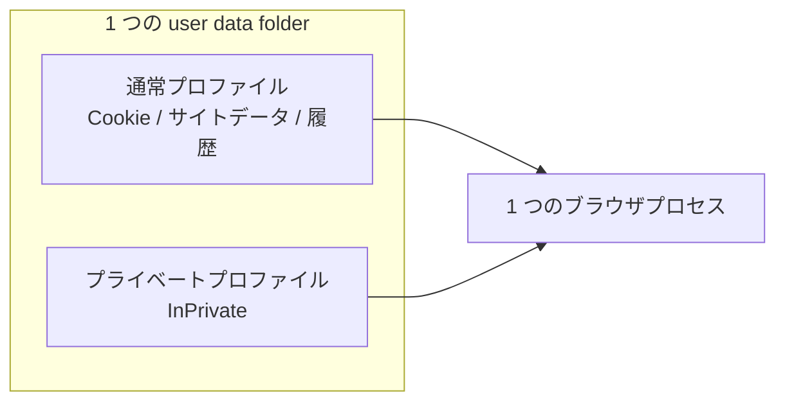

# 07. プライバシーとデータ保存

状態: 設計案（要件の一部を技術的に修正）
確信度: 高（WebView2 の保存種別は一次資料で確認、InPrivate のサイトデータ非永続は PX5 で確認）、中（削除の実効性は環境依存）

## 1. 要件の再検討

当初要件は「永続データを Cookie と閲覧履歴に限定する」だった。これは**そのままでは実現できない**。

理由:

1. WebView2 は UDF に、Cookie、LocalStorage、IndexedDB、CacheStorage、Service Worker、HTTP キャッシュ、履歴、設定、ダウンロード履歴を自動的に保存する [S06]。
2. これらを禁止する API は無い。`ClearBrowsingDataAsync` で消せるが、消すとサイトが壊れる [S06]。
3. LocalStorage や IndexedDB を消すと、ログイン状態、下書き、オフラインキャッシュ、PWA が壊れる。日常利用の品質が大きく落ちる。
4. Cookie だけ残してサイトデータを消す、という選択的な運用は、サイト側の前提（例: トークンを LocalStorage に保存）を破る。

したがって、次のように要件を修正する。

**修正後の方針**: 永続データは「Cookie、サイトデータ（LocalStorage/IndexedDB/CacheStorage）、履歴、設定」に限定する。パスワード、オートフィル、支払い情報、同期、テレメトリは保存しない。プライベートモードは別プロファイルで完全分離する。終了時削除オプションを提供する。

この修正は、要件を緩めたのではなく、**実現可能な最小集合に置き換えた**ものである。判断の理由は 9 節に書く。

## 2. データ目録

| データ | 保存場所 | 保存期間（既定） | 削除方法 |
|---|---|---|---|
| Cookie | WebView2 UDF | サイトの指定 | Cookie 管理 UI、終了時削除 |
| LocalStorage | WebView2 UDF | サイトの指定 | サイトデータ削除 |
| SessionStorage | レンダラのメモリ | タブを閉じるまで | タブ閉鎖で消える（保存しない） |
| IndexedDB | WebView2 UDF | サイトの指定 | サイトデータ削除 |
| CacheStorage | WebView2 UDF | サイトの指定 | サイトデータ削除 |
| HTTP キャッシュ | WebView2 UDF | エンジンの判断 | キャッシュ削除 |
| Service Worker | WebView2 UDF | サイトの指定 | サイトデータ削除 |
| DNS キャッシュ | OS / ルーター | OS の判断 | ブラウザからは消せない |
| 閲覧履歴（エンジン） | WebView2 UDF | エンジンの判断 | `BrowsingHistory` 削除 [S06] |
| 閲覧履歴（UI 用） | ホストの SQLite | 90 日（設定可） | UI から削除 |
| 設定 | ホストの SQLite / JSON | 永続 | UI から削除 |
| タブセッション | ホストの SQLite | 終了まで | 終了時に削除 |
| フィルタキャッシュ | ホストのディスク | 更新まで | 再生成 |
| ダウンロード履歴 | ホストの SQLite | 30 日 | UI から削除 |
| パスワード | 保存しない | — | — |
| オートフィル | 無効 [S13] | — | — |
| 支払い情報 | 無効 [S08] | — | — |
| クラッシュダンプ | 保存しない（既定） | — | — |
| テレメトリ | 送信しない | — | — |

## 3. プロファイル



【事実】WebView2 は同一 UDF 内で複数プロファイルを持てる。`ProfileName` と `IsInPrivateModeEnabled` を指定してコントローラを作る [S07]。プロファイルごとにデータが分離され、ブラウザプロセスは共有される [S05][S07]。

| 項目 | 通常 | プライベート |
|---|---|---|
| Cookie | 永続 | セッション内のみ |
| LocalStorage / IndexedDB | 永続 | セッション内のみ |
| 履歴（UI） | 記録 | 記録しない |
| 履歴（エンジン） | エンジンが保存 | 保存しない（InPrivate） |
| ダウンロード | 記録 | 記録しない |
| 権限 | 永続 | セッション内のみ |
| フィルタ | 共通 | 共通 |
| 拡張機能 | 無し | 無し |

### 3.1 プライベートモードで保証できないこと

- **InPrivate でもプロファイルファイルはディスクに作られる（PX5）。** サイトデータの行は残らないが、History DB（249,856B、0 行）、Cookies DB（20,480B、0 行）、Local Storage LevelDB、Code Cache、Crashpad などは残る。in-memory モードは提供されていない [S41][S53]。
- DNS キャッシュ（OS とルーター）
- GPU のシェーダーキャッシュ
- OS のファイルキャッシュ、 prefetch
- ネットワーク機器のログ
- サイト側のサーバーログ
- メモリ内の残存（プロセス終了まで）
- WebView2 の内部キャッシュの一部

これらは「プライベートモードでも漏れ得る」と明記する。Brave や Chrome のシークレットモードと同じ種類の限界である。

**PX5 の実測（2026-10-23、Windows 11、WebView2 155）**: InPrivate で cookie、localStorage、sessionStorage、IndexedDB、CacheStorage を設定し、終了後に同じ UDF で再起動すると、cookie / localStorage / IndexedDB はすべて空だった。History は 0 行、Cookies は 0 行。一方、UDF には History DB 249,856B（0 行）、Cookies DB 20,480B（0 行）、Local Storage LevelDB 6 ファイル、Code Cache 4 ファイル、Crashpad 3 ファイルが残った。IndexedDB、Session Storage、Cache、Service Worker、GPUCache、WebStorage は InPrivate では作られなかった。**「サイトデータは残らないが、プロファイルの痕跡は残る」**。UDF を削除するまで消えない。詳細は [prototype/reports/px5-privacy.md](../../prototype/reports/px5-privacy.md)。

### 3.2 終了・異常終了・OS 強制終了時の挙動

| 事象 | 通常プロファイル | プライベートプロファイル | ホストの後処理 |
|---|---|---|---|
| 正常終了 | 設定に従い履歴を保存。終了時削除が ON なら Cookie/サイトデータ/キャッシュを削除 | プロファイルの削除を試みる | SQLite を checkpoint、WAL を閉じる。Controller を Close |
| クラッシュ（ホスト） | 直前までの履歴は WAL から復旧。削除は未完了の可能性 | プロファイルが残る可能性 | 次回起動時に孤児プロファイルを検出し、削除を再試行 |
| クラッシュ（レンダラ） | 影響なし。タブだけ復旧 | 影響なし | `ProcessFailed` でタブを再生成 |
| OS 強制終了 / 電源断 | WAL の復旧。削除は未完了の可能性 | プロファイルが残る可能性 | 次回起動時に削除を再試行。残存を UI に表示 |
| 更新の再起動 | タブの URL を保存して再起動 | 保存しない | 再起動後に URL を復元 |

重要なのは、**削除は「要求」であり、電源断やクラッシュでは完了しないことがある**という点である。UI では「削除しました」ではなく「削除を要求しました。次回起動時に再試行します」と表示する。

## 4. Cookie の保護

### 4.1 第三者 Cookie の制御

第三者 Cookie の遮断は、WebView2 の追跡防止レベルに依存する。プロファイル単位で `PreferredTrackingPreventionLevel` を設定できる [S13]。ホストが Cookie の属性を書き換えたり、リクエストごとに Cookie を落としたりする API は無い。

したがって、Brave のような「第三者 Cookie を全面的に遮断する」モードは提供できない。追跡防止の Strict を既定にし、壊れるサイトはサイト別に解除する、という運用になる。これは完全な遮断ではない。

### 4.2 現状

Cookie は WebView2 が UDF に保存する。暗号化はエンジンの OS 暗号化層が行うとみられるが、方式の詳細は未検証である。ホストは暗号化の方式を制御しない。Windows ではユーザーに紐づく暗号化が使われる。

ホストが追加できるのは次の範囲。

1. UDF の ACL を、現在のユーザーだけに制限する。
2. UDF をユーザーのローカルプロファイル配下に置き、ネットワークドライブを避ける [S06]。
3. BitLocker など OS のディスク暗号化を前提とする（必須要件として案内）。
4. プライベートモードでは InPrivate を使い、終了時にプロファイルを破棄する。
5. Cookie をホストのメモリに読み込まない（UI で一覧表示する場合を除く）。

### 4.3 保証できないこと

- 同一ユーザー権限のマルウェアは、UDF を読める。OS のユーザー境界を越えない。
- `CryptProtectData` 相当のユーザー束縛は、同一ユーザーのプロセスには解除できる。
- Chrome が導入している追加の Cookie 保護（App-Bound Encryption 等）と同等の保証が WebView2 にあるかは【未検証】。
- メモリダンプ、休止状態ファイル、ページファイルからの復元。

したがって「Cookie は Windows のセキュリティ機能で保護される」とは言えるが、「同一ユーザーのマルウェアから守れる」とは言えない。

## 5. 履歴

### 5.1 スキーマ（案）

```sql
CREATE TABLE history (
  id INTEGER PRIMARY KEY,
  url TEXT NOT NULL,
  title TEXT,
  visited_at INTEGER NOT NULL,
  visit_count INTEGER NOT NULL DEFAULT 1,
  transition INTEGER NOT NULL DEFAULT 0
);
CREATE INDEX idx_history_visited ON history(visited_at DESC);
CREATE INDEX idx_history_url ON history(url);

CREATE TABLE downloads (
  id INTEGER PRIMARY KEY,
  url TEXT NOT NULL,
  path TEXT NOT NULL,
  started_at INTEGER NOT NULL,
  state INTEGER NOT NULL,
  danger INTEGER NOT NULL DEFAULT 0
);
```

- WAL モード、`synchronous=NORMAL`。
- 書き込みはバッチ（500ms または 32 件）。
- 起動時は直近 90 日だけメモリに載せる。全文検索はしない（初期）。
- 保存期間を過ぎた行は、起動時に削除する。

### 5.2 保存しないもの

- フォーム入力、検索クエリの本文、クリップボード、スクロール位置（タブセッションを除く）。
- サイトの favicon の長期キャッシュ（メモリのみ）。
- 閲覧時間の統計。

## 6. 削除

### 6.1 終了時削除

設定で「終了時に削除」を選んだ場合、次を `ClearBrowsingDataAsync` で消す [S06]。

- `Cookies`
- `AllDomStorage`（LocalStorage、IndexedDB、CacheStorage、FileSystems を含む）
- `DiskCache`
- `BrowsingHistory`
- `DownloadHistory`
- `GeneralAutofill`（無効化済みだが念のため）
- `PasswordAutosave`（無効化済み）

設定とフィルタキャッシュは残す。

### 6.2 緊急削除（パニックワイプ）

- ショートカット 1 つで、履歴、Cookie、サイトデータ、キャッシュを削除する。
- 実行中は進捗を表示し、完了後に再起動を促す。
- 「完全に消えた」とは表示しない。「削除を要求した」と表示する。

### 6.3 削除の限界

- SSD のウェアレベリングにより、物理ブロックの上書きは保証できない。
- NTFS のジャーナル、USN ジャーナル、Volume Shadow Copy に残る可能性がある。
- Windows Search のインデックス、 prefetch、メモリダンプ。
- WebView2 の LevelDB / SQLite のフリーリストに残る可能性がある。
- InPrivate でも UDF に空の History / Cookies DB、Local Storage LevelDB、Code Cache、Crashpad が残る（PX5）。UDF 削除まで消えない。
- バックアップ（OneDrive 等）に残る可能性がある。

プライバシー表示には、この限界を明記する。

## 7. OS との統合

| 機能 | 使い方 | 注意 |
|---|---|---|
| DPAPI | 設定ファイルの秘密値（更新鍵の指紋など） | Cookie には使わない（エンジン管理） |
| ACL | UDF と設定ディレクトリをユーザー限定 | 継承に注意 |
| Job Object | プロセスツリーの一括終了、メモリ会計 [S30] | エンジンの子プロセスを巻き込む |
| BitLocker | ディスク暗号化を推奨 | 必須にすると導入障壁 |
| AppContainer | ホストを AppContainer で動かす | WebView2 はサポートする [S43] が、COM、ファイル、印刷、ドラッグドロップの再検証が必要 |
| Windows Defender | 除外設定をしない | セキュリティを下げない |
| フォント / IME | OS 標準 | 追加の辞書を保存しない |

## 8. クラッシュと診断

- クラッシュダンプの自動収集をしない。
- 例外時は、スタックトレースをローカルのログに書く（URL はマスク）。
- ユーザーが「報告」を選んだ場合だけ、ログをエクスポートする。送信はしない（ユーザーが手動で送る）。
- ログの保存期間は 7 日。起動時に古いログを削除する。

## 9. 要件を修正した理由（価値判断）

| 選択肢 | 長所 | 短所 | 採用 |
|---|---|---|---|
| Cookie と履歴だけ保存 | プライバシーが強い | サイトが壊れる。ログイン、下書き、PWA、オフラインが動かない | 不採用 |
| サイトデータも保存 | 互換性が高い | 保存量が増える | 採用 |
| すべて揮発 | 最もプライベート | 毎回ログイン。日常利用に耐えない | 不採用（オプションとして提供） |
| サイト別に保存可否 | 柔軟 | UI が複雑。実装コスト大 | 将来検討 |

この判断は「プライバシーより互換性」ではない。**保存する範囲を明示し、削除を要求し、送信をしない**ことで、プライバシーを守りながら日常利用を成立させる、というバランスである。

## 10. 未検証事項

1. WebView2 の Cookie 暗号化の具体的な方式と、追加保護の有無。
2. `ClearBrowsingDataAsync` が Service Worker のキャッシュとスクリプトを確実に消すか。
3. InPrivate プロファイルのディスク残留（一時ファイル、GPU キャッシュ）。
4. `BrowsingHistory` を削除しても、エンジンの内部 DB に URL が残るか。
5. SQLite の `secure_delete` と WAL の組み合わせで、どこまで復元を防げるか。
