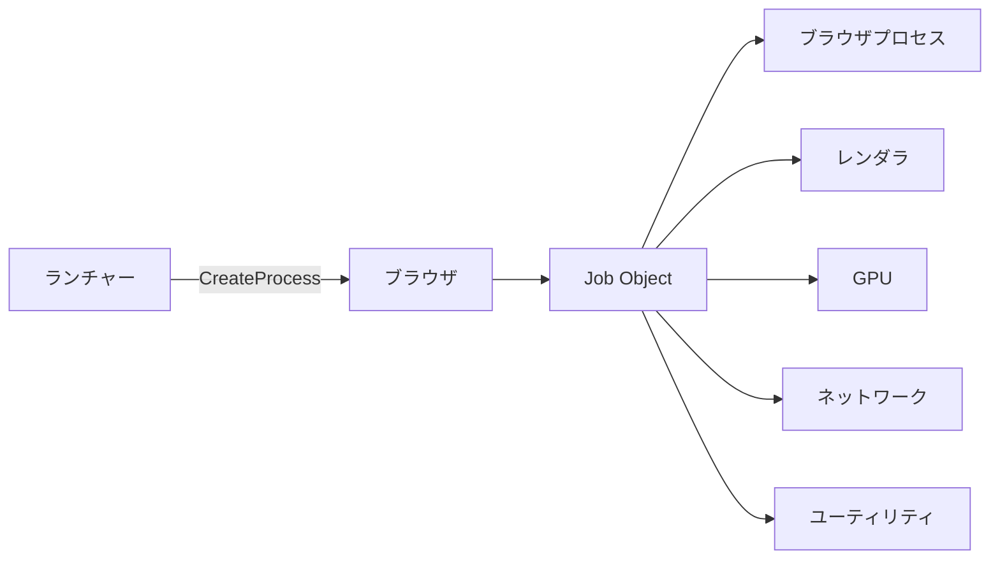
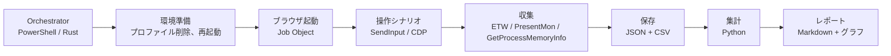

# 09. ベンチマーク計画

状態: 設計案（未実施）
確信度: 高（計測手法は確立済みの OS/API に基づく）、中（目標値は仮説）

## 1. 目的

1. 本製品が既存ブラウザに対して、どの指標で勝ち、どの指標で負けるかを、再現可能な形で示す。
2. 設計上の仮説（適応型タブ管理、WebResourceRequested のコスト、起動の固定費）を反証する。
3. 目標値を実測で置き換え、主張を修正する。

## 2. 仮説

| ID | 仮説 | 反証条件 |
|---|---|---|
| H1 | コールドスタートは Edge より短い | 中央値で Edge 以上 |
| H2 | 5 タブ総メモリは Edge 以下 | 中央値で Edge より 5% 以上多い |
| H3 | 20 タブ総メモリは Edge の +10% 以内 | +10% を超える |
| H4 | Warm タブ切替 p95 は 100ms 未満 | 100ms 以上 |
| H5 | 広告遮断の読み込み悪化は中央値 +3% 以内 | +3% を超える |
| H6 | アイドル CPU は Edge 以下 | Edge より高い |
| H7 | 8 時間連続でメモリ増加が 10% 未満 | 10% 以上、またはクラッシュ |

## 3. 比較対象

| ブラウザ | チャネル | 記録するバージョン |
|---|---|---|
| 本製品 | 開発ビルド | ホストのバージョン、WebView2 Runtime のバージョン |
| Microsoft Edge | Stable | `edge://version` |
| Google Chrome | Stable | `chrome://version` |
| Brave | Stable | `brave://version` |
| Firefox | Stable | `about:support` |

- すべて同一の拡張機能構成（なし）で測る。ただし Brave は標準の Shields を有効のまま測る（製品の既定値だから）。
- 本製品は広告遮断の ON/OFF 両方を測る。
- 各ブラウザのプロファイルは、測定ごとに新規作成する。

## 4. 環境

| 項目 | 固定内容 |
|---|---|
| OS | Windows 11 Pro 24H2 または 25H2（ビルド番号を記録） |
| CPU | 同一マシン。型番、コア数、HT の有無を記録 |
| メモリ | 16GB または 32GB。使用量を記録 |
| ストレージ | NVMe SSD。空き容量を 20% 以上確保 |
| GPU | 同一。iGPU/dGPU、ドライバ版を記録 |
| ディスプレイ | 解像度、リフレッシュレート、HDR の有無 |
| 電源 | 「バランス」。バッテリー節約を無効 |
| Windows Update | 測定中は一時停止 |
| Defender | 有効のまま。除外設定をしない（公平性のため） |
| ネットワーク | ページ読み込みはローカル HTTP サーバー。実サイトは別途「現実性チェック」として測る |
| バックグラウンド | 同期、OneDrive、Teams などを終了 |
| 温度 | 測定前に 10 分アイドル。サーマルスロットリングを避ける |

### 4.1 なぜローカルサーバーか

インターネットの遅延・CDN・広告配信の変動は、ブラウザ差より大きい。ページ読み込みの比較は、固定したローカルサーバーで行う。実サイトは「現実性チェック」として別に記録し、比較の主指標にしない。

ローカルサーバーのページセット:

| ID | 内容 | 目的 |
|---|---|---|
| P1 | 静的ニュース記事（画像 30 枚、CSS 5、JS 3） | 一般的なページ |
| P2 | SPA（大量の DOM、WebSocket） | レンダラ負荷 |
| P3 | 動画ページ（1080p30 H.264、10 分） | メディア |
| P4 | 広告密集ページ（既知の広告 URL を 50 個） | 遮断の性能 |
| P5 | 長い記事（テキスト 5 万字、画像 100 枚） | スクロールとメモリ |

## 5. 指標の定義

### 5.1 コールドスタート

| 指標 | 定義 |
|---|---|
| OS コールド | PC 再起動後、初回のブラウザ起動。`CreateProcess` から最初の `WM_PAINT` まで |
| アプリコールド | OS 起動後、ブラウザを終了した状態から起動。同上 |
| ウォーム | 終了後 60 秒以内の再起動。同上 |

- 起動完了の定義は「タブストリップとアドレスバーが描画され、入力を受け付ける」時点。
- ページの描画完了は別指標（5.5）。
- 計測は ETW の `Microsoft-Windows-Kernel-Process` と、ホストが打つカスタム ETW イベント。

### 5.2 メモリ

| 指標 | 定義 |
|---|---|
| Private Working Set | 各プロセスの `PROCESS_MEMORY_COUNTERS_EX.PrivateWorkingSetSize` の合計 [S31] |
| Commit | `PrivateUsage` の合計 |
| Working Set | 参考値。共有ページを含むため、主指標にしない |
| GPU メモリ | `GPU Process Memory` カウンタ、または CDP の `SystemInfo.getProcessInfo` |

手順:

1. タブを 1 / 5 / 20 / 50 枚開く。URL は固定セット（P1〜P5 を巡回）。
2. 最後のタブを開いてから 60 秒待つ（サスペンドのポリシーが落ち着くまで）。
3. 5 秒間隔で 12 回サンプリングし、中央値を取る。
4. 5 回繰り返す。

### 5.3 プロセスの帰属

- ランチャーが Job Object を作り、`JOB_OBJECT_LIMIT_KILL_ON_JOB_CLOSE` を設定する [S30]。
- ブラウザを Job に割り当て、子プロセスも自動的に Job に入る [S30]。
- Job 内のプロセスを列挙し、`GetProcessMemoryInfo` で合計する [S31]。
- **二重計上を避ける**: Working Set ではなく Private Working Set を使う。共有メモリ（フォント、DLL、GPU 共有サーフェス）は Private に含まれない。
- **計測漏れを避ける**: Job の外に出るプロセス（breakaway）が無いことを `IsProcessInJob` で確認する [S30]。
- WebView2 のブラウザプロセスは、同じ UDF を使う他のアプリと共有され得る [S05]。測定前に、同じ UDF を使うアプリが無いことを確認する。
- Edge の測定では、`msedge.exe` のプロセスツリーだけを対象にし、`msedgewebview2.exe`（他アプリの WebView2）を混ぜない。

### 5.4 タブ切替レイテンシ

| 指標 | 定義 |
|---|---|
| Warm 切替 | 非表示タブをクリックしてから、最初のフレームが present されるまで |
| Cool 復帰 | サスペンドタブをクリックしてから、最初のフレームまで |
| Cold 復帰 | 破棄タブをクリックしてから、`NavigationCompleted` + 最初のフレームまで |

- 入力は `SendInput` で行い、入力のタイムスタンプを ETW で記録する。
- フレームの present は PresentMon の CSV で確認する [S32]。
- 20 回試行し、中央値と p95 を報告する。
- クリック位置はタブストリップの同一座標に固定する。

### 5.5 ページ読み込み

| 指標 | 定義 |
|---|---|
| TTFB | ナビゲーション開始から最初のバイト |
| FCP | 最初のコンテンツ描画 |
| LCP | 最大のコンテンツ描画 |
| Load | `loadEventEnd` |
| リクエスト数 | ネットワークログの件数 |
| 遮断数 | ホストが遮断した件数 |

- Chromium 系は CDP の `Performance` と `Network` を使う。
- Firefox はリモートデバッグプロトコルを使う。
- ローカルサーバーは Cache-Control を `no-store` にし、毎回同じ条件にする。
- 10 回試行し、中央値と p95 を報告する。

### 5.6 アイドル CPU

- 5 タブを開いた状態で 10 分間放置。
- 各プロセスの `GetProcessTimes` の差分を合計し、経過時間で割る。
- 参考として、`powercfg /energy` のレポートを取る。

### 5.7 動画

- P3 を 10 分再生。
- CPU 時間、GPU 使用率、フレームドロップを記録。
- ハードウェアデコードの有無を確認する。

### 5.8 メモリ解放

- 20 タブを開いた後、10 タブを閉じる。
- 閉じた直後、1 秒後、5 秒後、30 秒後、60 秒後の Private Working Set を記録。
- Cool 化と Cold 化のポリシーが効いているかを確認する。

### 5.9 広告遮断

| 指標 | 定義 |
|---|---|
| 判定時間 | 1 リクエストあたりのホスト滞在時間（ETW） |
| スループット | 秒間の判定数（マイクロベンチ） |
| 遮断率 | 既知の広告リクエストのうち遮断された割合 |
| 誤遮断率 | 既知の正常リクエストのうち遮断された割合 |
| 読み込み悪化 | 遮断 ON/OFF の LCP と Load の比 |

- 遮断率のテストセットは、公開の広告テストページと、自前の固定 HTML（既知の広告 URL 50 個）を使う。
- 誤遮断は、主要 20 サイトの静的コピーで、画像・スクリプトの欠落を目視確認する。

### 5.10 長時間安定性

- 8 時間、5 分ごとに P1〜P5 を巡回。
- クラッシュ、ハング、メモリ増加、CPU の張り付きを記録。
- メモリ増加は、開始時と終了時の Private Working Set の比で見る。

### 5.11 消費電力

- ノート PC の場合、バッテリー駆動で 1 時間の同一操作を行い、`powercfg /batteryreport` の消費を比較する。
- デスクトップの場合、壁コンセントの電力計を使う。無い場合は省略し、CPU 時間で代用する。
- 電力は環境依存が大きいため、参考指標とする。

### 5.12 アプリサイズ

| 指標 | 定義 |
|---|---|
| インストーラ | 配布ファイルのサイズ |
| インストール後 | Program Files 配下のサイズ（WebView2 Runtime を除く） |
| 実行時ディスク | UDF とキャッシュのサイズ（1 時間閲覧後） |

WebView2 Runtime は共有コンポーネントなので、アプリサイズに含めない。含める場合は別欄に書く [S15]。

## 6. 統計

- 各条件 10 回以上。最初の 1 回はウォームアップとして除外。
- 中央値、IQR、p95 を報告する。
- 差の検定は Mann-Whitney U。有意水準 0.05。
- 効果量は Cliff's delta。
- 信頼区間はブートストラップ（10,000 回）。
- 生データを全件公開する。中央値だけを出さない。

## 7. 目標・予測・実測

| 指標 | 目標 | 予測（実測前） | 実測 |
|---|---|---|---|
| コールドスタート | Edge 未満 | Edge の 60〜80% | 未測定 |
| 5 タブメモリ | Edge 以下 | Edge の 70〜90% | 未測定 |
| 20 タブメモリ | Edge +10% 以内 | Edge の 90〜110% | 未測定 |
| 50 タブメモリ | 参考 | Edge の 90〜120% | 未測定 |
| Warm 切替 p95 | 100ms 未満 | 50〜90ms | 未測定 |
| Cool 復帰 p95 | 300ms 未満 | 150〜300ms | 未測定 |
| アイドル CPU | Edge 以下 | Edge の 50〜80% | 未測定 |
| 遮断の読み込み悪化 | +3% 以内 | +1〜5% | 未測定 |
| アプリサイズ | 20MB 未満 | 8〜15MB | 未測定 |

「予測」は設計上の見込みであり、約束ではない。実測後にこの表を更新し、外れた予測は理由を書く。

**PX2 の予備実測（2026-10-23、ローカル 500 リクエスト）**: 全件フック（all-allow）とフックなし（none）のナビゲーション時間は 324ms vs 321ms で、悪化は観測されなかった。遮断した all / hybrid は 243ms / 208ms に短縮した。実サイトと大量ルールは未検証である。詳細は [prototype/reports/px2-adblock.md](../../prototype/reports/px2-adblock.md)。

**PX3 の予備実測（2026-10-23、ローカル軽量ページ、各 1 回）**: Private メモリは 1 タブ 204 vs 373MB、5 タブ 290 vs 494MB、20 タブ 769 vs 852MB（本 vs Edge）。1/5 タブは大きく下回り、20 タブは -10%。起動は、本が全タブ読込完了、Edge がウィンドウ表示で定義が異なり、比較できない。詳細は [prototype/reports/px3-memory.md](../../prototype/reports/px3-memory.md)。

**PX3b の予備実測（2026-10-23、load ビーコン、各 3 回）**: 起動は 1 タブ 5.13 vs 5.90 秒、5 タブ 4.24 vs 7.56 秒、20 タブ 7.47 vs 6.73 秒（本 vs Edge）。5 タブは遅延復元で有利、1 タブは僅差、20 タブは逆転。分散が大きく、未確定。詳細は [prototype/reports/px3b-startup.md](../../prototype/reports/px3b-startup.md)。

**PX3c の予備実測（2026-10-23、暖機後、各 5 回）**: 1 タブ 481 vs 293ms、5 タブ 456 vs 310ms、20 タブ 534 vs 589ms（本 vs Edge）。1/5 タブでは Edge が明確に速い。20 タブは本が最初のタブのみ。**「起動が速い」は支持されず、Gate 1 は起動で不合格。** 詳細は [prototype/reports/px3c-startup.md](../../prototype/reports/px3c-startup.md)。

## 8. 合格基準

| ゲート | 条件 |
|---|---|
| G1 | H1（起動）と H2（5 タブメモリ）の両方が支持される。片方だけでは足りない |
| G2 | H5 が支持される（遮断が性能の主因にならない） |
| G3 | 8 時間試験でクラッシュが 1 回以下 |
| G4 | 誤遮断率が 1% 未満 |
| G5 | メモリの二重計上が無いことを、Job の会計と照合して確認 |

G1〜G3 のいずれかが失敗した場合、製品定義を見直す（12 の Go/No-Go）。

## 9. 自動化

- Orchestrator は各ブラウザを同じシナリオで操作する。
- シナリオは YAML で定義（タブを開く、待つ、切り替える、閉じる）。
- 再起動を伴う試験は、スケジュールタスクで自動化する。
- 生データは `bench/results/<date>/<browser>/<metric>.csv` に保存する。
- CI では実行しない（環境依存が大きい）。夜間に専用機で実行する。

## 10. 妥当性への脅威

| 脅威 | 影響 | 対策 |
|---|---|---|
| サーマルスロットリング | 後半の測定が遅くなる | 10 分アイドル、順序をランダム化 |
| Defender のスキャン | 起動が遅くなる | 測定前にフルスキャンを完了させる（除外はしない） |
| Windows Update | 再起動、CPU 使用 | 一時停止 |
| ネットワーク変動 | ページ読み込みの分散 | ローカルサーバー |
| プロファイル状態 | キャッシュ、Cookie の差 | 毎回新規作成 |
| 拡張機能 | ブラウザ差 | なしに統一（Brave の Shields は既定のまま） |
| バージョン差 | エンジンの差 | バージョンを記録し、同一週に測る |
| 共有プロセス | 二重計上 | Private Working Set、Job の確認 |
| 測定者の操作 | 入力タイミングのばらつき | SendInput と ETW |
| 少数サンプル | 偶然の差 | 10 回以上、中央値と CI |

## 11. 報告

- すべての生データとスクリプトを公開する。
- 「勝った指標」だけでなく「負けた指標」も出す。
- 目標を達成できなかった場合は、目標を下げるのではなく、設計を変えるか主張を撤回する。
