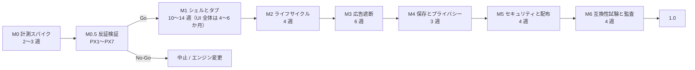
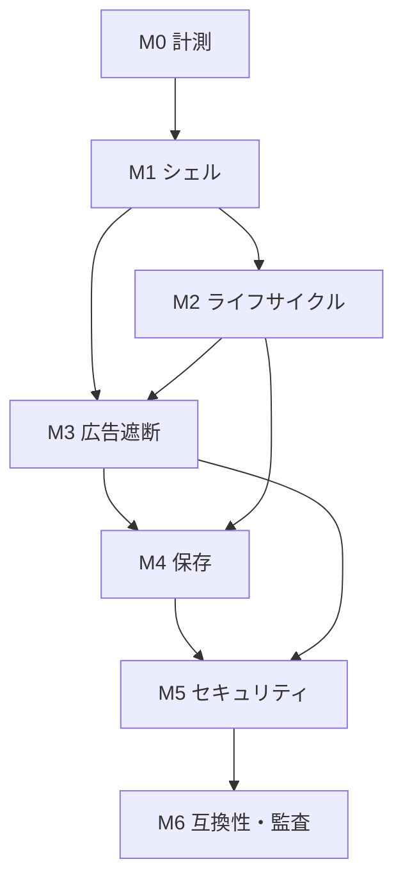

# 10. 実装ロードマップ

状態: 設計案（工数は推定）
確信度: 中（依存関係は確実、工数は未検証）

## 1. 前提

| 項目 | 前提 |
|---|---|
| チーム | 1〜3 人。Rust と Win32 の経験があることが望ましい |
| 期間 | 1 人なら 12〜15 か月、3 人なら 7〜9 か月（反証レビューで修正） |
| 予算 | 外部監査、コード署名、配布に別枠 |
| 対象 OS | Windows 11。Windows 10 はベストエフォート |
| リリース | まずは個人配布。ストア配布は後 |

工数は【推測】であり、PX1〜PX7 の結果で再見積もりする。PX6 の結果、UI だけで 4〜6 か月かかる。M1 の 10〜14 週は UI シェルとタブの一部にすぎない。

## 2. マイルストーン

### M0: 計測スパイク（2〜3 週）

目的: 設計の主要仮説を、最小のコードで反証する。

| 作業 | 成果物 | 終了条件 |
|---|---|---|
| Tauri v2 または wry で 5 タブのプロトタイプ | `spike/`（製品に持ち込まない） | 起動、タブ切替、URL 入力が動く |
| WebResourceRequested の全件フック | 計測ログ | リクエストあたりのホスト滞在時間が出る |
| 1/5/20 タブのメモリ | CSV | Private Working Set の合計が出る |
| コールド/ウォーム起動 | CSV | 中央値と p95 が出る |
| フィルタのコンパイル時間 | CSV | キャッシュ有無の両方 |
| Go/No-Go 判定 | `spike/report.md` | H1〜H3、H5 の可否 |

**M0 の終了時に、次のいずれかなら中止する。**

- 5 タブメモリが Edge を下回らず、起動も Edge を下回る。**PX3c で起動が未達（481 vs 293ms、456 vs 310ms）。この条件に該当し、M1 に進まない。**
- 全件フックの読み込み悪化が 10% を超え、ハイブリッドでも 5% を切らない。
- Tauri の IPC 注入を回避できないことが、セキュリティ上致命的と判断される（この場合は B に直行できるため、中止ではなく方針変更）。

### M0.5: 反証検証（PX1〜PX7、2〜3 週）

[13-refutation-review.md](13-refutation-review.md) の PX1〜PX7 を実行する。目的は、製品の可否を決めること。ミニブラウザは作らない。

| ID | 検証 | 判定 |
|---|---|---|
| PX1 | Google の完全ログイン、パスキーの認証完了、OAuth | 通らなければ WebView2 は失格 |
| PX2 | 遮断コスト（全件 / ハイブリッド / エンジン追跡防止） | 5% 以内、またはエンジン追跡防止に切替 |
| PX3 | 1/5/20 タブのメモリ、起動、切替 | 5 タブと起動で Edge を上回る |
| PX4 | Widevine、コーデック | 動画用途の可否 |
| PX5 | InPrivate の残留、AppContainer | プライバシー表示と隔離の可否 |
| PX6 | UI のクリックプロトタイプ | 1 人 12〜15 か月が妥当か。**完了: 404 行、生産 UI は 4〜6 か月** |
| PX7 | CEF Chrome スタイル（任意） | uBO とログインが通るか。**未実施（prebuilt cefclient なし、VS2022/CMake 必要）** |

PX1 の識別子画面は確認済みである。完全ログインとパスキーの認証完了が不合格で、対象ユーザーの過半が Google ログインを必要とするなら、M1 に進まない。CEF/Chromium を検討するか、中止する。

### M1: シェルとタブ（10〜14 週、UI 全体は 4〜6 か月）

| 週 | 作業 |
|---|---|
| 1 | Win32 ウィンドウ、DPI、テーマ、単一インスタンス |
| 2 | タブストリップ（Direct2D）、タブの生成・閉鎖・並べ替え |
| 3 | アドレスバー（EDIT、IME）、URL 正規化、検索 |
| 4 | WebView2 環境、コントローラ、ナビゲーション、履歴 |
| 5 | 戻る/進む/更新/停止、タイトル、favicon、ローディング |
| 6 | エラー画面、クラッシュ表示、最小の設定 |
| 7-8 | テスト、アクセシビリティの初歩、バグ修正 |
| 9-12 | UIA、ハイコントラスト、マルチモニタ DPI、エッジケース |
| 13-14 | 予備、性能回帰の修正 |

終了条件:

- 5 タブを開いて、移動・切替・閉鎖ができる。
- 日本語入力がアドレスバーとページで動く。
- レンダラ崩壊で該当タブだけ復旧する。
- 起動から 1 秒以内に UI が出る（目標）。

### M2: タブライフサイクル（4 週）

| 週 | 作業 |
|---|---|
| 1 | 状態機械、Warm/Cool、`TrySuspendAsync` |
| 2 | 保護ルール（音声、権限、ダウンロード、入力） |
| 3 | メモリ逼迫ポリシー、Cold 化、復元 |
| 4 | 計測、チューニング、09 の手法で再測定 |

終了条件:

- 20 タブで、非アクティブタブが Cool になる。
- 音声再生中のタブが Cool にならない。
- Warm 切替 p95 が 100ms 未満（目標）。
- メモリが 8 時間で 10% 以上増えない（目標）。

### M3: 広告遮断（6 週）

| 週 | 作業 |
|---|---|
| 1 | adblock-rust の統合、フィルタのパース、キャッシュ |
| 2 | WebResourceRequested のハイブリッド登録 |
| 3 | 遮断レスポンス、リソース種別、`$removeparam` |
| 4 | cosmetic 注入、サイト別例外、UI |
| 5 | 署名付き更新、ロールバック、テスト |
| 6 | 遮断率・誤遮断・性能の測定 |

終了条件:

- EasyList/EasyPrivacy を読み込める。
- 広告テストページで 80% 以上を遮断（目標）。
- 誤遮断率 1% 未満（目標）。
- 読み込み悪化が中央値 +3% 以内（目標）。
- フィルタ更新が署名検証を通る。

### M4: 保存とプライバシー（3 週）

| 週 | 作業 |
|---|---|
| 1 | SQLite スキーマ、履歴、ダウンロード履歴 |
| 2 | プロファイル、InPrivate、終了時削除 |
| 3 | 削除 UI、プライバシー表示、テスト |

終了条件:

- 通常とプライベートでデータが混ざらない。
- 終了時削除で Cookie とサイトデータが消える。
- 履歴の保存期間が機能する。
- クラッシュログが自動送信されない。

### M5: セキュリティと配布（4 週）

| 週 | 作業 |
|---|---|
| 1 | 権限ブローカー、ダウンロード検査、ナビゲーション制限 |
| 2 | 更新クライアント、署名検証、ロールバック |
| 3 | インストーラ（WiX/MSIX）、コード署名、初回起動 |
| 4 | セキュリティチェックリスト、ファジングの初回 |

終了条件:

- 署名なしの更新を拒否する。
- 危険な拡張子のダウンロードを警告する。
- 証明書エラーの例外処理が無い。
- インストーラが署名されている。
- 04 の不変条件 1〜10 をテストで確認する。

### M6: 互換性試験と監査（4 週）

| 週 | 作業 |
|---|---|
| 1 | 20 サイトの実機試験（08 のリスト） |
| 2 | 不具合修正、制約の UI 表示 |
| 3 | 外部ペネトレーションテスト |
| 4 | 修正、リリースノート、1.0 判定 |

終了条件:

- 20 サイト中 15 以上で主要操作が通る。
- 重大な脆弱性が 0。
- 既知の制約が UI と README に書かれている。
- 09 の G1〜G5 を満たす、または満たさない理由が明記されている。

## 3. 依存関係

- M3 は M2 と並行できるが、同じ UI スレッドを触るため、コンフリクトに注意。
- M4 は M1 の後なら早めに始められる。
- M5 の更新は M1 の後いつでも始められるが、署名鍵の管理は早めに決める。

## 4. テスト計画

### 4.1 単体

- URL 正規化、検索クエリ生成。
- フィルタのパースと照合（既知のルールセット）。
- タブ状態機械（遷移の全パターン）。
- 更新マニフェストの検証。
- ダウンロードの拡張子判定。

### 4.2 統合

- タブ生成 → ナビゲーション → サスペンド → 復帰。
- フィルタ適用 → 遮断 → ページの表示。
- プライベート → 終了 → データ削除。
- 更新 → 署名検証 → 適用。

### 4.3 E2E

- WebDriver（Microsoft Edge WebDriver）で WebView2 を操作できるか確認する。できない場合は、Win32 の UI Automation で操作する。
- 20 サイトのスモークテスト。
- 画像比較（スクリーンショット）で、レイアウト崩れを検出。

### 4.4 ファジング

- フィルタのパーサ（adblock-rust の入力）。
- 更新マニフェストの JSON。
- URL パーサ。
- ダウンロードのファイル名。

### 4.5 セキュリティ

- 04 の不変条件の自動テスト。
- COM 境界の呼び出しを網羅するテスト。
- 権限の既定拒否のテスト。
- 更新の署名偽装テスト。
- 外部ペネトレーションテスト（M6）。

### 4.6 性能

- 09 の自動ベンチを夜間に実行。
- 主要コミットで、起動と 5 タブメモリの回帰を検出。
- 回帰が 5% を超えたらマージを止める。

## 5. CI/CD

| 段階 | 内容 |
|---|---|
| PR | `cargo fmt`、`cargo clippy`、単体テスト、`cargo-audit` |
| main | 統合テスト、E2E のスモーク、ベンチの短縮版 |
| nightly | フルベンチ、ファジング、8 時間試験 |
| release | 再現ビルド、SBOM、コード署名、更新マニフェスト署名 |

- 依存はロックファイルで固定する。
- 新規依存はレビューを必須にし、`cargo-vet` の監査対象にする。
- ビルドは再現可能にする（タイムスタンプ、パスの除去）。

## 6. 人要員とスキル

| 役割 | 必須スキル | 目安 |
|---|---|---|
| リード | Rust、Win32、COM、WebView2 | 1 人 |
| UI | Direct2D、Win32、アクセシビリティ | 0.5〜1 人 |
| セキュリティ | 脅威モデル、ペネトレーション、署名 | 0.3〜0.5 人（外部でも可） |
| QA | 自動化、計測 | 0.5 人 |

1 人の場合、UI とセキュリティがボトルネックになる。外部監査と、UI の一部を外部に委託することを検討する。

## 7. リスクバッファ

| リスク | バッファ |
|---|---|
| Win32 UI の想定超過 | M1 に 2 週追加 |
| WebResourceRequested の性能問題 | M3 に 2 週追加、ハイブリッドの再設計 |
| 互換性の想定超過 | M6 に 2 週追加、対象サイトの見直し |
| セキュリティ監査の指摘 | M6 に 2 週追加 |

合計で 6〜8 週のバッファを見込む。

## 8. 最初の 2 週間でやること

1. 09 の環境を 1 台用意する。
2. Tauri v2 または wry で 5 タブのプロトタイプを作る（製品コードではない）。
3. WebResourceRequested を全件フックし、リクエストあたりの時間を測る。
4. Edge / Chrome / Brave の 1/5/20 タブメモリを測る。
5. 結果を `spike/report.md` に書き、H1〜H3、H5 を判定する。

この 5 つが終わるまで、製品コードを書かない。設計の前提が間違っていた場合、後戻りが大きい。
