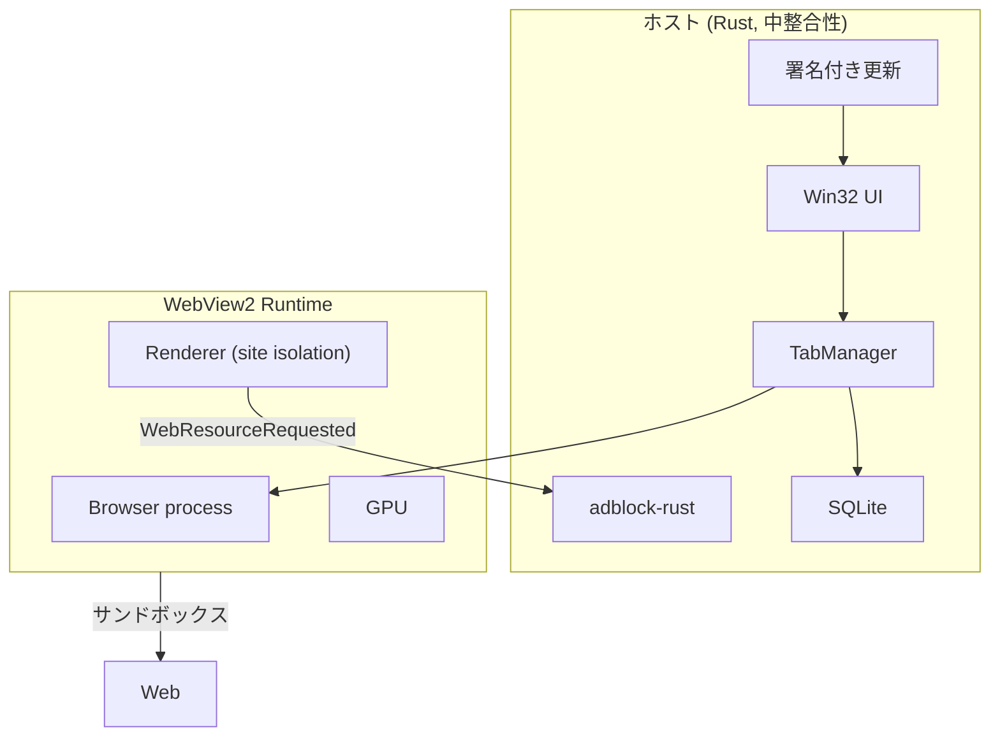

# 12. 最終推奨

状態: PX3c を受けて「軽量 + 高速」の推奨を取り下げ
確信度: 高（制約の根拠）、低（「軽量 + 高速」の成立）

## 0. 反証レビューによる修正

[13-refutation-review.md](13-refutation-review.md) は、本推奨の前提を崩す問題を挙げた。Chrome 拡張が必須なら、WebView2 は失格である。Widevine は PX4 で EME が supported だったが、実再生の確認が必要である。Google ログインと Windows Hello パスキーは PX1 で一部動作したが、完全ログインと認証完了の確認が必要である。さらに PX3c で、暖機後の起動が Edge より遅いと確認された。したがって、**当初の「軽量 + 高速」としての推奨は取り下げる**。以下の B' は、看板を再定義する場合の技術候補である。

## 1. 結論

**最終回答（一意）**:

- **当初の「軽量 + 高速」のブラウザとしては、B' を推奨しない。** PX3c で暖機後起動が Edge より遅い（1 タブ 481 vs 293ms、5 タブ 456 vs 310ms）[S52]。Gate 1 は起動で不合格である。
- **B' を続けるなら、看板を「メモリが軽い・プライバシー・制御」に再定義する。** 1/5 タブのメモリは Edge 以下 [S50]。ただし 20 タブは -10%、広告遮断はカバレッジで劣る。再定義した製品に需要があるかは未検証である。
- **再定義した製品に需要の証拠が無いなら、作らない。** CEF Chrome スタイル / Chromium フォークは、専任チームと Widevine ライセンスがある場合だけ例外的に検討する。

統合した最終報告と再定義案は [16-final-report.md](16-final-report.md)。再定義した製品の MVP は [18-mvp-implementation.md](18-mvp-implementation.md) で実装済みである。

Tauri v2 は最善ではない。Tauri は全 WebView に `isTauri` と `__TAURI_INTERNALS__` を注入し、複数 WebView は `unstable` である。ただし、これは致命傷ではなく二次的な問題である。wry は Tauri の下層で、`controller()` と `environment()` を公開し、IPC の自動注入が無い [S44]。製品の第一候補は wry、Tauri は 3 か月 MVP の妥協案、raw `webview2-com` は最大制御が必要な場合の第三候補とする。

**Gate 0 を通らないなら、WebView2 を選ばない。** CEF Chrome スタイルのスパイク（PX7）を行う。ただし PX7 は MSVC / cmake が無く、CEF 配布物にも prebuilt `cefclient.exe` が無いため未実施であり、行うならビルド環境を導入してからになる。uBO と Google ログインが通るかを確認する。それも通らなければ、Chromium フォーク（専任チームが必要）を検討するか、中止する。

### Gate 0（必須要件）

| 要件 | 必須なら | WebView2 の判定 |
|---|---|---|
| Google ログイン | PX1 で完全ログインを確認。不可なら失格 | 識別子画面は表示 [S47]。完全ログインは未検証 |
| Windows Hello パスキー | PX1 で登録・認証の完了を確認。不可なら失格 | UVPAA=true、プロンプト起動 [S47]。完了は未検証 |
| Widevine | PX4 で実再生を確認。不可なら対象外 | EME は supported [S48]。実再生は未検証 |
| Chrome 拡張 | CEF Chrome スタイル / Chromium フォーク | 失格 [S08] |
| 5 タブメモリと起動で Edge 超え | メモリと起動の両方 | メモリは 1/5 タブで合格方向 [S50]。起動は 1/5 タブで不合格（481 vs 293、456 vs 310ms）[S52] |

### Gate 1（性能と実装）

- PX1: 識別子（Google ログイン、パスキー）
- PX2: 遮断コスト（全件 / ハイブリッド / エンジン追跡防止）
- PX3: 1/5/20 タブのメモリ、起動、切替。メモリは 1/5 タブで Edge 以下、20 タブは -10% [S50]。起動は PX3c の暖機後で 1 タブ 481 vs 293ms、5 タブ 456 vs 310ms、20 タブ 534 vs 589ms（本は最初のタブのみ）[S52]。**起動で不合格。**
- PX4: DRM / コーデック
- PX5: InPrivate の残留、AppContainer。InPrivate はサイトデータ行を残さないが、空の History/Cookies DB と Local Storage、Code Cache、Crashpad は残る [S53]。AppContainer は未検証。
- PX6: UI プロトタイプは 404 行・14 コントロール。生産 UI は 4〜6 か月、M1 の 10〜14 週は UI だけで過小 [S54]。
- PX7: CEF Chrome スタイル（任意、未実施。CEF 配布物は確認したが prebuilt `cefclient.exe` は無く、MSVC / cmake も無い）

Gate 0 と Gate 1 の両方を通った場合だけ、M1 に進む。**PX3c の起動結果により、現時点では M1 に進まない。**

## 2. 三つの構成

### 構成 A: 理論上の性能・セキュリティを最大限重視

**内容**: Chromium をフォークし、独自のサンドボックス強化、ネットワークスタックの hardening、プロセス分離の細分化、Rust によるホスト、独自の更新基盤を持つ。Widevine のライセンスを取得し、拡張機能と Google ログインを成立させる。

**長所**:

- Chrome/Edge と同等の互換性（拡張、Google ログイン、DRM、Push、Payment）。
- プロセスモデルとサンドボックスを自前で制御できる。
- 広告遮断をエンジン内で実行でき、性能と遮断率の両立が可能。

**短所**:

- Chromium は 2 週間ごとにマイルストーン、毎週セキュリティ更新を出す [S29]。追随には専任チームが必要。
- Widevine のライセンス契約が必要。
- ビルド基盤、GPU ドライバ、印刷、IME、アクセシビリティ、クラッシュ対応を自前で持つ。
- 1〜3 人では、更新追随が遅れ、**セキュリティはかえって悪化する**。

**評価**: 理論上の上限は高いが、小規模チームでは実行できない。実行できない構成を「理論最大」として推奨することはできない。

### 構成 B: 開発・保守コストも考慮した現実的な最良

**内容**: Rust + Win32 ネイティブ UI + wry 経由の WebView2 制御。エンジンは Evergreen。広告遮断は adblock-rust + WebResourceRequested のハイブリッド（ただしエンジン追跡防止を主にする）。保存は SQLite + UDF。更新は署名付き。

**長所**:

- エンジンのセキュリティ更新を Microsoft に委ねられる [S15]。
- ホストの攻撃面を小さくできる（IPC 無し、ホストオブジェクト無し）。
- 固定費（起動、アイドル、1〜5 タブ）を小さくする余地がある。
- ネイティブ UI により、Web UI のレンダラをもう 1 つ持たない。

**短所**:

- 拡張、Push、Payment が無い [S08]。Widevine は PX4 で EME が supported だが、実再生は未検証 [S48]。Google ログインとパスキーは PX1 で一部動作したが、完全確認は未検証 [S47]。
- 広告遮断は uBO 同等にならない（フレーム URL が取れない [S18]）。
- ネイティブ UI の実装コストが高い。
- エンジンの 0-day には、Microsoft の更新まで待つしかない。

**評価**: 制約を製品契約として受け入れるなら、最もバランスがよい。

### 構成 C: 最小限の実装で仮説を検証するプロトタイプ

**内容**: Tauri v2 + WebView2 + adblock-rust。5 タブ、アドレスバー、簡易遮断。2〜3 週間。

**長所**:

- 最短で、起動・メモリ・遮断コストを測れる。
- 失敗しても捨てられる。

**短所**:

- Tauri は IPC ブリッジを全 WebView に注入する [S02]。
- 複数 WebView は `unstable` [S03]。
- 製品の土台にはしない。

**評価**: 計測専用として有用。製品構成ではない。

## 3. 比較

| 軸 | A | B | C |
|---|---|---|---|
| 互換性 | 高 | 対象限定 | 対象限定 |
| セキュリティ更新 | 自前（小規模では不利） | Microsoft | Microsoft |
| 攻撃面 | 中（新規コード大） | 小 | 中（IPC 注入） |
| 性能の上限 | 高 | 中〜高 | 中 |
| 開発コスト | 極大 | 大 | 小 |
| 3 年保守 | 困難 | 可能 | 不可 |
| 製品としての適性 | 資金次第 | 条件付き（再定義時） | 試作のみ |

## 4. なぜ B を技術候補にするのか

ただし、これは「軽量 + 高速」としての推奨ではない。PX3c で起動の優位が否定された。B は、看板を「メモリが軽い・プライバシー・制御」に再定義する場合の技術候補である。

1. **セキュリティ更新の継続性が最優先だから。** 小規模チームの fork は、更新遅延という形でセキュリティを下げる [S29]。
2. **エンジンのサンドボックスとサイト分離を維持できるから。** WebView2 は Edge と同じプロセスモデルを使う [S05][S26]。
3. **ホストの攻撃面を最小化できるから。** IPC を注入せず、ホストオブジェクトも Web メッセージも使わない [S16]。
4. **Tauri の抽象がブラウザに合わないから。** 全 WebView への `__TAURI_INTERNALS__` 注入 [S02] と、`unstable` な複数 WebView [S03] は、ブラウザの中核には受け入れにくい。ただし、これは wry に替えれば避けられる。wry は `controller()` と `environment()` を公開する [S44]。
5. **CEF は壁を解決しないから。** 拡張、Google ログイン、Widevine のいずれも、CEF にすれば自動的に解決するわけではない。
6. **ネイティブ UI がメモリに効くから。** Web UI のレンダラをもう 1 つ持たないことで、固定費を下げられる。ただし起動は Edge より遅い（PX3c）。
7. **制約を製品契約にできるから。** 実再生が通らない DRM と、完全ログインが通らないサイトを対象外にすれば、残る用途で価値を出せる。
8. **計測で反証できるから。** Phase 0 で、性能仮説を小さく検証できる。
9. **交換可能性を残せるから。** エンジン境界を trait で切り、将来の変更に備えられる。
10. **中止判断ができるから。** Phase 0 の結果で、製品化を止める基準を先に決められる。

## 5. なぜ A を選ばないのか

A は「理論上の最大」である。しかし、次の理由で推奨しない。

1. **更新の継続性が、機能の多さに勝る。** 更新できないブラウザは、Google ログインができても安全ではない。
2. **Widevine のライセンスが不確実。** 技術だけでなく、契約の問題である。
3. **1〜3 人では、fork の保守が本業を圧迫する。** セキュリティ更新、GPU、印刷、IME、アクセシビリティのすべてを抱えることになる。
4. **「セキュリティを最大化する」という目的に反する。** 小規模チームの fork は、更新遅延のリスクを負う。

A を選ぶべきなのは、**専任の Chromium チームと Widevine の契約を持ち、更新を 1 週間以内に追随できる組織**だけである。その条件が無いなら、A は「理想」ではなく「負債」になる。ただし、Gate 0 で Google ログインや拡張が必須になった場合は、A か CEF Chrome スタイルを比較せざるを得ない。WebView2 に留まる選択肢は無い。

## 6. 最終アーキテクチャ

## 7. 受け入れるリスク

| リスク | 受容理由 | 緩和 |
|---|---|---|
| Google の完全ログイン | PX1 では識別子画面まで。完全ログインは未検証 [S47] | 使い捨てアカウントで同意画面と Gmail を確認 |
| Widevine の実再生が通らない | EME は supported [S48]。実再生は未検証 | 公開テストストリームと Netflix で確認 |
| 拡張不可 | エンジンの制約 [S08] | 広告遮断を内蔵 |
| 遮断率が uBO 未満 | フレーム URL が取れない [S18] | コンテキスト非依存ルールに集中 |
| エンジン 0-day | Microsoft 依存 | 再起動促進、ESM の選択肢 |
| ネイティブ UI の工数 | 性能のため | M1 のバッファ、外部委託 |

## 8. Go / No-Go

### Go

- Gate 0: Chrome 拡張が必須なら WebView2 は失格。Widevine は実再生を確認。Google ログインとパスキーは PX1 の完全確認が必要。
- PX1: WebView2 で進む場合、Google の完全ログインとパスキーの認証完了が通る。
- PX3c: 5 タブメモリが Edge 以下、**かつ**最初のタブの起動が Edge 未満。メモリは合格方向だが、起動は不合格（481 vs 293、456 vs 310ms）。事前起動などで挽回する場合だけ再測定する。
- PX2: ハイブリッド遮断の読み込み悪化が 5% 未満、またはエンジン追跡防止で許容できる。
- PX6: 1 人 12〜15 か月以内の見込み。ただし UI だけで 4〜6 か月かかり、M1 の 10〜14 週では足りない。
- 法務がフィルタのライセンスを許容する。

### No-Go

- PX1 で Google の完全ログインが拒否される、またはパスキーの認証完了が通らない。
- PX4 で Widevine の実再生が通らない。
- PX3c で起動の優位が無い（1/5 タブで Edge より遅い）。
- PX7（CEF）が未検証のまま、または失敗し、Chromium フォークのコストも許容できない。
- 法務がフィルタを許容しない。
- 事業の継続方法が無い。

No-Go の場合、**構成 A に進まない**。中止するか、対象を業務用 kiosk に絞る。WebView2 の設計を微修正して続行しない。

**現時点の判定: No-Go（「軽量 + 高速」として）。** PX3c で起動の優位が否定された。再定義する場合は M1 ではなく、需要検証（「メモリが軽い・プライバシー・制御」に金を払う人がいるか）に戻る。

## 9. 次の作業

1. **PX1 の続きを実施する。** 識別子画面は確認済みである。次に、使い捨ての Google アカウントで OAuth の同意画面、Gmail、再ログインを確認する。資格情報は保存しない。
2. パスキーの登録を最後まで完了し、再ログインできるか確認する。Windows Hello の操作が必要である。
3. PX2（遮断コスト）は完了。PX3c で暖機後起動を測り、Edge より遅いと確認した。事前起動のトレードオフ（起動 200ms とメモリ +50〜100MB）を測るか、看板を再定義する。
4. PX4〜PX6（DRM、プライバシー、UI 工数）を実施する。
5. PX7 は MSVC / cmake を導入してから実施する（現環境では未実施）。
6. `prototype/reports/px1-identity.md` と PX2〜PX6 の結果、PX7 の可否を書き、Go/No-Go を決める。
7. Go なら M1 へ。現時点は No-Go。再定義するなら需要検証に戻る。
8. 需要検証は [17-redefinition-and-demand-validation.md](17-redefinition-and-demand-validation.md) の 3 週間計画で行う。データが集まるまで M1 に進まない。

この順序を守る。設計の前提を測らずに、製品コードを書き始めない。
