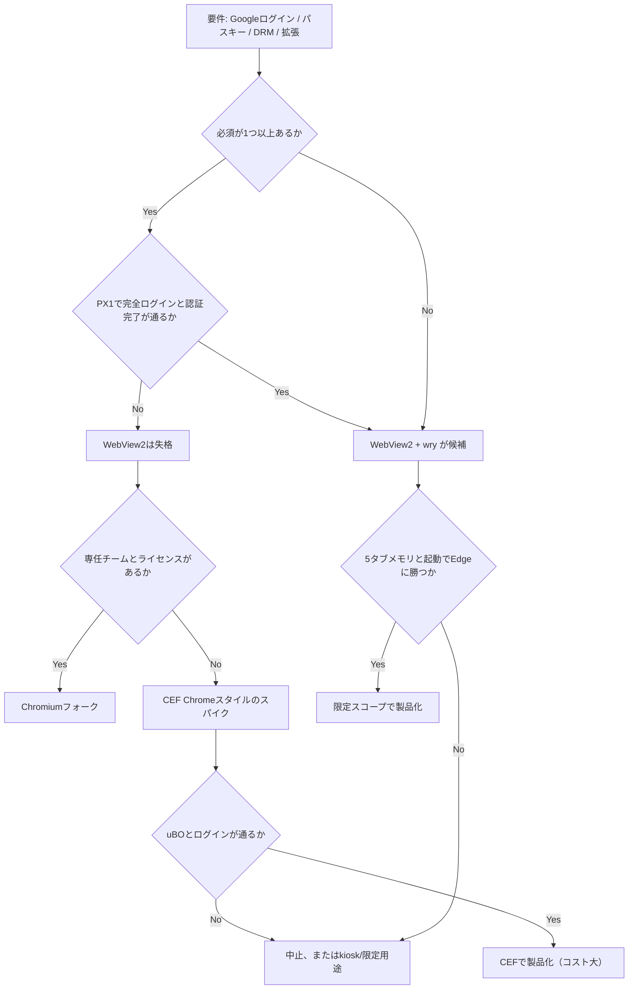

# 13. 反証レビュー — この設計を破綻させる問題

状態: 反証レビュー完了。設計の一部を撤回・修正。
日付: 2026-10-23
立場: 設計への賛同はしない。実装前に止めるべき理由を探す。

## 0. 判定

**現状の設計のまま、本格実装に進むべきではない。** ただし、PX1 の実機試験で、当初の「致命的」の 1 つが条件付きに変わった。

理由は「実装が足りない」ではない。**製品の成立条件が、エンジンの選択と利用者の要求の間で矛盾している**からである。WebView2 を選ぶと、公式には Google ログイン、パスキー、Widevine、拡張機能を失う。ただし、PX1 では Google OAuth の識別子画面と Windows Hello のプロンプトが動作し、PX4 では Widevine/PlayReady の EME が supported だった。完全ログイン、実再生、拡張は未検証である。必要としない利用者に絞ると、市場がどの程度残るかは未検証で、設計はその市場を都合よく仮定している。

| 分類 | 件数 | 内容 |
|---|---|---|
| 致命的（設計の前提を壊す） | 2 | 広告遮断のカバレッジ天井、起動の優位の否定（PX3c） |
| 条件付き（PX で一部反証・支持、完全確認が必要） | 2 | 識別子の壁、DRM の壁 |
| 重大（実装前に解消が必要） | 6 | UI 工数、プライバシー表示、セキュリティの TCB、Tauri の位置づけ、CEF/Chromium の再評価、法務・事業 |
| 設計が生き残る部分 | 5 | 制約の整理、脅威モデル、ベンチ計画、フィルタのカバレッジ表、署名更新 |

## 1. 方法と新しい証拠

前回の設計は、WebView2 の公式ドキュメントを中心に作った。今回は、**設計に不利な一次資料**を追加で探した。

| ID | 資料 | わかったこと |
|---|---|---|
| [R01] | Google OAuth 2.0 Policies | 埋め込みユーザーエージェントへの OAuth 要求を禁止。スクリプト挿入・要求改変・Cookie アクセスができる環境を明示的に問題視 |
| [R02] | WebView2Feedback #5663 | Windows Hello のパスキーが WebView2 で動かない報告。`isUserVerifyingPlatformAuthenticatorAvailable()` が false |
| [R03] | WebView2Feedback #4303 | `WebResourceRequested` が WebSocket で発火しない。Microsoft は backlog と回答 |
| [R04] | WebView2 Performance best practices | コールドスタートは既知のボトルネック。各コントロールがプロセス群を起動し、メモリと起動のオーバーヘッドになる |
| [R05] | WebView2Feedback #3637 | InPrivate でもプロファイルが作られ、ディスクに残る。in-memory モードは無い |
| [R06] | CEF issue #3859 | Alloy スタイルでは `chrome://extensions` はブロックされるが、RequestContext レベルの拡張機能は動く |
| [R07] | WebView2Feedback #198 | WebView2 を AppContainer のプロセスから動かすことはサポートされる |
| [R08] | wry のソース | Windows で `controller()` と `environment()` を公開。Tauri を介さず WebView2 を直接制御できる |
| [R09] | Brave adblock-lists のライセンス | MPL-2.0。Brave のリストは再利用の候補になる |
| [R10] | Microsoft Edge Sleeping Tabs | 平均 32% のメモリ削減、37% の CPU 削減（ベンダー報告） |
| [R11] | WebView2 の機能差表 | 拡張、Google 認証、Web Push、Payment、Periodic Sync が無い |
| [R12] | WebView2 のプロセスモデル | 1 UDF に 1 ブラウザプロセス。レンダラはサイト分離で共有 |
| [R13] | Chromium のリリースサイクル | 2 週ごとのマイルストーン、毎週のセキュリティ更新 |
| [R14] | Google の埋め込み WebView ブログ | 2021-09-30 以降、埋め込み WebView の OAuth を拒否 |
| [R15] | WebView2Feedback #455 | reCAPTCHA やポップアップを使うログインが WebView2 で失敗する報告 |
| [R16] | WebResourceRequestedEventArgs | 引数に発信元フレーム URL が無い |
| [R17] | WebView2 の通信管理 | ホスト UI スレッドへの往復と読み込み待ち |
| [R18] | ICoreWebView2WebResourceRequest | `put_Uri` による URL 書換が可能 |
| [R19] | WebView2 の UDF | Cookie、DOMStorage、IndexedDB、CacheStorage、履歴の保存種別 |
| [R20] | EasyList のライセンス | GPL-3.0+ または CC BY-SA 3.0+ |
| [R21] | PreferredTrackingPreventionLevel | プロファイル単位で追跡防止レベルを設定できる |
| [R22] | PX1 WebView2 identity probe | Google OAuth の識別子画面、UVPAA=true、Windows Security プロンプトを実機で確認 |
| [R23] | PX4 WebView2 DRM/EME probe | Widevine/PlayReady の EME が supported。実再生は未検証 |
| [R24] | PX2 adblock cost probe | 500 リクエストの全件フックで、none と all-allow の差は観測されず |
| [R25] | PX3 multi-tab memory probe | 1/5/20 タブの Private メモリが Edge を下回る。起動は定義が異なり未判定 |
| [R26] | PX3b fair startup probe | 1/5/20 タブの起動は 5.13/4.24/7.47 vs 5.90/7.56/6.73 秒。分散大で未判定 |
| [R27] | PX3c warm startup probe | 暖機後 1/5 タブで Edge が速い（481 vs 293ms、456 vs 310ms） |
| [R28] | PX5 privacy probe | InPrivate はサイトデータ行を残さないが、空の History/Cookies DB と Local Storage 等のファイルは残る |
| [R29] | PX6 UI prototype | 404 行・14 コントロール。生産 UI は 4〜6 か月と推定 |
| [R30] | PX7 CEF feasibility | CEF 156 standard を確認。prebuilt cefclient なし、VS2022/CMake 必要。未実行 |

## 2. 深刻な欠陥

### F1. 識別子の壁 — Google ログインとパスキー（PX1 で一部反証）

**何が問題か**: 日常利用の中心にある「ログイン」が、公式には制限されている。

- Google は公式には埋め込み WebView の OAuth を拒否し、WebView2 も対象とされている [R11][R14]。
- Google のポリシーは、スクリプト挿入・要求改変・Cookie アクセスができる環境を OAuth の信頼境界の外に置いている [R01]。本設計は広告遮断のためにその機能を持つ。
- パスキーは、WebView2 で Windows Hello が使えないという報告がある [R02]。UVPAA が false になり、プロンプトが出ないという内容である。

**PX1 の結果（2026-10-23、Windows 11、WebView2 155）** [R22]:

- Google の通常ログイン画面は表示され、ダミーメールを入力すると「アカウントが見つかりません」と表示された。`disallowed_useragent` は出なかった。
- OAuth 2.0 Playground の client_id で Google の認可エンドポイントに遷移すると、識別子画面が表示された。即時のブロックは無かった。
- `UVPAA` は true を返し、webauthn.io と GitHub の passkey 操作で `Windows Security` のプロンプト（CredentialUIBroker）が起動した。

**PX1 でまだ言えないこと**:

- 実アカウントでのパスワード入力、同意画面、Gmail、OAuth コールバック。
- パスキーの登録・認証の完了、再ログイン、attestation。
- 別の Windows、VDI、WebView2 バージョンでの再現性。

**評価**: F1 は「即失格」ではない。「完全ログインが通るかを PX1 で確認し、通らなければ失格」に格下げする。公式文書と実機が矛盾するため、どちらかを一方的に信じない。

**反論への反論**: 外部ブラウザでログインしても、Gmail の Web セッションは本ブラウザに移らない。これは変わらない。ただし、本ブラウザ内で OAuth が通る可能性が PX1 で示されたため、外部委譲を前提にしない。

**結論**: Google ログインとパスキーは、条件付きで成立する可能性がある。完全ログインの確認が Gate 0 の条件である。

### F1b. DRM の壁 — Widevine（PX4 で一部反証）

**何が問題か**: 公式には、WebView2 は Widevine を提供しないとされてきた [R11]。Netflix、Prime Video、Disney+、Spotify は Widevine を要求する。

**PX4 の結果（2026-10-23、Windows 11、WebView2 155）** [R23]:

- `navigator.requestMediaKeySystemAccess` は、`com.widevine.alpha`、`com.microsoft.playready`、`org.w3.clearkey` のすべてで supported を返した。
- Netflix のトップと Spotify Web は表示された。ログイン前のため、再生は未検証である。
- Bitmovin の DRM デモは、manifest の読み込みに失敗した（`SOURCE_COULD_NOT_LOAD_MANIFEST`）。DRM ライセンスか、ネットワーク・同意ダイアログ・CORS かは未切り分けである。

**評価**: 「Widevine 非対応」は、この環境では再現しない。ただし、EME の supported は、ライセンス取得、HDCP、robustness、Netflix のポリシーを保証しない。**実再生の確認が必要**である。

**結論**: DRM は「即失格」ではない。「PX4 で実再生が通るかを確認し、通らなければ対象外にする」に格下げする。

### F2. 広告遮断のカバレッジ天井

**何が壊れるか**: 「Brave/uBO 級の遮断」という差別化が成立しない。

- `WebResourceRequested` は発信元フレームの URL を渡さない [R16]。`$third-party` と `$domain` は近似になる。
- リクエストはホストの UI スレッドに渡され、ページの読み込みが待たされる [R17]。ただし、PX2 では 500 リクエストの全件フック（all-allow）とフックなし（none）のナビゲーション時間に差がなかった（324ms vs 321ms）[R24]。性能の一般化は、この環境では支持されない。
- WebSocket ではイベントが発火しない [R03]。WebSocket を使う広告・トラッカーは素通りする。
- `$csp` はレスポンスヘッダを変更できないため実装できない [R17]。
- サービスワーカー由来の要求は、種別は取れても文脈が無い。
- `$removeparam` は `put_Uri` で部分対応できるが、署名付き URL や CORS を壊す危険がある [R18]。

**なぜ致命的か**: 本設計の差別化は「軽量 + 強い遮断」である。遮断のコストは PX2 では観測されなかったが、**カバレッジと精度が uBO に届かない**。Brave はエンジン内で遮断するため、フレーム URL と WebSocket を扱える。この差は、実装の工夫では埋まらない。

**代替案の評価**:

| 案 | 遮断率 | 性能 | セキュリティ | 判定 |
|---|---|---|---|---|
| 全件 `WebResourceRequested` | 中〜高 | PX2 では許容（500 req） | ホストが全通信を見る | 条件付き |
| ハイブリッド | 中 | 良好（PX2 最速） | 同上 | 条件付き |
| エンジンの追跡防止のみ | 低〜中（Microsoft のリスト次第） | 良い | ホストは通信を見ない | 最有力 |
| CDP Fetch で横取り | 中〜高 | 不明（JSON 往復） | さらに強い MITM | 実験のみ |
| ローカルプロキシ（TLS MITM） | 高 | 悪い | 壊滅的（TLS の信頼を壊す） | 不採用 |

**結論**: 広告遮断を主役にするなら、WebView2 は適さない。理由は速度ではなく、**フレーム URL、WebSocket、CSP の欠落**である。WebView2 で作るなら、遮断は「エンジンの追跡防止 + 小さな厳選リスト」に留め、uBO 互換を捨てるべきである。これは製品の性格を「広告遮断ブラウザ」から「プライバシーブラウザ」に変える。

### F3. 差別化の失敗 — 起動は Edge より遅い

**何が壊れるか**: 「Edge より軽い」という主張の根拠が、実測ではなく願望である。

- WebView2 は Edge と同じエンジンである [R12]。レンダラと GPU のコストは同じ方向に動く。
- Microsoft の性能ガイドは、コールドスタートを既知のボトルネックとし、各コントロールがプロセス群を起動すると説明する [R04]。タブごとにコントロールを作る設計は、このコストをタブ数分だけ払う可能性がある。
- Edge は sleeping tabs を持つ [R10]。20〜50 タブで Edge を上回る根拠は無い。
- Edge は OS に同梱され、起動経路が最適化されている。新規アプリがコールドスタートで勝てる保証は無い。
- WebView2 のプロセスモデルの文書は「1 UDF に 1 ブラウザプロセス」と説明する [R12] が、性能ガイドは「各コントロールがプロセス群を起動する」と説明する [R04]。**公式文書の間にニュアンスの差があり、実測なしには結論できない。**
- **PX3 の初期実測（1 回、軽量・同一オリジン）では、Private メモリが 1 タブ 204 vs 373MB、5 タブ 290 vs 494MB、20 タブ 769 vs 852MB だった [R25]。** 1/5 タブは大きく下回り、20 タブは -10% にとどまる。
- **起動は未判定である。** 本プロトタイプは全タブの読み込み完了まで、Edge はウィンドウ表示までを測っており、定義が異なる [R25]。

- **PX3c では、同じ UDF / プロファイルを再利用した暖機後起動を測った。1 タブ 481.5 vs 293.1ms、5 タブ 456.3 vs 310.5ms で Edge が速い。20 タブは本 533.8 vs Edge 588.8ms だが、本は最初のタブのみである [R27]。** 起動の優位は否定された。

**なぜ致命的か**: 差別化が「軽量 + 高速」なら、起動で Edge に負けた時点で、その看板は崩れる。メモリは 1/5 タブで優位だが、20 タブでは -10% に縮む。広告遮断は F2 でカバレッジの天井があり、プライバシーは Edge の設定でもある程度達成できる。価格は無料。乗り換える理由が残らない。

**結論**: Gate 1 は起動で不合格。設計の「起動が速い」を撤回する。製品を続けるなら、看板を「メモリが軽い・プライバシー・制御」に限定し、起動の速さを主張しない。その製品に十分な需要があるかは未検証である。起動の優位を必須にするなら、中止する。

## 3. 重大な欠陥

### M1. ネイティブ UI の工数が非現実的

「最小限の UI」と言っても、ブラウザには次が必要である。

- タブストリップ（生成、閉鎖、並べ替え、固定、復元、オーバーフロー、ドラッグ）
- アドレスバー（IME、選択、コピー、検索、履歴候補、セキュリティ表示）
- 戻る/進む/更新/停止、ホーム、ズーム、全画面、PiP
- 履歴、ダウンロード、権限、設定、Cookie 管理
- 検索（ページ内）、印刷、PDF、コンテキストメニュー
- エラー画面、証明書エラー、HTTP 認証、ファイル選択
- マルチモニタ DPI、ハイコントラスト、UIA、RTL
- クラッシュ復旧、セッション復元、タブ復元

1 人で 6 か月は楽観的である。M1 の 6〜8 週では、タブとアドレスバーの基本だけで埋まる。アクセシビリティとエッジケースを入れると、2〜3 倍かかる。

PX6 の UI プロトタイプは 404 行・14 コントロールで、タブ、アドレスバー、履歴、設定、権限、ダウンロードの基本だけを実装した。生産 UI は、タブモデル、永続化、アクセシビリティ、DPI、復元、更新 UI を含めると 4〜6 か月と推定される [R29]。**M1 の 10〜14 週は、UI だけで過小である。**

**修正**: ロードマップを 1 人 12〜15 か月、3 人 7〜9 か月に修正する。UI を外部委託するか、Tauri/wry の Web UI を妥協して使う判断が必要。

### M2. プライバシー表示が誇大

- InPrivate でもプロファイルが作られ、ディスクに残る [R05]。in-memory モードは無い。
- PX5 では、InPrivate のサイトデータ行（cookie / history / localStorage / IndexedDB）は再起動後に残らなかった。一方、空の History / Cookies DB（249,856B / 20,480B）と Local Storage LevelDB、Code Cache、Crashpad は残った。**「サイトデータは残らないが、プロファイルの痕跡は残る」** が正確である [R28]。
- UDF には Cookie、LocalStorage、IndexedDB、CacheStorage、履歴、設定が保存される [R19]。
- 削除は物理的な消去を保証しない。
- クラッシュダンプを無効にしても、OS のページファイル、休止状態ファイル、 prefetch、DNS キャッシュは残る。

「プライベートモードで痕跡が残らない」と表示することはできない。表示は「セッション終了時に削除を要求する。ディスク上に残る可能性がある」に修正する。

### M3. セキュリティの TCB が大きすぎる

- ホストは全リクエストを見て、ページにスクリプトを注入する。これは Google が OAuth で問題視する「MITM 可能なホスト」そのものである [R01]。
- フィルタ更新のサプライチェーンを破られると、全ページの資格情報が危険にさらされる。
- 同一ユーザーのマルウェアは UDF を読める。AppContainer でホストを動かせば緩和できる可能性がある [R07] が、WebView2 の COM、ファイルアクセス、ドラッグドロップ、印刷の挙動を再検証する必要がある。
- 「攻撃面が小さい」と言いながら、独自の通信フック、フィルタエンジン、更新、ダウンロード、保存を持つ。Edge の同等機能は、はるかに大きく監査されている。**ホストが小さいことは、ホストが安全であることを意味しない。**

**修正**: AppContainer を P1 の実験にする。スクリプトレットは無効のまま。フィルタの署名と固定を必須にする。ホストのコードサイズと `unsafe` の数を公開する。

### M4. Tauri は「最善」ではないが、主要な問題ではない

- Tauri は全 WebView に `__TAURI_INTERNALS__` を注入する。これは事実である。
- しかし、Tauri を使わなくても、WebView2 の識別子・広告遮断・差別化の問題は残る。**Tauri は致命傷ではなく、二次的な問題である。**
- wry は Tauri の下層で、`controller()` と `environment()` を公開する [R08]。IPC の自動注入が無い。タブを子 WebView として作れる。Tauri より製品に適する。
- 1 人で 3 か月以内に MVP を出すなら、Tauri は妥当な加速装置である。capability を絞り、リモート IPC を許可しなければ、実害は限定的である。「Tauri を製品に使わない」という断言は強すぎた。

**修正**: 製品の第一候補を「wry + ネイティブ UI」に変える。Tauri は「3 か月 MVP の妥協案」として残す。raw webview2-com は「最大制御が必要な場合」の第三候補にする。

### M5. CEF / Chromium を切るのが早すぎた

- CEF は Alloy スタイルで `chrome://extensions` をブロックするが、RequestContext レベルの拡張機能は動く [R06]。Chrome スタイルのウィンドウにすれば、拡張機能の UI も視野に入る。
- つまり「CEF では uBO が使えない」は言い過ぎである。CEF で拡張機能を読み込める可能性があり、その場合は WebView2 より遮断の自由度が高い。
- Chromium フォークは、Google ログイン、パスキー、Widevine、拡張のすべてを成立させ得る最も確実な経路である。コストは高いが、**WebView2 で製品が成立しないなら、比較すべきは「CEF Chrome スタイル」と「Chromium フォーク」であり、WebView2 ではない。**
- **PX7 は、CEF 標準配布物（156.0.7、366,862,060 バイト）を確認したが、`cefclient.exe` は含まれず、`tests/cefclient` のソースのみだった。** `bootstrap.exe` は `Missing module name` で終了する。ビルドには Visual Studio 2022 と CMake が必要で、現在の環境には無い。CEF の成立は未検証である [R30]。
- CEF の拡張機能サポートは限定的で、uBO が要求する API をすべて満たす保証はない。Widevine のライセンスも解決しない。したがって CEF は「無料の解決策」ではないが、「検証する価値のある中間案」である。

**修正**: CEF Chrome スタイルの 1〜2 週間のスパイクを追加する。目的は「uBO が動くか」「Google ログインが通るか」「配布サイズと起動が許容範囲か」の 3 点。

### M6. 法務・事業・配布

- EasyList は GPL-3.0+ または CC BY-SA 3.0+ [R20]。無改変配布でも、コンパイル済みキャッシュや合成リストが派生著作物と解釈される可能性がある。法務確認が必要。
- uBO の uAssets は GPL-3.0。スクリプトレットを同梱すると、GPL の条件が及ぶ可能性がある。
- Brave の adblock-lists は MPL-2.0 [R09]。MPL はファイル単位の copyleft で、GPL より扱いやすい。ただし上流リストのライセンスが残る可能性がある。
- Widevine はライセンス契約が必要。個人開発者が取得できる保証はない。
- コード署名（EV）の費用、SmartScreen の評判、更新サーバーの運用、プライバシーポリシー、利用規約が必要。
- テレメトリ無し、広告無し、同期無しでは、継続的な収益の道が無い。これは技術設計ではないが、製品の存続条件である。

## 4. 設計が生き残る部分

反証しても、次の部分は有効である。

1. **WebView2 の能力と制約の整理**（02、06、08）。これはエンジン選定の基礎資料として使える。
2. **脅威モデル**（04）。とくに「ホストが MITM である」「フィルタ供給網が危険」「同一ユーザーのマルウェアに Cookie を守れない」という指摘。
3. **ベンチマーク計画**（09）。Job Object、Private Working Set、PresentMon、CDP の使い方は、エンジンが変わっても再利用できる。
4. **フィルタのカバレッジ表**（06）。どの構文が使え、どれが使えないかの整理は、CEF や Chromium に移っても役立つ。
5. **署名更新とプライバシー既定値**（ADR-0007、ADR-0008）。エンジンに依存しない。

## 5. 何を変えるべきか

### 5.1 製品定義を先に決める（エンジンより先）

| 質問 | Yes の場合 | No の場合 |
|---|---|---|
| Google ログインが必須か | PX1 で完全ログインを確認。不可なら WebView2 は失格 | WebView2 の可能性が残る |
| パスキーが必須か | PX1 で登録・認証の完了を確認。不可なら失格 | WebView2 の可能性が残る |
| Widevine の実再生が必須か | PX4 で実再生を確認。不可なら WebView2 は対象外 | WebView2 の可能性が残る |
| Chrome 拡張が必須か | WebView2 は失格。CEF Chrome スタイル / Chromium フォーク | WebView2 の可能性が残る |
| 5 タブメモリと起動で Edge に勝つことが必須か | 実測で確認。未達なら中止 | 「プライバシーと小ささ」に価値を置ける |

Google ログインとパスキーは、PX1 の識別子画面・プロンプト起動だけでは「必須を満たした」と判定しない。完全ログインと認証完了が条件である。Widevine と拡張が必須なら、WebView2 を選ぶ理由は無い。

### 5.2 エンジンの再候補

| 候補 | Google ログイン | パスキー | Widevine | 拡張 | 更新 | コスト |
|---|---|---|---|---|---|---|
| WebView2 | 識別子画面は表示。完全ログイン未検証 | UVPAA=true、プロンプト起動。完了未検証 | EME supported、実再生未検証 [R22] | 不可 | Microsoft | 小 |
| wry + WebView2 | 同上 | 同上 | 同上 | 同上 | Microsoft | 小〜中 |
| CEF Chrome スタイル | 未検証（可能性） | 未検証 | ライセンス次第 | 一部可能 [R06] | 自前 | 大 |
| Chromium フォーク | 可能（ブラウザ扱い） | 可能 | ライセンス次第 | 可能 | 自前（専任） | 極大 |
| Gecko フォーク | 可能 | 可能 | ライセンス次第 | 可能 | 自前 | 極大 |

`wry + WebView2` は Tauri の代替として有力だが、F2（広告遮断）と F3（差別化）は解決しない。F1 は PX1 の完全ログイン次第である。

### 5.3 広告遮断の再設計

第一候補を「エンジンの追跡防止 + 厳選した小さいホストリスト」に変える。

- `PreferredTrackingPreventionLevel = Strict` を既定にする [R21]。
- ホストの `WebResourceRequested` は、**文書・スクリプト・XHR のうち、既知の高リスクドメインだけ**に限定する。
- EasyList 全件の適用は、性能と法務の両面で保留する。
- cosmetic は汎用 CSS とサイト別の最小限にとどめる。
- スクリプトレットは無効のまま。
- uBO 互換を名乗らない。

これにより、遮断率は下がるが、性能とセキュリティのバランスが改善する。製品の売りを「広告遮断」から「プライバシー既定値と軽さ」に移す。

### 5.4 プライバシー表示の修正

- 「痕跡を残さない」と言わない。
- 「終了時に削除を要求する。ディスクに残る可能性がある」と表示する。
- InPrivate の限界 [R05] を明記する。
- 削除の物理的な保証をしない。

### 5.5 セキュリティの修正

- AppContainer でのホスト実行を実験する [R07]。
- スクリプトレットを無効に固定する。
- フィルタの署名、固定、ロールバックを必須にする。
- ホストの `unsafe` を COM 境界に限定し、コードサイズを公開する。
- 外部監査を公開前に必須とする。

## 6. 決定木

## 7. 技術検証用プロトタイプ（反証優先）

本格実装の前に、**製品の可否を決める実験だけ**を行う。ミニブラウザは作らない。期間は 2〜3 週間。

| ID | 実験 | 方法 | 合格条件 | 不合格なら |
|---|---|---|---|---|
| PX1 | 識別子 | WebView2 で accounts.google.com、Gmail、YouTube ログイン、GitHub、Microsoft、webauthn.io を開く。可能なら使い捨てアカウントで完全ログインとパスキー登録まで行う | 完全ログインとパスキー認証が完了する | WebView2 を失格（CEF/Chromium へ） |
| PX2 | 遮断コスト | 同一ページで (a) 遮断なし (b) 全件フック (c) ハイブリッド (d) 追跡防止のみ。LCP、Load、CPU、遮断数を測る | ハイブリッドで +5% 以内、かつ 80% 遮断 | エンジン追跡防止に切替 |
| PX3 | 軽さ | 1/5/20 タブの Private Working Set、コールド/ウォーム起動、Warm 切替 p95 を Edge/Chrome/Brave と比較 | 5 タブで Edge 以下、起動で Edge 未満 | 中止または価値提案の変更 |
| PX4 | DRM/コーデック | Netflix、Prime、Spotify、YouTube、`requestMediaKeySystemAccess('com.widevine.alpha')`、公開テストストリーム | EME が supported で、実再生が通る | 動画用途を対象外に |
| PX5 | プライバシー | InPrivate のディスク書き込み、UDF の中身、終了時削除、AppContainer での起動 | 想定外の残留が無い、AppContainer が動く | 表示と設計を修正 |
| PX6 | UI 工数 | タブ、アドレスバー、履歴、DL、権限、設定のクリック可能なプロトタイプ | 1 人 6 か月が妥当と判断できる | 期間を 2〜3 倍に修正 |
| PX7 | CEF Chrome | CEF Chrome スタイルで uBO を読み込み、Google ログインを試す（任意） | uBO が動き、ログインが通る | 未検証のまま |

### PX1 の詳細

- WebView2 の最小アプリで、各 URL に遷移する。
- 画面、エラーメッセージ、`navigator.userAgent`、`window.chrome.webview` の有無を記録する。
- パスキーは webauthn.io で登録と認証を試す。
- Google は「ログイン画面が出るか」「`disallowed_useragent` が出るか」「ログイン後に Gmail が開くか」を分けて記録する。
- 結果はスクリーンショット付きで `spike/px1-identity.md` に残す。

### PX2 の詳細

- 同一のローカルページ（P1〜P5）を使う。
- 4 条件をランダム順で 10 回ずつ測る。
- 遮断数は CDP の Network イベントとホストのカウンタで照合する。
- ホスト滞在時間は ETW で測る。
- 結果は `prototype/reports/px2-adblock.md`。

### PX3 の詳細

- 09 の手法（Job Object、Private Working Set、PresentMon）を使う。
- 各ブラウザのプロファイルは新規。
- 5 回以上、中央値と p95。
- 結果は `prototype/reports/px3c-startup.md`。

## 8. Go / No-Go

### Go（WebView2 で進む）

- PX1 で Google の完全ログイン（同意画面と Gmail）とパスキーの認証完了が通る。
- PX4 で Widevine の実再生が通る（動画配信を必須にする場合）。
- PX2 でハイブリッドの悪化が 5% 未満、またはエンジン追跡防止で許容できる。
- PX3c で 5 タブメモリが Edge 以下、かつ最初のタブの起動が Edge 未満。**起動は不合格（481 vs 293ms、456 vs 310ms）。** 事前起動などで挽回する場合だけ再測定する。
- PX6 で 1 人 12 か月以内の見込み。
- 法務がフィルタのライセンスを許容する。

### Conditional Go（用途を限定）

- PX1 の一部が失敗するが、対象を「Google ログインと DRM を必要としない読解・調査用途」に限定できる。
- PX3 のメモリは支持されるが、起動は支持されない。起動を看板にしない場合に限る。
- その場合、製品名と説明で「Chrome の代替ではない」と明示する。

### No-Go

- PX1 で Google ログインとパスキーの両方が失敗し、対象ユーザーの過半がそれを必要とする。
- PX4 で Widevine の実再生が通らず、動画配信が必須である。
- PX3c で起動の優位が無い。
- PX7 が未検証のまま、または失敗し、CEF/Chromium のコストも許容できない。
- 法務がフィルタを許容しない。
- 事業の継続方法が無い。

No-Go の場合、**WebView2 の設計を微修正して続行しない**。エンジンを変えるか、中止する。

**現時点の判定: No-Go（「軽量 + 高速」として）。** PX3c で起動の優位が否定された。続けるなら、看板を「メモリが軽い・プライバシー・制御」に再定義し、需要の証拠を得てから M1 に進む。

## 9. 付論: Tauri は本当に問題か

Tauri の問題は 2 つある。

1. 全 WebView への `isTauri` / `__TAURI_INTERNALS__` 注入。
2. 複数 WebView の `unstable` 依存。

これは製品のセキュリティと保守性に影響する。しかし、**F1〜F3 に比べれば小さい**。Tauri を wry に替えても、Google ログインの完全確認は別途必要だし、広告遮断の天井も変わらない。

したがって、Tauri の是非は「エンジンを WebView2 に決めた後」の第二段階で判断する。第一候補は wry、次点は Tauri（3 か月 MVP）、第三候補は raw webview2-com（最大制御）。

## 10. 付論: Brave の技術をどこまで流用できるか

| 技術 | ライセンス | 流用可能性 | 制約 |
|---|---|---|---|
| adblock-rust | MPL-2.0 | 高い。ネットワーク判定と cosmetic の基盤 | `source_url` が必要。WebView2 では近似 |
| adblock-resources | MPL-2.0 | 中。スクリプトレットと redirect 資源 | スクリプトレットはページ権限。供給網リスク |
| Brave adblock-lists | MPL-2.0 [R09] | 中〜高。リストの再利用候補 | 上流ライセンスの確認が必要 |
| Brave Shields の UI/ロジック | MPL-2.0 | 低。エンジン内の統合が前提 | WebView2 では再現できない |
| uBO の uAssets | GPL-3.0 | 低。スクリプトレットの copyleft | 独自ブラウザとの組み合わせに注意 |
| EasyList | GPL-3.0+ / CC BY-SA 3.0+ | 中。無改変配布 | 派生・キャッシュの解釈に法務確認 |

**結論**: adblock-rust と Brave のリストは流用できる。しかし、Brave の「エンジン内で完結する遮断」は流用できない。WebView2 のホスト側遮断は、Brave のアーキテクチャとは別物である。

## 11. 付論: セキュリティの再評価

前回の設計は「ホストが小さいから攻撃面が小さい」と主張した。反証すると、次の理由で成り立たない。

1. ホストは全リクエストを見て、ページにスクリプトを注入する。これは TCB の拡大である。
2. ホストはフィルタ、更新、ダウンロード、保存、権限を持つ。Edge の同等機能より小さいが、**新規コードの脆弱性は監査されていない**。
3. エンジンの 0-day は Microsoft が直すが、ホストの 0-day は自分で直す。時差が生じる。
4. 同一ユーザーのマルウェアは UDF を読める。AppContainer [R07] は緩和策になるが、未検証。
5. 「Google ログインを避ける」ことは、セキュリティ上の利点ではない。利用者が別のブラウザに資格情報を置くだけである。

**修正**: 「Edge より安全」とは言わない。「エンジンの防御は同等、ホストの攻撃面は小さいが、新規コードのリスクとエコシステム防御の不足がある」と書く。

## 12. 未検証事項（追加）

1. Google の完全ログイン（パスワード、同意画面、Gmail、OAuth コールバック）が通るか。PX1 では識別子画面まで表示された [R22]。
2. パスキーの認証完了、再ログイン、attestation が通るか。PX1 では UVPAA=true とプロンプト起動を確認した [R22]。
3. WebView2 のタブごとのプロセス生成が、本当に「1 ブラウザプロセス + 共有レンダラ」になるか [R04][R12]。
4. CEF Chrome スタイルで uBO が実用になるか [R06]。
5. CEF で Google の完全ログインが通るか。
6. AppContainer で WebView2 が実用になるか [R07]。
7. Google 以外の IdP（Microsoft、GitHub、Apple）の WebView2 での挙動。
8. フィルタのライセンス解釈。
9. Widevine のライセンス取得可能性。
10. 5 タブメモリと起動で Edge に勝てるか。

## 13. 結論

**設計は、WebView2 の制約を正直に整理した点では価値がある。しかし、その制約が製品の成立条件と衝突している点を、設計は「対象ユーザーの限定」で回避しようとした。この回避は、利用者の要求ではなく、エンジンの都合から導かれている。PX1 で Google OAuth の識別子画面とパスキーのプロンプト、PX4 で Widevine/PlayReady の EME、PX2 で遮断コストの小ささ、PX3 でメモリの優位を確認した。しかし PX3c で、暖機後の起動が 1 タブ 481 vs Edge 293ms、5 タブ 456 vs 310ms と、Edge より遅いことが確認された。『軽量 + 高速』は成立しない。完全ログイン、認証完了、実再生、実サイトの性能も未検証である。**

統合した最終報告と再定義案は [16-final-report.md](16-final-report.md)。

実装前に必要なのは、コードではなく、次の 3 つの回答である。

1. Google ログイン、パスキー、DRM、拡張のどれが必須か。
2. 必須のうち、PX1 で完全ログインと認証完了が通るか。通らなければ、WebView2 を捨てて CEF/Chromium を検討する覚悟があるか。
3. 5 タブメモリと起動で Edge に勝てなければ、中止できるか。

この 3 つに答えられないまま、本格実装に進むべきではない。

## 14. 出典（反証レビュー用）

本文の `[Rxx]` は、この節の URL を指す。設計本体の `[Sxx]` とは別の台帳である。

| ID | URL |
|---|---|
| R01 | https://developers.google.com/identity/protocols/oauth2/policies |
| R02 | https://github.com/MicrosoftEdge/WebView2Feedback/issues/5663 |
| R03 | https://github.com/MicrosoftEdge/WebView2Feedback/issues/4303 |
| R04 | https://learn.microsoft.com/en-us/microsoft-edge/webview2/concepts/performance |
| R05 | https://github.com/MicrosoftEdge/WebView2Feedback/issues/3637 |
| R06 | https://github.com/chromiumembedded/cef/issues/3859 |
| R07 | https://github.com/MicrosoftEdge/WebView2Feedback/issues/198 |
| R08 | https://raw.githubusercontent.com/tauri-apps/wry/dev/src/lib.rs |
| R09 | https://api.github.com/repos/brave/adblock-lists |
| R10 | https://blogs.windows.com/msedgedev/2020/12/09/sleeping-tabs-beta-performance/ |
| R11 | https://learn.microsoft.com/en-us/microsoft-edge/webview2/concepts/browser-features |
| R12 | https://learn.microsoft.com/en-us/microsoft-edge/webview2/concepts/process-model |
| R13 | https://chromium.googlesource.com/chromium/src/+/main/docs/process/release_cycle.md |
| R14 | https://developers.googleblog.com/upcoming-security-changes-to-googles-oauth-20-authorization-endpoint-in-embedded-webviews/ |
| R15 | https://github.com/MicrosoftEdge/WebView2Feedback/issues/455 |
| R16 | https://learn.microsoft.com/en-us/dotnet/api/microsoft.web.webview2.core.corewebview2webresourcerequestedeventargs |
| R17 | https://learn.microsoft.com/en-us/microsoft-edge/webview2/concepts/working-with-local-content |
| R18 | https://learn.microsoft.com/en-us/microsoft-edge/webview2/reference/win32/icorewebview2webresourcerequest |
| R19 | https://learn.microsoft.com/en-us/microsoft-edge/webview2/concepts/user-data-folder |
| R20 | https://easylist.to/pages/licence.html |
| R21 | https://learn.microsoft.com/en-us/dotnet/api/microsoft.web.webview2.core.corewebview2profile.preferredtrackingpreventionlevel |
| R22 | prototype/reports/px1-identity.md |
| R23 | prototype/reports/px4-drm.md |
| R24 | prototype/reports/px2-adblock.md |
| R25 | prototype/reports/px3-memory.md |
| R26 | prototype/reports/px3b-startup.md |
| R27 | prototype/reports/px3c-startup.md |
| R28 | prototype/reports/px5-privacy.md |
| R29 | prototype/reports/px6-ui.md |
| R30 | prototype/reports/px7-cef.md |

取得日: 2026-10-23。R02、R03、R05、R06、R07、R15 はコミュニティの issue であり、一次資料ではない。本文では「報告がある」と表現し、断定していない。
