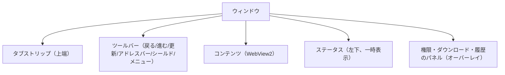
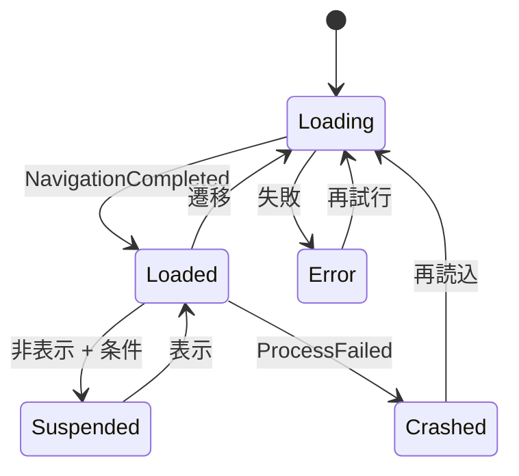
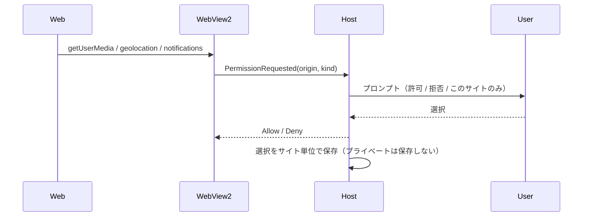

# 14. 機能仕様（最小限のブラウザ UI）

状態: 設計案
確信度: 中（機能範囲は確定、実装コストは未検証）
関連: [03-system-architecture.md](03-system-architecture.md)、[05-performance-architecture.md](05-performance-architecture.md)、[07-privacy-and-storage.md](07-privacy-and-storage.md)、[08-compatibility-and-limitations.md](08-compatibility-and-limitations.md)

## 1. 目的

「必要最低限」と言っても、日常利用に必要な操作は多い。この文書は、実装者が UI の挙動で迷わないように、機能・状態・ショートカット・受け入れ条件を定義する。

機能を増やすための文書ではない。**削るための文書**である。ここに書かれていない機能は、1.0 では作らない。

## 2. 画面構成

- サイドバー、ニュース、AI パネル、ブックマークバーは持たない。
- タブストリップとツールバーは 1 行にまとめない。タブが多い場合の視認性を優先する。
- コンテンツは HWND の子ウィンドウ。UI のオーバーレイは別のポップアップウィンドウで出す（エアスペース回避）。

## 3. 機能一覧と優先度

| ID | 機能 | 優先 | 備考 |
|---|---|---|---|
| F01 | アドレスバー（URL / 検索） | 必須 | IME、候補、セキュリティ表示 |
| F02 | タブ（作成・閉鎖・切替・並べ替え） | 必須 | オーバーフロー、復元 |
| F03 | 戻る・進む・更新・停止 | 必須 | マウス副ボタン、Alt+←/→ |
| F04 | 履歴（一覧・検索・削除） | 必須 | ローカルのみ |
| F05 | Cookie / サイトデータ管理 | 必須 | サイト単位の削除 |
| F06 | ダウンロード | 必須 | MOTW、危険ファイル警告 |
| F07 | サイト権限 | 必須 | 既定拒否、サイト単位 |
| F08 | 広告・トラッカー遮断 | 必須 | サイト単位の ON/OFF |
| F09 | プライベートウィンドウ | 必須 | InPrivate、履歴なし |
| F10 | 設定（1 画面） | 必須 | 検索エンジン、保存、更新 |
| F11 | ページ内検索 | 準必須 | Ctrl+F |
| F12 | ズーム | 準必須 | Ctrl+ +/-/0 |
| F13 | 印刷 / PDF | 準必須 | Ctrl+P、内蔵 PDF ビューア |
| F14 | 全画面 | 準必須 | F11 |
| F15 | セッション復元 | 準必須 | URL とタブ順のみ |
| F16 | クラッシュ復旧 | 準必須 | URL の復元 |
| F17 | ブックマーク | P1 | MVP で実装（☆ / Ctrl+D / 一覧 / JSON 保存） |
| F18 | ピクチャーインピクチャー | P2 | 1.0 では作らない |
| F19 | 拡張機能 | 対象外 | エンジン制約 |
| F20 | 同期 / アカウント | 対象外 | 非目標 |

## 4. アドレスバー（F01）

### 4.1 入力の解釈

1. 入力が `http://` または `https://` で始まる → URL として開く。
2. 入力がスキームなしで、ドメインとして解決できる（`.` を含む、または `localhost`） → `https://` を補う。失敗したら `http://` を試す。
3. それ以外 → 検索クエリとして扱う。
4. `file:`、`javascript:`、`data:`、`view-source:` は拒否する（内部 UI を除く）。
5. 空白を含む入力は、URL エンコードして検索に回す。

### 4.2 表示

- フォーカス時は全体を選択し、現在の URL を表示する。
- 非フォーカス時はオリジン（scheme + host）を強調し、パス以降を薄く表示する。
- HTTPS は錠アイコン、HTTP は「保護されていない」表示。証明書エラーは別画面。
- 広告遮断が有効なサイトではシールドアイコン。クリックでサイト単位の ON/OFF。
- ページ読み込み中は更新ボタンが停止ボタンに変わる。

### 4.3 候補

- 履歴からの候補のみ。外部の検索候補は送らない（プライバシー）。
- 候補は最大 8 件。キーボードで選択できる。
- 候補の削除（Shift+Delete）を提供する。

### 4.4 受け入れ条件

- 日本語 IME で「てすと」と入力し、変換確定後に検索できる。
- `example.com` と入力すると `https://example.com` に遷移する。
- `javascript:alert(1)` を貼り付けても実行されない。
- 候補をキーボードだけで選択し、Enter で開ける。

## 5. タブ（F02）

### 5.1 操作

| 操作 | マウス | キーボード |
|---|---|---|
| 新規タブ | タブストリップの `+` | Ctrl+T |
| 閉じる | タブの ×、中クリック | Ctrl+W |
| 切替 | クリック | Ctrl+Tab / Ctrl+Shift+Tab |
| 位置指定切替 | — | Ctrl+1〜8、Ctrl+9（最後） |
| 並べ替え | ドラッグ | — |
| 復元 | — | Ctrl+Shift+T |
| タブを複製 | コンテキストメニュー | — |
| タブを破棄 | コンテキストメニュー | — |

### 5.2 表示

- タイトル、favicon、音声再生アイコン、サスペンドアイコン。
- 読み込み中はスピナー。クラッシュ時は警告アイコン。
- タブが多い場合は横スクロールではなく、幅を縮めてオーバーフローメニューに送る。
- プライベートウィンドウは、ツールバーに「プライベート」と表示し、背景色を変える。

### 5.3 状態

### 5.4 受け入れ条件

- 20 タブを開いても、タブストリップが崩れない。
- タブを閉じて Ctrl+Shift+T で戻せる。
- 音声再生中のタブにアイコンが出る。
- レンダラ崩壊で、そのタブだけがエラー表示になる。

## 6. ナビゲーション（F03）

- 戻る/進むは、同一タブの履歴スタックを使う。新しい遷移で forward を破棄する。
- 更新はキャッシュを尊重する。強制再読み込み（Ctrl+Shift+R）はキャッシュを無視する。
- 停止は `Stop` を呼び、読み込み中のリソースを止める。
- 外部プロトコル（`mailto:`、`ms-settings:` など）は、既定のアプリで開く前に確認する。
- ダウンロードリンクは、ナビゲーションではなくダウンロードとして扱う。

## 7. 履歴（F04）

- 保存: URL、タイトル、訪問日時、回数。本文や検索語は保存しない。
- 保存期間: 90 日（設定で 7/30/90/無期限）。
- 一覧: 日付順、URL/タイトルの部分一致検索。
- 削除: 個別、期間指定、全件。
- プライベート: 記録しない。
- 履歴からの候補は、削除後すぐに反映する。

## 8. Cookie / サイトデータ（F05）

- サイト単位で、Cookie、LocalStorage、IndexedDB、CacheStorage をまとめて削除する。
- 全件削除は、確認ダイアログを出す。
- 個別 Cookie の編集は提供しない（複雑さとリスクのため）。
- プライベートのデータは、ウィンドウを閉じたときに削除する。
- 削除の限界は [07](07-privacy-and-storage.md) の 6.3 に従い、UI にも「完全な消去を保証しない」と表示する。

## 9. ダウンロード（F06）

- 保存先: ユーザーの Downloads 配下。設定で変更可能。
- 保存前に、ファイル名、MIME、サイズ、URL を表示する。
- 実行ファイル（`.exe`、`.msi`、`.bat`、`.cmd`、`.ps1`、`.scr`、`.js`）は、警告を出し、既定では保存しない。
- 保存後は自動実行しない。「開く」はユーザー操作を要求する。
- Zone.Identifier（MOTW）を付与する。
- 中断、再開、キャンセルを提供する（WebView2 の範囲で）。
- ダウンロード履歴は 30 日で削除する。

## 10. サイト権限（F07）

- 既定は拒否。
- プロンプトにはオリジンと権限名を明示する。
- 一度拒否したら、設定から明示的に解除するまで拒否を維持する。
- カメラ・マイク・位置情報・通知・クリップボード読取・MIDI を対象にする。
- 権限の一覧と解除を設定に置く。

## 11. 広告・トラッカー遮断（F08）

- 既定で有効。サイト単位で一時停止できる。
- シールドアイコンに、そのサイトの状態（有効/一時停止）を表示する。
- 遮断件数の常時表示はしない（正確な計数はホストの負担になる）。必要なら開発者向けの診断でのみ表示する。
- フィルタの更新状態を設定に表示する。失敗時は「更新できていない」と明示する。
- uBO 互換は名乗らない。カスタムリストの追加は 1.0 では提供しない。

## 12. プライベートウィンドウ（F09）

- メニューから「新しいプライベートウィンドウ」。
- 通常ウィンドウとは別の InPrivate プロファイルを使う。
- 履歴、Cookie、サイトデータ、ダウンロード履歴を保存しない。
- ウィンドウを閉じたら、プロファイルの削除を試みる。失敗したら次回起動時に再試行する。
- 「痕跡が残らない」とは表示しない。ディスクに残る可能性を明記する。

## 13. 設定（F10）

1 画面に次だけを置く。

| 区分 | 設定 |
|---|---|
| 一般 | 起動時の動作（新規タブ / 前回のタブ）、検索エンジン、ダウンロード先 |
| プライバシー | 履歴の保存期間、終了時に削除、追跡防止レベル、広告遮断の ON/OFF |
| 権限 | サイト権限の一覧と解除 |
| データ | 履歴、Cookie、サイトデータ、キャッシュの削除 |
| 更新 | 自動更新の確認、現在のバージョン、再起動の促し |
| このアプリについて | バージョン、ライセンス、制約（Google ログイン、DRM、拡張） |

「詳細設定」は作らない。設定項目を増やす場合は、この表に追加してから実装する。

## 14. セキュリティ UI

- 証明書エラー: 専用画面。例外を追加するボタンは置かない。「戻る」だけ。
- HTTP: アドレスバーに「保護されていない」と表示する。入力フォームがある場合は、より強い警告を出す。
- 危険なダウンロード: 赤い警告。既定は保存しない。
- フィッシング: 判定はしない。ドメインの表示を強調する。
- クラッシュ: タブ単位のエラー画面。全タブの復元を提案する。
- 権限: 既定拒否。オリジンを明示する。

## 15. キーボードショートカット

| 操作 | キー |
|---|---|
| 新規タブ | Ctrl+T |
| タブを閉じる | Ctrl+W |
| 閉じたタブを復元 | Ctrl+Shift+T |
| 次のタブ / 前のタブ | Ctrl+Tab / Ctrl+Shift+Tab |
| タブ 1〜8 / 最後 | Ctrl+1〜8 / Ctrl+9 |
| アドレスバー | Ctrl+L / Alt+D |
| 更新 / 強制更新 | Ctrl+R / Ctrl+Shift+R |
| 戻る / 進む | Alt+← / Alt+→ |
| 履歴 | Ctrl+H |
| ダウンロード | Ctrl+J |
| ページ内検索 | Ctrl+F |
| 印刷 | Ctrl+P |
| ズーム | Ctrl+ + / - / 0 |
| 全画面 | F11 |
| プライベートウィンドウ | Ctrl+Shift+N |
| 設定 | Ctrl+, |

## 16. アクセシビリティ

- タブ、ツールバー、アドレスバーは UIA で名前と役割を公開する。
- フォーカスは可視化する。キーボードだけで全操作ができる。
- ハイコントラストモードに追従する。
- 画面読み上げで、タブのタイトル、URL、読み込み状態が分かる。
- アニメーションは 100ms 以下。`prefers-reduced-motion` に相当する OS 設定に追従する。

## 17. 受け入れ条件（全体）

1. 5 タブを開き、移動、切替、閉鎖、復元ができる。
2. 日本語で URL を入力し、検索できる。
3. 履歴、Cookie、ダウンロード、権限の各画面が動く。
4. プライベートウィンドウで履歴が残らない。
5. 証明書エラーで例外を追加できない。
6. 危険な拡張子のダウンロードが警告される。
7. キーボードだけで主要操作ができる。
8. 設定は 1 画面に収まる。
9. クラッシュ後にタブの URL が復元される。
10. 広告遮断の ON/OFF がサイト単位でできる。

## 18. 非目標（再掲）

アカウント、同期、拡張機能ストア、内蔵 AI、ニュース、サイドバー、ポイント、パスワードマネージャ、バックグラウンドサービス、テレメトリ、複雑な設定画面は作らない。
