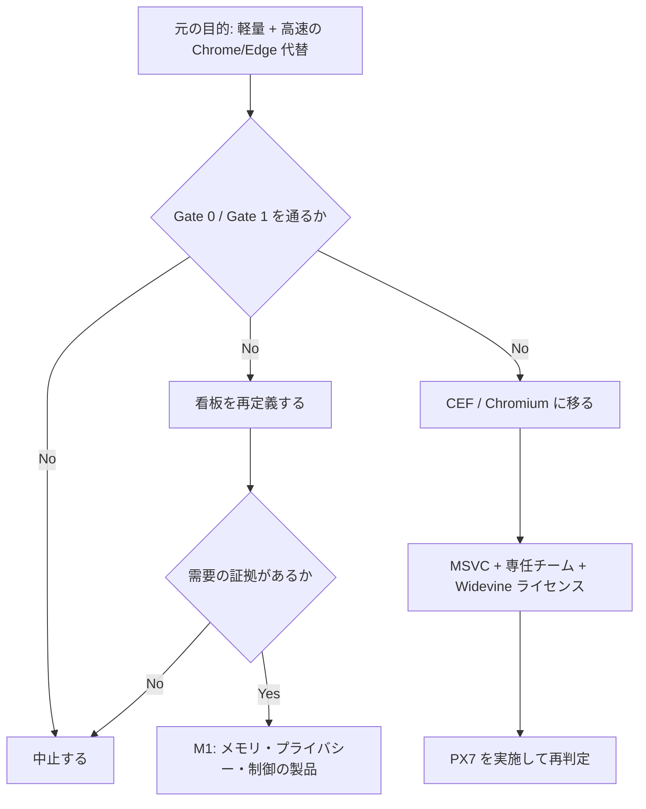

# 16. 最終報告 — 「軽量 + 高速」ブラウザとしての No-Go

状態: 設計・検証フェーズの最終報告
日付: 2026-10-23
ユーザーの選択: **再定義して需要検証へ**（2026-10-23）
対象: Windows 11
結論: **元の依頼である「Chrome/Edge の代替になる、軽量で高速なブラウザ」は、WebView2 では成立しない。** 作るなら、看板を変えた別製品として再定義し、需要を先に検証する。

## 1. 最終回答

- **元の目的（軽量 + 高速の Chrome/Edge 代替）: No-Go。** 起動は Edge より遅く、広告遮断はカバレッジで uBO/Brave に届かず、UI は 4〜6 か月かかる。メモリの優位だけでは乗り換えの理由にならない。
- **技術候補 B'（Rust + Win32 ネイティブ UI + wry 経由の WebView2）: 看板を変えるなら候補。** ただし「軽量 + 高速」の製品としてではない。
- **CEF / Chromium フォーク: 未検証かつ高コスト。** PX7 は CEF 配布物を確認したが prebuilt `cefclient.exe` が無く、MSVC も無いため未実施。専任チーム、Widevine ライセンス、更新追随が必要。
- **推奨: 中止するか、看板を「メモリが軽い・プライバシー・制御」に再定義し、需要の証拠を得てから開発する。** 需要の証拠が無いまま M1 に進まない。

## 2. 検証結果の統合

| PX | 検証 | 結果 | 判定 |
|---|---|---|---|
| PX1 | Google OAuth、パスキー | OAuth の識別子画面を表示。ダミーメールは「アカウントが見つかりません」。UVPAA=true、Windows Security のプロンプト起動。完全ログイン、認証完了は未検証 | 条件付き |
| PX2 | 遮断コスト | 500 リクエストの全件フックで、none 324ms vs all-allow 321ms。遮断した all 243ms、hybrid 208ms。往復コストはこの規模では小さい | 性能は許容。カバレッジは別問題 |
| PX3 | 1/5/20 タブのメモリ | Private メモリは 204 vs 373MB、290 vs 494MB、769 vs 852MB（本 vs Edge）。1/5 タブは -45%/-41%、20 タブは -10% | メモリは優位 |
| PX3b | 公平な起動（コールド） | 1 タブ 5.13 vs 5.90 秒、5 タブ 4.24 vs 7.56 秒、20 タブ 7.47 vs 6.73 秒。分散が大きい | 未確定 |
| PX3c | 暖機後起動 | 1 タブ 481 vs 293ms、5 タブ 456 vs 310ms、20 タブ 534 vs 589ms（本 vs Edge）。1/5 タブで Edge が明確に速い | **起動は不合格** |
| PX4 | DRM / EME | Widevine、PlayReady、ClearKey の EME が supported。Netflix/Spotify のページは表示。実再生、ライセンス、HDCP は未検証 | 条件付き |
| PX5 | InPrivate の残留 | サイトデータ（cookie/history/localStorage/IndexedDB）は再起動後に残らない。一方、History/Cookies DB（249,856B/20,480B、0 行）、Local Storage LevelDB、Code Cache、Crashpad は UDF に残る | 表示を修正 |
| PX6 | UI 工数 | 404 行・14 コントロールの UI プロトタイプ。生産 UI は 4〜6 か月。M1 の 10〜14 週は過小 | **UI は高コスト** |
| PX7 | CEF Chrome スタイル | CEF 156 standard（366,862,060 バイト）を確認。`cefclient.exe` は含まれず、`tests/cefclient` のソースのみ。`bootstrap.exe` は Missing module name。VS2022/CMake が必要で未実行 | 未検証 |

## 3. Gate の判定

### Gate 0（必須の互換性）

| 要件 | 判定 |
|---|---|
| Google の完全ログイン | 未検証（識別子画面までは表示） |
| Windows Hello パスキーの認証完了 | 未検証（プロンプトまでは起動） |
| Widevine の実再生 | 未検証（EME は supported） |
| Chrome 拡張 | **失格**（WebView2 は拡張非対応） |

### Gate 1（性能と実装）

| 要件 | 判定 |
|---|---|
| 5 タブメモリが Edge 以下 | 初期実測では合格方向（1 回、軽量ページ） |
| 起動が Edge 未満 | **不合格**（1 タブ 481 vs 293ms、5 タブ 456 vs 310ms） |
| M1 が 10〜14 週 | **不合格**（UI だけで 4〜6 か月） |

**Gate 0 と Gate 1 の両方を通らないため、当初の目的では No-Go。**

## 4. なぜ No-Go か

1. **起動で負ける。** 日常利用の暖機後で、Edge は 293〜310ms、本は 456〜481ms。Edge のスタートアップブースト / OS 統合に対する挽回には、常駐プロセスが必要になる。
2. **広告遮断のカバレッジが届かない。** フレーム URL、WebSocket、`$csp` の欠落。速度は PX2 で問題にならなかったが、遮断の質は uBO/Brave に届かない。
3. **UI が高い。** プロトタイプは 404 行だが、生産 UI は 4〜6 か月。1 人 12〜15 か月の見積もりは、UI だけで半分近くを使う。
4. **差別化が残らない。** メモリは 1/5 タブで優位だが、20 タブでは -10%。広告遮断は劣り、プライバシーは Edge の設定でもある程度達成できる。価格は無料。
5. **セキュリティの TCB が大きい。** ホストは通信を横取りし、スクリプトを注入する。フィルタ更新のサプライチェーンを破られると、全ページの資格情報が危険にさらされる。これは「作れない」理由ではないが、「軽いから安全」という主張を難しくする。

## 5. 反論への回答

| 反論 | 回答 |
|---|---|
| 事前起動を入れれば起動で勝てる | 常駐プロセスとメモリ +50〜100MB が必要。5 タブメモリの優位を削る。実装して測るまで「勝てる」とは言えない |
| メモリが軽いだけで価値がある | 1/5 タブでは価値がある。20 タブでは -10% に縮む。ユーザーが 10% のメモリ差で乗り換える証拠は無い |
| プライバシーを売りにできる | InPrivate でもプロファイルファイルは残る。Edge の設定でも追跡防止は可能。「完全なプライバシー」は主張できない |
| CEF にすれば解決する | PX7 未実施。CEF は配布物が大きく、更新責任が開発側に残り、UI 工数も増える。拡張と DRM が自動で解決するわけではない |
| とにかく作れば分かる | Gate 1 で起動不合格。作る前に分かる反証を無視して M1 に進む理由が無い |

## 6. 選択肢

### 選択肢 A: 中止する（元の目的に対して推奨）

- 追加コストが最も小さい。
- 設計資料と PX の結果は、別の判断に再利用できる。
- 「作らない」も設計の結論である。

### 選択肢 B: 看板を再定義する（条件付き、採用）

- 「メモリが軽い」「プライバシー既定値」「制御性」に絞る。
- 起動の速さ、Chrome 拡張、Google の完全ログイン、DRM を非目標にする。
- **需要の証拠が先。** 20 人のインタビュー、ランディングページ、5〜10 人のプロトタイプ利用で、支払い意思 or 継続利用を確認する。
- 証拠が無ければ中止する。
- 検証計画は [17-redefinition-and-demand-validation.md](17-redefinition-and-demand-validation.md)。

### 選択肢 C: CEF / Chromium フォーク（推奨しない）

- PX7 未実施。MSVC、専任チーム、Widevine ライセンス、更新追随が必要。
- 1 人では 12〜15 か月に収まらない。
- 資金と体制がある場合の比較対象として残す。

## 7. 再定義する場合の製品定義（案）

**この節が、選択された方向である。** 詳細と検証計画は [17-redefinition-and-demand-validation.md](17-redefinition-and-demand-validation.md)。

**対象ユーザー**

- 5〜20 タブを常時開く。
- Chrome 拡張、Google の完全ログイン、Netflix を必須にしない。
- メモリ、起動後の安定性、追跡防止、UI の軽さを重視する。

**価値提案**

- 5 タブのメモリが Edge 以下（初期実測）。
- 既定で厳格な追跡防止。テレメトリなし。
- ネイティブ UI で、Web UI の二重レンダラを持たない。
- 署名済みフィルタと更新。

**非目標**

- Chrome/Edge の完全代替。
- Chrome 拡張、Web Push、Payment API。
- Google の完全ログイン、Netflix、Widevine の実再生（通れば追加）。
- Edge より速い起動。

**MVP の範囲**

- タブ、アドレスバー、戻る/進む/更新、履歴、設定、権限、ダウンロード。
- 広告遮断はエンジンの追跡防止 + 小さな厳選リスト。
- プライベートモードは InPrivate を使い、表示は「サイトデータは残らないが、プロファイルファイルは残る」と明記。
- 更新は署名検証、差分、ロールバック。

**成功指標**

- 5 タブの Private メモリが Edge 以下（複数回、実サイト）。
- 起動が Edge + 50ms 以内（速さは主張しない）。
- クラッシュフリー率、10 人の継続利用。
- 遮断率は「uBO 同等」ではなく「エンジン追跡防止 + 厳選リスト」の実測値で示す。

**需要検証の殺す条件**

- 20 人中 15 人が「メモリ差では乗り換えない」。
- 5〜10 人のプロトタイプ利用で、1 週間後の継続が 2 人以下。
- 「Chrome 拡張 / Google ログイン / Netflix が無いと困る」が過半。

## 8. 納品物

- 設計文書 `01`〜`16`、ADR `0001`〜`0008`。
- 証拠台帳: 出典 55 件、主張 40 件、引用 127 件。監査 READY（Critical 0 / Major 0 / Minor 9 / Info 1）。
- プロトタイプ:
  - PX1 識別子（WebView2）
  - PX2 遮断コスト（500 リクエスト）
  - PX3 / PX3b / PX3c メモリ・起動
  - PX4 DRM/EME
  - PX5 InPrivate 残留
  - PX6 UI プロトタイプ
- レポート: `prototype/reports/px1`〜`px7`。
- 需要検証キット: [17](17-redefinition-and-demand-validation.md)、[prototype/px8-demand](../../prototype/px8-demand/)（ランディングページ、インタビュー台本、定量調査、スコアカード）。データは未取得。
- 生データ: `prototype/results/`。

## 9. 納品していないもの

- ブラウザ本体の実装。→ **MVP は実装済み（[18](18-mvp-implementation.md)）。製品としての本格実装は未実施。**
- PX7（CEF）のビルドと実行。
- 法務確認（フィルタのライセンス、Widevine、コード署名）。
- 外部セキュリティ監査。
- 需要の証拠（ユーザーインタビュー、継続利用）。
- Google の完全ログイン、パスキーの認証完了、Widevine の実再生。

## 10. 最後に

設計は「作れるか」を問うた。答えは「作れるが、元の看板では勝てない」である。WebView2 は、軽量なホストを作ることは許す。しかし、Edge より速い起動、uBO 級の遮断、Chrome 並みの互換性を同時に与えない。メモリの優位だけでは、無料の Edge から人を動かす理由にならない。

**元の依頼に対しては、作らないことを推奨する。** どうしても作るなら、看板を「メモリが軽い・プライバシー・制御」に変え、需要の証拠を先に取る。その証拠が無いままコードを書き始めない。次の作業は [17](17-redefinition-and-demand-validation.md) の需要検証である。

## 11. 追記: MVP の実装（2026-10-23）

ユーザーの「実際に完成まで」を受けて、再定義した製品の MVP を実装した。

- コード: [app/lilBrowser](../../app/lilBrowser/)
- 配布物: [dist/lIlBrowser](../../dist/lIlBrowser/)、[dist/lIlBrowser-win-x64.zip](../../dist/lIlBrowser-win-x64.zip)
- 実装レポート: [18-mvp-implementation.md](18-mvp-implementation.md)

実装した機能: タブ、アドレスバー、履歴、設定、簡易遮断、プライベート、権限、ダウンロード、セッション復元。
スモークテスト: 2 タブ、履歴 2 件、遮断 1 件、設定往復、プライベートの再起動後 cookie/local 空。

**これは 16 の No-Go 判断を覆さない。** MVP は「元の軽量 + 高速の Chrome/Edge 代替」ではなく、看板を再定義した限定製品である。拡張、Google の完全ログイン、Netflix、速い起動は依然として対象外である。
