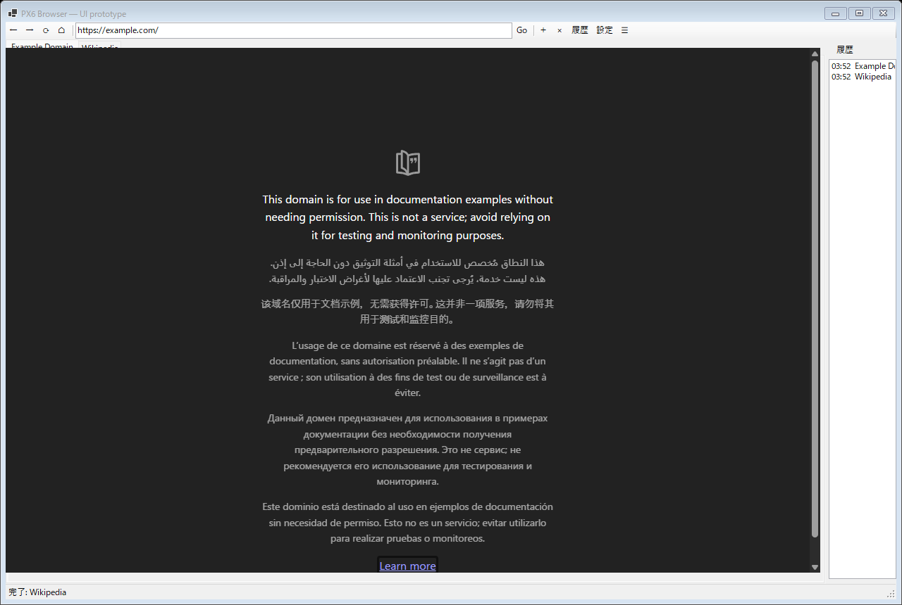

# PX6: UI プロトタイプと工数見積もり

日付: 2026-10-23
環境: Windows 11 Home 10.0.26200、WebView2 Runtime 155.0.4283.62、.NET SDK 8.0.426
コード: [`prototype/px6-ui/`](../px6-ui/)
スクリーンショット: [`prototype/results/px6-demo/ui-full.png`](../results/px6-demo/ui-full.png)、[`ui-chrome.png`](../results/px6-demo/ui-chrome.png)、[`ui-page.png`](../results/px6-demo/ui-page.png)
生データ: [`prototype/results/px6-demo/`](../results/px6-demo/)

## 1. 目的

「最小限のブラウザ UI」がどれくらいの規模になるかを、クリック可能なプロトタイプで確認する。設計の M1（10〜14 週）と、1 人 12〜15 か月の見積もりの妥当性を検証する。

## 2. 実装したもの

WinForms + WebView2 の UI シェル。ブラウザエンジンの機能ではなく、UI の操作感とコンポーネント数を確認するためのもの。

- タブ: 新規、閉じる、選択、タイトル更新
- ツールバー: 戻る、進む、再読み込み、ホーム、アドレスバー、Go
- 履歴: ナビゲーション成功時に記録、サイドパネルに表示、ダブルクリックで移動
- 設定: 広告遮断、プライベート、終了時削除のチェックボックス（未実装のプレースホルダー）
- 権限: `PermissionRequested` を拒否し、ステータスに表示
- ダウンロード: `DownloadStarting` を中止し、ステータスに表示
- 新規ウィンドウ: 新しいタブで開く
- キーボード: Ctrl+T、Ctrl+W、Ctrl+L、F5、Alt+←/→
- デモ: 2 タブを開き、履歴パネルを表示し、UI とページをキャプチャ

### 2.1 画面

`ui-full.png` は、`DrawToBitmap` で取得したウィンドウ（chrome）と、`CapturePreviewAsync` で取得したページを合成したものである。WebView2 は HWND 子ウィンドウのため、`DrawToBitmap` だけではページ内容が黒くなる。`ui-chrome.png` と `ui-page.png` も保存している。

## 3. 規模

| 指標 | 値 |
|---|---:|
| `Program.cs` の総行数 | 404 |
| 非空行 / コード行 | 370 |
| コントロール数（`CountControls`） | 14 |
| タブ数（デモ） | 2 |
| 履歴件数（デモ） | 2 |
| 実装した操作 | タブ、ナビゲーション、履歴、設定、権限、ダウンロード、キーボード |

404 行で「触れる」UI になる。ただし、これは WinForms の既成コントロールを使った場合であり、設計のネイティブ UI（Rust + Win32）では、同等の見た目と操作を自前で作る必要がある。

## 4. 生産 UI との差

プロトタイプに無いもの、または簡略化したもの。

| 領域 | プロトタイプ | 生産実装に必要 |
|---|---|---|
| タブ | 新規、閉じる、選択 | ドラッグ並べ替え、固定、オーバーフロー、タブ復元、複数ウィンドウ |
| アドレスバー | 文字列入力と Go | IME、補完、検索候補、セキュリティ表示、コピー/貼り付け、RTL |
| 履歴 | メモリ上の一覧 | SQLite 永続化、検索、期間削除、プライバシー表示 |
| 設定 | ダイアログのチェックボックス | スキーマ、永続化、移行、既定値、ポリシー |
| 権限 | すべて拒否 | 種類別の許可/拒否、記憶、UI、監査ログ |
| ダウンロード | すべて中止 | 保存先、進捗、再開、キャンセル、履歴 |
| サイトデータ | 無し | Cookie / LocalStorage / IndexedDB の表示と削除 |
| ページ操作 | 無し | 検索、印刷、PDF、ズーム、全画面、PiP、コンテキストメニュー |
| アクセシビリティ | 無し | UIA、キーボード完結、ハイコントラスト、スクリーンリーダー |
| DPI / マルチモニタ | 簡易 | PerMonitorV2、異なる DPI 間の移動、座標変換 |
| セッション復元 | 無し | タブ、履歴、ウィンドウ位置、クラッシュ復旧 |
| クラッシュ UI | 無し | 復旧提案、報告、再起動 |
| 更新 | 無し | 署名検証、差分、ロールバック、再起動促進 |
| ネイティブ UI | WinForms | Rust + Win32 で同等品を自作 |

## 5. 工数見積もり

1 人の経験あるデスクトップ開発者を仮定する。プロトタイプの 404 行は、既成コントロールと WebView2 のおかげであり、生産実装の行数とは比較できない。

| 項目 | 見積もり |
|---|---:|
| UI シェル（ツールバー、タブ、アドレスバー） | 3〜4 週 |
| タブモデル（並べ替え、固定、復元、複数ウィンドウ） | 6〜8 週 |
| 履歴 / 設定 / サイトデータの永続化と UI | 6〜8 週 |
| 権限 / ダウンロード / 検索 / 印刷 / PDF | 6〜8 週 |
| アクセシビリティ / IME / DPI / RTL | 4〜6 週 |
| セッション復元 / クラッシュ復旧 / 更新 UI | 5〜7 週 |
| ネイティブ UI（Rust + Win32）への移植 | 4〜6 週 |
| **UI 合計** | **4〜6 か月** |

これにエンジン統合、遮断、セキュリティ、更新、法務、テストを加えると、1 人では 12〜15 か月になる。**M1 の 10〜14 週で「ブラウザとして使える UI」まで到達するのは過小である。** UI だけで M1 の期間を使い切る。

## 6. 設計への影響

- M1（ネイティブ UI の工数が非現実的）は、PX6 で支持された。プロトタイプは 404 行だが、生産 UI の不足領域が広い。
- 1 人 12〜15 か月の見積もりは、UI だけで 4〜6 か月を含む。妥当だが、余裕はない。
- UI を WebView2 の Web UI で作る案（Tauri 的）は、起動とメモリの固定費を増やす。PX3c で起動の優位が否定された以上、UI の作り方で起動を挽回するのは難しい。
- 「軽量 + 高速」の No-Go は変わらない。PX6 は、再定義した製品でも UI コストが重いことを示す。

## 7. 限界

- WinForms の既成コントロールを使った。設計の Rust + Win32 ネイティブ UI ではない。
- 見た目、IME、DPI、アクセシビリティ、RTL の検証をしていない。
- 設定、履歴、権限、ダウンロードはプレースホルダーで、永続化していない。
- 1 画面、1 解像度、1 人。ユーザビリティテストをしていない。
- 工数は推定であり、実測ではない。

## 8. 次の試験（PX6b）

1. タブのドラッグ並べ替え、固定、オーバーフローを実装し、工数を測る。
2. アドレスバーの IME、補完、セキュリティ表示を実装する。
3. 履歴 / 設定 / サイトデータの SQLite 永続化を実装する。
4. UIA とキーボード完結を検証する。
5. 異なる DPI のマルチモニタで表示を確認する。
